# Design spec: Chess vs Computer (Android, Kotlin), v1

- **Status:** Draft for build
- **Date:** 2026-10-14
- **Input:** [01-prd.md](./01-prd.md) (approved 2026-10-14; all open questions resolved to their defaults)
- **Prototype:** [prototype/index.html](./prototype/index.html). A static, clickable, phone-size prototype with scripted chess logic. Open it in any browser; it needs no build step and makes no network calls.
- **Platform:** native Android, Kotlin, Jetpack Compose with Material 3. minSdk 26, targetSdk 36. Phones, tablets and foldables, in portrait and landscape. English only, with every string in resources.

---

## 1. Summary

The app has five destinations and three overlays:

| ID | Name | Type | Stories |
|---|---|---|---|
| S1 | Home | Screen (start destination) | US-1, US-2, US-12 |
| S2 | New game | Modal bottom sheet over Home or Game | US-1 |
| S3 | Game | Screen | US-3 to US-11, US-13 |
| S4 | Promotion picker | Dialog over Game | US-4, US-8 |
| S5 | Moves | Modal bottom sheet over Game (compact fallback only) | US-11 |
| S6 | Stats | Screen | US-12 |
| S7 | About and licences | Screen (plus a licence-text sub-screen) | Piece-art attribution (PRD dependency), privacy promise |
| D1 to D3 | Abandon, Resign and Reset-stats confirmations | Alert dialogs | US-1, US-7, US-12 |

The game ends in a **result panel**, not a modal dialog. The panel replaces the controls under the board (or beside it in landscape), so the final position stays fully visible. This follows US-5: "board stays visible, a result panel shows…".

There is no existing UI. Everything here is built from stock Material 3 components except for six custom components (section 4.11). Each custom component says why no stock component fits.

### Platform baseline (applies to every screen)

- **Edge-to-edge.** Call `enableEdgeToEdge()`. With targetSdk 36 the edge-to-edge opt-out is disabled on Android 16 ([behaviour changes, Android 16](https://developer.android.com/about/versions/16/behavior-changes-16)). Status and navigation bars are transparent. Content is padded by `WindowInsets.safeDrawing`, which covers system bars, the IME and display cutouts. Scrolling screens (Home, Stats, About) let content scroll behind the navigation bar, with bottom content padding equal to the navigation bar inset. The Game screen does not scroll, and everything on it sits inside `safeDrawing`.
- **Predictive back.** On Android 16, apps targeting API 36 get predictive back animations by default, and `onBackPressed()` and `KEYCODE_BACK` are no longer delivered ([same source](https://developer.android.com/about/versions/16/behavior-changes-16)). Use Navigation Compose (which supports predictive back), the built-in back handling of `ModalBottomSheet` and `Dialog`, and `BackHandler` only where section 2.2 says so. Never override `onBackPressed`.
- **No orientation lock.** Every screen has a portrait and a landscape layout. Split-screen and freeform windows are supported down to the floor in section 4.1.
- **Touch targets.** Every control outside the board is at least 48 × 48 dp. Compose's `minimumInteractiveComponentSize` stays on. Board squares are at least 40 dp at 360 dp width (US-9) and never smaller than 24 dp (the 192 dp board floor), which meets WCAG 2.5.8.
- **Font scaling up to 200%.** All text is in `sp`. No text outside the board has `maxLines = 1` with ellipsis, except where this spec says so. Section 4.1 defines how the Game layout gives way as fonts grow, so the board never scrolls and no control is clipped.
- **No network.** No screen may load remote images or fonts. Use system fonts only.

---

## 2. Design principles for this feature

1. **The board comes first.** The board is always square, never scrolls and is never covered by controls or snackbars. Before the board shrinks below 40 dp per square, the chrome around it collapses.
2. **Say it with shape, then with colour, then in words.** Each cue has a distinct shape, a colour that passes contrast on both square colours, and a spoken equivalent. No cue relies on colour alone.
3. **Nothing is lost by accident.** Every action that ends a game asks for confirmation. Undo is unlimited and cheap. All state (position, selection, open picker, sheet choices) survives rotation, process death and resizing.

---

## 3. Navigation and flows

### 3.1 Information architecture

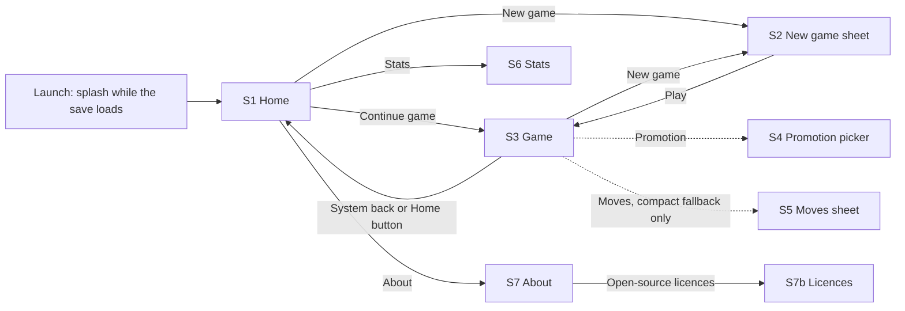

Navigation Compose routes: `home` (start), `game`, `stats`, `about`, `licences`. The sheet and dialogs are not routes. They are UI state owned by the screen's ViewModel and saved with `SavedStateHandle`, so they survive rotation and process death.

### 3.2 System back behaviour

| Where | Back does | Predictive back preview |
|---|---|---|
| Home | Leaves the app (system back-to-home). Not intercepted. | System back-to-home animation |
| Game, nothing open | Goes to Home. The game is not ended, and Home shows **Continue game** (US-7). A selected piece is cleared. | Navigation Compose cross-fade to Home |
| Game, piece selected | Same as above. Back does **not** clear the selection first. Intercepting back for that would break the predictive preview and add a hidden extra step. | Same |
| Game, drag in progress | The finger is on the board, so no back gesture can start. 3-button Back cancels the drag (the piece returns) and then goes Home. | n/a |
| New game sheet | Closes the sheet with no change. | `ModalBottomSheet` built-in predictive shrink |
| Promotion picker | Same as **Cancel**. The pawn returns to its square and no move is made (US-4). | Dialog default |
| D1 to D3 dialogs | Same as **Cancel**. | Dialog default |
| Moves sheet | Closes the sheet. | Built-in |
| Stats, About, Licences | Up one level (About ← Licences; Home ← Stats or About). | Navigation Compose default |

**Back-gesture conflict on the board.** Edge swipes trigger back. Apply `Modifier.systemGestureExclusion` to the player's half of the board (the four ranks nearest the player, capped at 200 dp tall; the system honours at most 200 dp per edge). Players' own pieces start on that half, so dragging from the a- or h-file does not trigger back. Tap-to-move is never affected.

### 3.3 Flows per story

Each flow lists the happy path first, then the branches. Screen IDs refer to section 4.

#### US-1: Start a new game (Must)

Happy path:
1. On Home (S1), tap **New game**.
2. The New game sheet (S2) opens with Side and Level pre-selected. These are the last-used values, or White and Level 2 the first time.
3. Optionally change Side and Level.
4. Tap **Play**. The sheet closes and the Game screen (S3) shows the start position within 1 s. The player's colour is at the bottom.
5. Playing White: the status reads "Your move". Playing Black: the status reads "Computer is thinking…" and the computer plays first. Random: a snackbar says "You play White" or "You play Black" for 4 s.

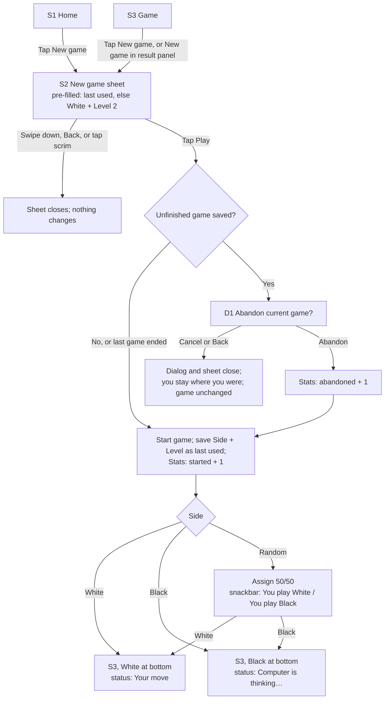

Branches:
- **Cancel the sheet:** nothing changes. Choices made in the sheet are not saved until **Play**.
- **Game in progress:** the abandon prompt appears only after **Play**, so a player who closes the sheet never loses the game by accident. **Cancel** closes the dialog *and* the sheet (PRD: "Cancel returns to the current game unchanged").
- **The game has ended:** no abandon prompt. A finished game is already recorded.
- **Rotation while the sheet or dialog is open:** both stay open with the same choices.

#### US-2: Auto-save and resume (Must)

Happy path:
1. Each applied move (player or computer) saves the game off the main thread within 500 ms. Nothing is shown when a save succeeds.
2. The app is killed (swipe from Recents, force stop, process death or reboot).
3. On relaunch, the splash shows while the save loads. Home shows the **Game in progress** card with **Continue game**.
4. Tap **Continue game**. The Game screen opens with the exact position, move list, side, level and turn. If it is the computer's turn, the search restarts and the computer moves within the level's cap.

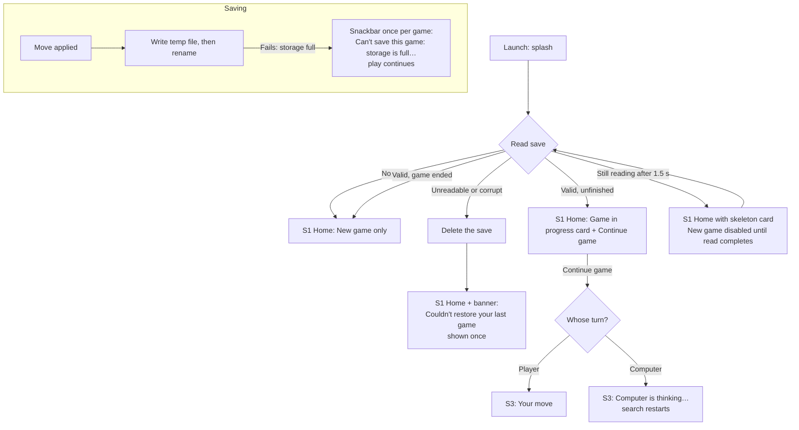

Branches:
- **Configuration change** (rotation, dark mode, font size, split-screen): no visible reload. The position, selected piece, open promotion picker, open sheet with its choices, and open dialog are all kept. A drag in progress is cancelled: the piece returns and stays selected.
- **Corrupt save:** shown once. A "shown" flag is stored, so the banner never repeats after the next launch.
- **Storage full:** non-blocking. Shown at most once per game, even if later saves also fail.

#### US-3: Move by tapping (Must)

Happy path:
1. On the player's turn, tap one of your pieces. Its square gets the **selected** border. Empty legal destinations get a **dot**; capturable pieces get a **ring**.
2. Tap a destination. The piece slides there (200 ms) and the from and to squares get the **last-move** tint and corner mark. The selection clears.
3. The computer's turn begins (US-6).

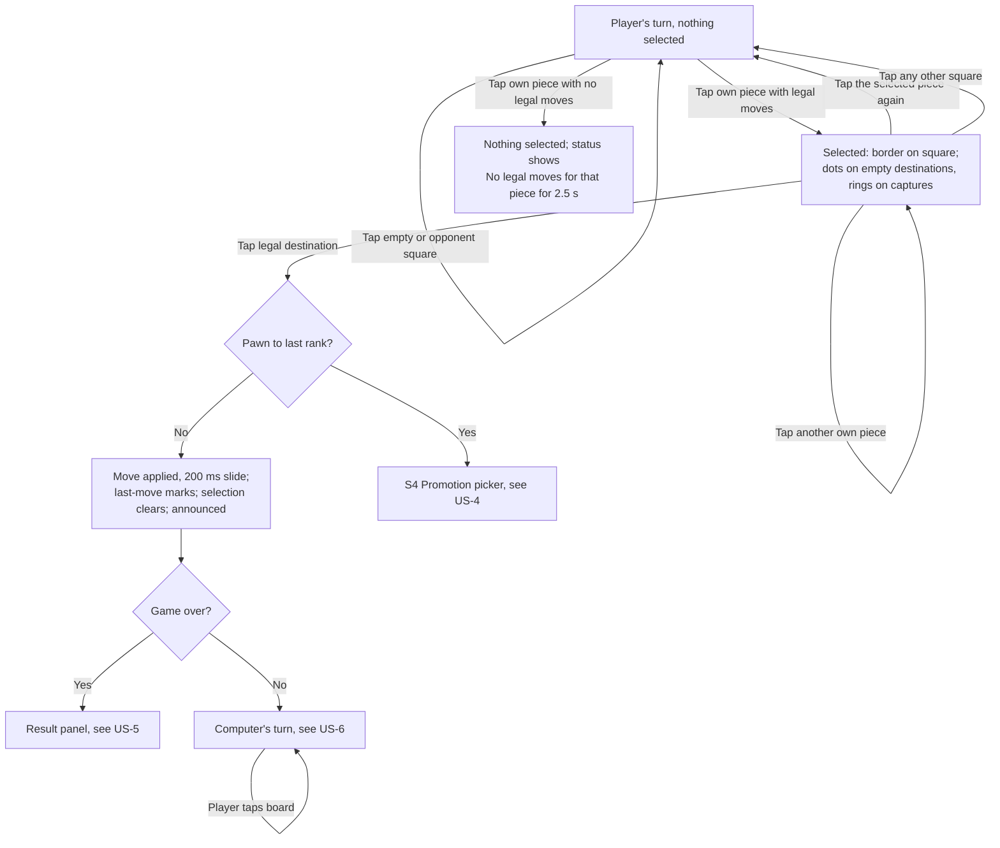

Branches:
- **Computer's turn:** taps on the board do nothing. No selection and no hint appear. "Computer is thinking…" is already visible in the status row.
- **Game over:** the board ignores all input.
- **Selection after the computer moves:** you cannot select during the computer's turn, so there is never a stale selection.

#### US-4: Special moves (Must)

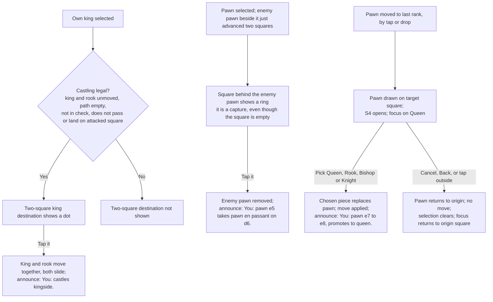

- **King safety:** moves that would leave your own king in check are never shown as destinations, so they can't be tapped or dropped.
- **Computer promotions** (including under-promotion) have no picker. The announcement names the piece: "Computer: pawn b2 to b1, promotes to knight."

#### US-5: Game end and result (Must)

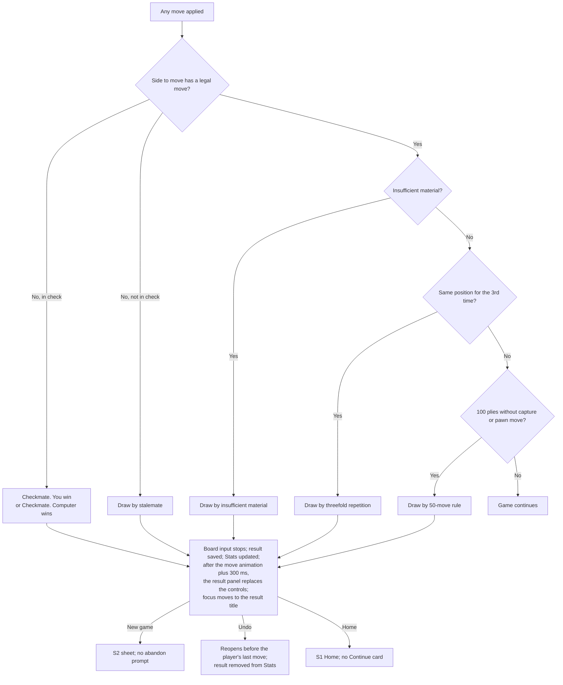

Checkmate is checked first, so a mate on the 100th ply wins (PRD US-5). Resignation is in US-7. All seven result variants are in section 4.3.7.

#### US-6: Computer's turn (Must)

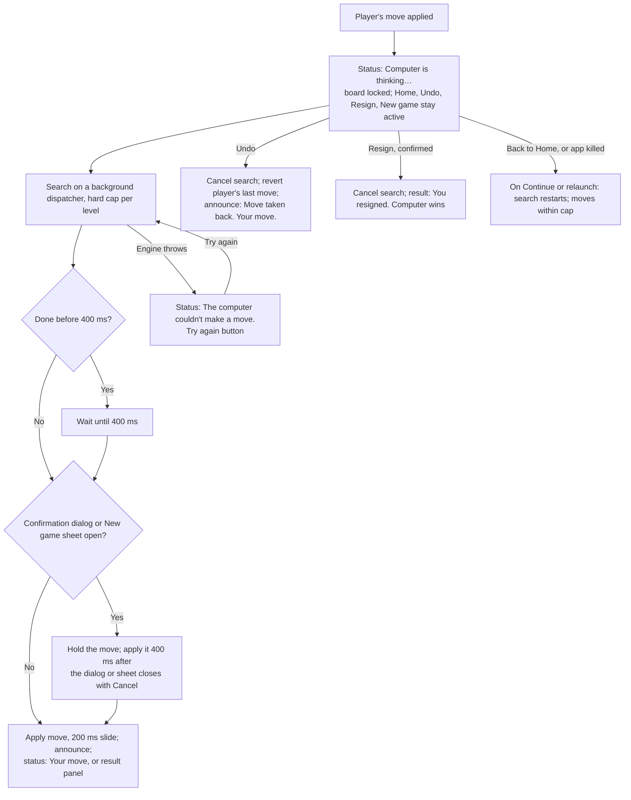

The computer's move is **held while a confirmation dialog or the New game sheet is open**. Otherwise the board would change, or the game could end, behind a question the player is still answering. If the player confirms Resign or Abandon, the held move is thrown away.

#### US-7: Resign and leave (Must)

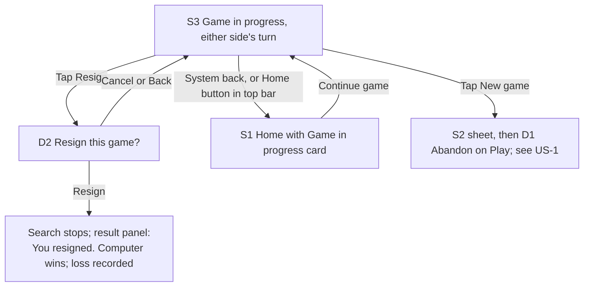

#### US-8: Play with TalkBack (Must)

Happy path:
1. Swipe right through the board. Each square reads, for example, "g1, white knight".
2. Double-tap the knight. TalkBack says "Knight g1 selected. 2 moves: f3, h3."
3. Swipe to f3 ("f3, empty, move available") and double-tap. TalkBack says "You: knight g1 to f3."
4. The computer replies. TalkBack says "Computer: pawn e7 to e5."

Faster path: with focus on g1, open the TalkBack actions menu (swipe up then right, or a three-finger tap, depending on the TalkBack gesture set). Choose **Move to f3**.

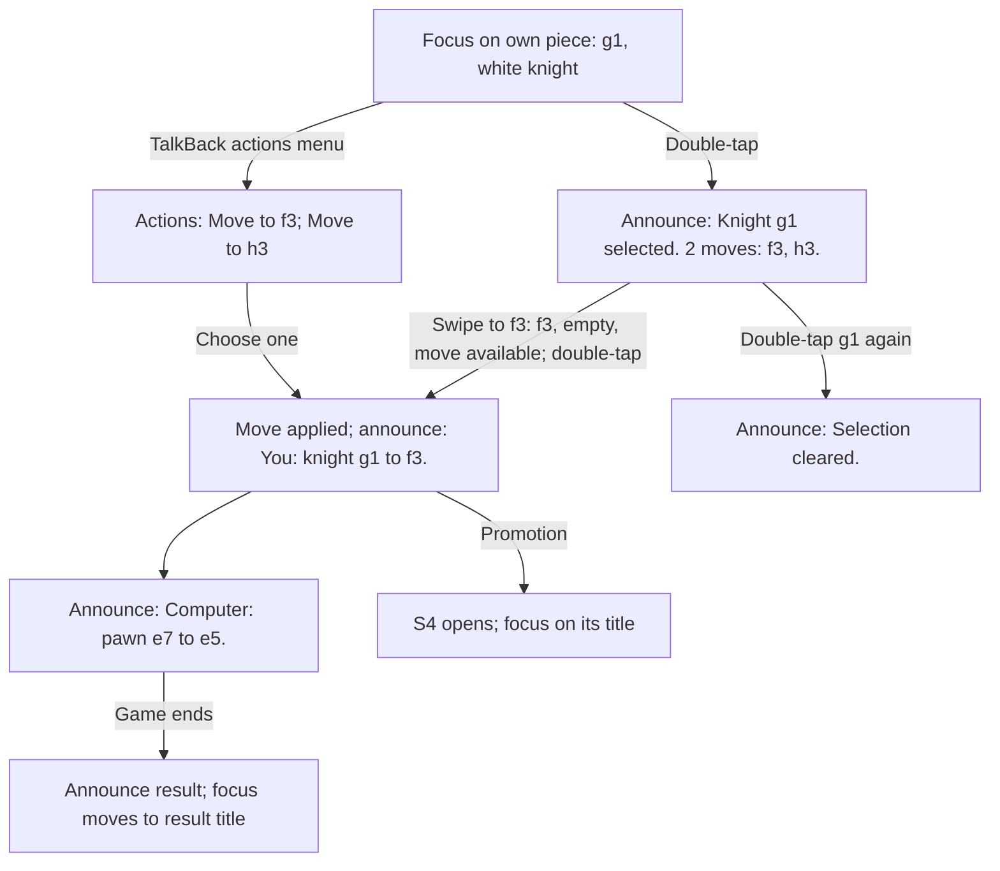

#### US-9: Board fits any window (Must)

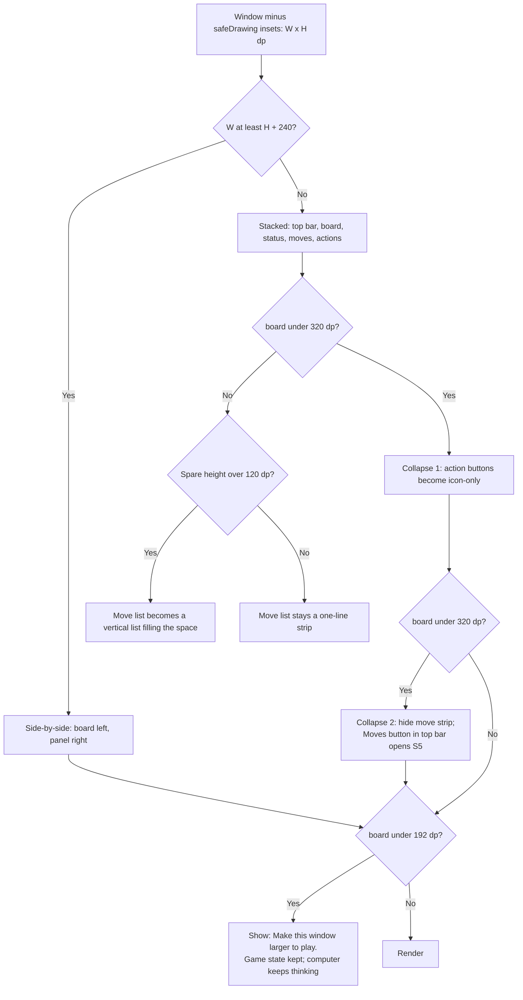

The exact sizing rules are in section 4.1.

#### US-10: Undo (Should)

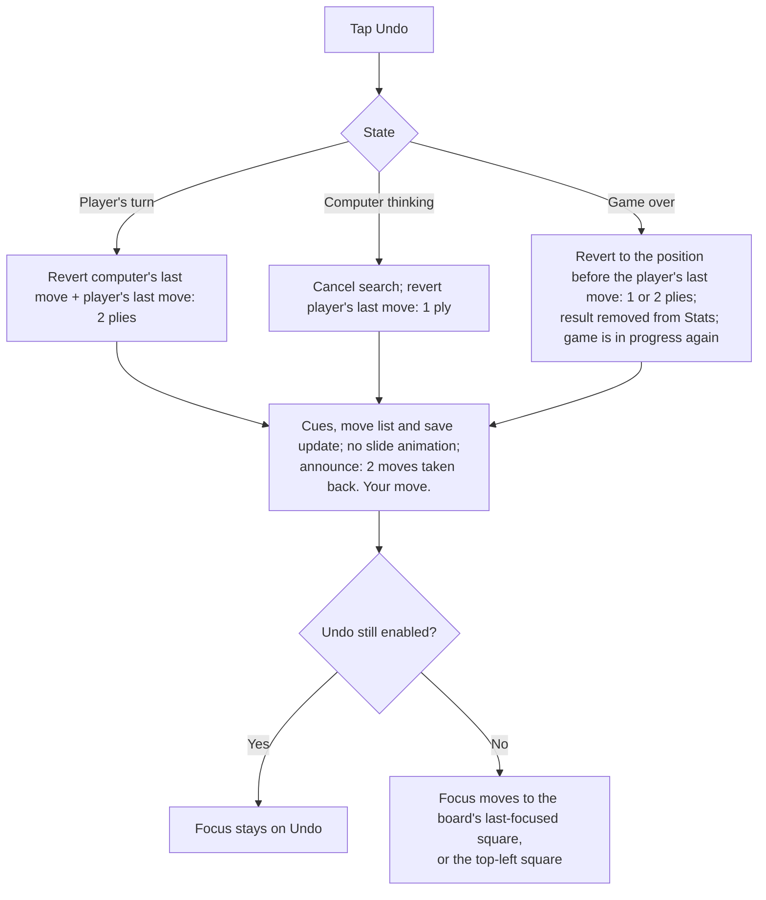

**Undo is disabled when** the position is the start position; when the player is Black and only the computer's first move has been played; or when the promotion picker is open (it is modal, so Undo can't be reached anyway). A disabled Undo stays visible.

#### US-11: Move history (Should)

1. A move is applied, so its SAN is added to the list and the list scrolls to show it.
2. An undo removes the reverted moves, and the list scrolls to the end.
3. Tapping a move does nothing. Moves are not clickable and have no ripple.

The empty state reads "No moves yet". This covers a new game, and also a Black player waiting for the computer's first move.

#### US-12: Stats (Should)

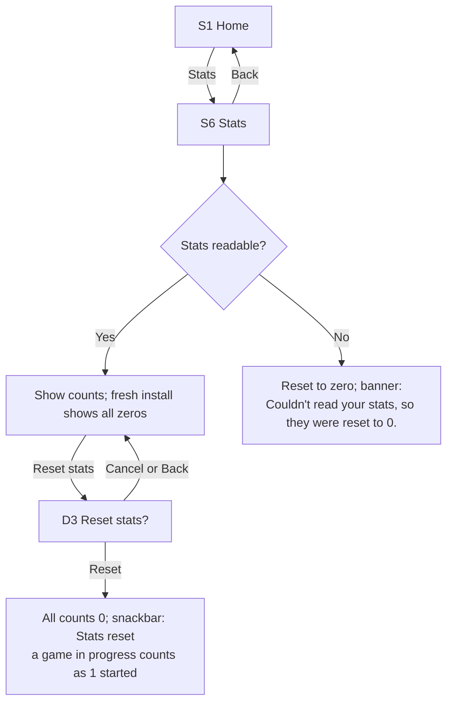

Counts change at these moments, all immediately:
- **started** goes up at **Play**.
- **abandoned** goes up at **Abandon**.
- **completed** and the per-level win, draw or loss go up when a result is set. Undo after a game ends takes both off again.

#### US-13: Drag and drop (Should)

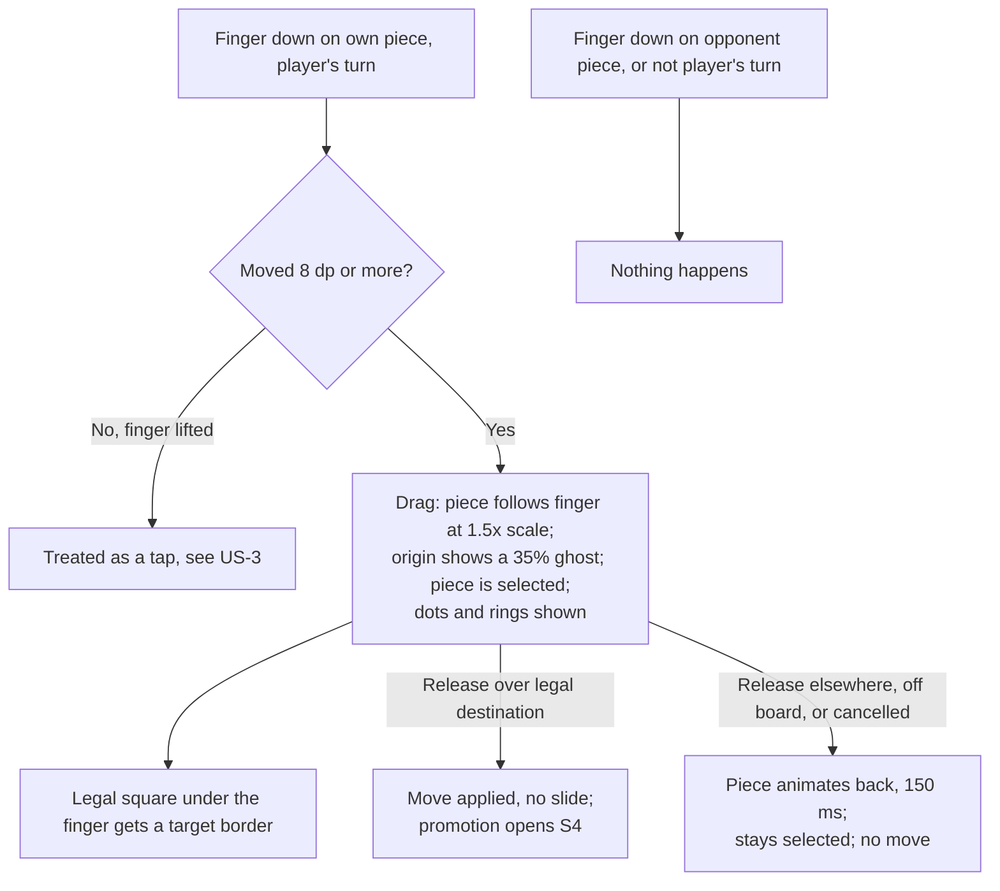

- The drop target is the square **under the finger**, not under the enlarged piece.
- A second finger is ignored.
- After a failed drop the piece **stays selected**, so the player can finish the move with a tap. A failed drag is usually a near-miss, not a change of mind. This differs from the US-3 rule, where tapping an illegal square clears the selection.

---

## 4. Screens and components

### 4.1 Layout system (Game screen sizing)

All sizes are in dp after removing `WindowInsets.safeDrawing`. `W` and `H` are the remaining width and height.

**Mode choice**

- **Side-by-side** if `W >= H + 240`. Examples: phone landscape, tablet landscape, desktop-style windows.
- **Stacked** otherwise. Examples: phone portrait, tablet portrait, unfolded foldables near square.

**Stacked mode (top to bottom):** top bar (56) · board · status row (min 40) · move strip (min 48) · action row (min 64).

```
chrome = topBar + statusRow + moveStrip + actionRow     // measured at the current font scale
margin = (W >= 600) ? 16 : 0                            // horizontal board margin
board  = min(W - 2*margin, H - chrome)
if board < 320: action row -> icon-only (collapse 1); recompute
if board < 320: hide move strip, show Moves icon in top bar (collapse 2); recompute
spare  = H - chrome - board
if spare > 120: move list becomes a vertical list using all spare height (between status row and action row)
else: spare height is split evenly above and below the board+controls block (centred)
```

**Side-by-side mode:** the board is on the left (start side), and a panel on the right holds: top row (56) · status row (min 48) · move list (fills) · action row (min 64).

```
vmargin = (H >= 400) ? 16 : 0
panel   = clamp(W - (H - 2*vmargin) - 24, 240, 400)
board   = min(H - 2*vmargin, W - panel - 24)
the board is centred vertically; the board+panel block is centred horizontally if there is spare width
if panel height leaves < 96 for the move list: action row -> icon-only
```

**Floor and snapping**

- If `board < 192` in either mode, show the **window too small** state (section 4.3.8) instead of the board.
- Round the board side down so `board / 8` is a whole number of **pixels**. This avoids hairline seams between squares.

**Checked against the PRD sizes**

| Window (whole display) | Insets used | Mode | Board | Square |
|---|---|---|---|---|
| 360 × 640 portrait, 3-button nav | 24 top, 48 bottom | Stacked | min(360, 568 − 208) = 360 | 45 dp |
| 360 × 640 portrait, gesture nav | 24 top, 24 bottom | Stacked | 360; spare 24 centred | 45 dp |
| 320 × 568 portrait | 24 / 48 | Stacked | min(320, 496 − 208) = 288 → collapse 1 (action row 64 → 48): min(320, 304) = 304 → collapse 2 (move strip hidden): min(320, 352) = 320 | 40 dp |
| 640 × 360 landscape, 3-button nav on right | 24 top, 48 right | Side-by-side (vmargin 0, panel 240) | min(336, 592 − 240 − 24) = 328 | 41 dp |
| 640 × 360 landscape, gesture nav | 24 top, 24 bottom | Side-by-side (panel 304) | min(312, 640 − 304 − 24) = 312 | 39 dp (accepted; see OQ-D7) |
| 800 × 1280 tablet portrait | 24 / 48 | Stacked | min(768, 1208 − 208) = 768; spare 232 → vertical move list | 96 dp |
| 1280 × 800 tablet landscape | 24 / 48 | Side-by-side | min(696, 1280 − 400 − 24) = 696; panel 400 | 87 dp |

At **200% font** on a 360 × 640 phone, the chrome grows to about 300 dp. Collapse 1 applies, then collapse 2. The board ends up at about 312 to 320 dp (39 to 40 dp squares). Nothing outside the board is clipped. The move list moves into the S5 sheet.

### 4.2 S1 Home

**Purpose.** The entry point, with one tap to continue and two taps to a new game. Stories: US-1, US-2, US-12.

**Wireframe (portrait, compact)**

```
┌──────────────────────────────────────┐
│ status bar (transparent)             │
│                                      │
│              ┌──────┐                │
│              │  ♞   │  72dp app mark │
│              └──────┘                │
│               Chess                  │  headlineMedium (heading)
│   Play the computer. Offline,        │  bodyLarge, onSurfaceVariant
│   no account, no ads.                │
│                                      │
│ ┌──────────────────────────────────┐ │  Card (only when a game is unfinished)
│ │ Game in progress                 │ │  titleMedium (heading)
│ │ Level 2 · Casual · You play White│ │  bodyMedium
│ │ Move 14 · Your move              │ │  bodyMedium
│ │ ┌──────────────────────────────┐ │ │
│ │ │        Continue game         │ │ │  Button (filled), full width
│ │ └──────────────────────────────┘ │ │
│ └──────────────────────────────────┘ │
│ ┌──────────────────────────────────┐ │
│ │            New game              │ │  Filled if no card, else FilledTonal
│ └──────────────────────────────────┘ │
│ ┌──────────────────────────────────┐ │
│ │              Stats               │ │  OutlinedButton
│ └──────────────────────────────────┘ │
│                About                 │  TextButton
│ nav bar (transparent)                │
└──────────────────────────────────────┘
```

- A single centred column, max width 480 dp, 24 dp side padding. Spacing: 32 above the app mark, 8 between title and tagline, 32 before the card or New game, 12 between buttons. The column scrolls when it doesn't fit (landscape phone, 200% font).
- **Landscape phone:** the same column, centred, scrollable. The app mark shrinks to 48 dp when `H < 480`.
- **Tablet:** the same column, vertically centred.

**Content**

| Element | Copy |
|---|---|
| Title | Chess *(placeholder app name, OQ-D1)* |
| Tagline | Play the computer. Offline, no account, no ads. |
| Card heading | Game in progress |
| Card line 1 | Level 2 · Casual · You play White |
| Card line 2, player's turn | Move 14 · Your move |
| Card line 2, computer's turn | Move 14 · Computer to move |
| Primary button | Continue game |
| Secondary buttons | New game · Stats · About |
| Corrupt-save banner title | Couldn't restore your last game |
| Corrupt-save banner body | The saved game was damaged, so it was removed. Your stats aren't affected. |
| Corrupt-save banner button | OK |
| Loading card text | Checking for a saved game… |

The move number is the full-move number of the position, as in SAN numbering.

**States**

| State | What shows |
|---|---|
| First launch (empty) | No card. **New game** is a filled button. No empty-state message: the screen is complete without a game. |
| Returning, unfinished game | The card shows with **Continue game** (filled). **New game** becomes a tonal button. |
| Returning, last game ended | Same as first launch. |
| Loading | The splash (`core-splashscreen`, app icon on `surface`) stays up until the save is read or 1.5 s pass. After 1.5 s, Home shows a **skeleton card**: same size as the real card, `surfaceContainerHighest` blocks, no shimmer. The skeleton carries the text "Checking for a saved game…" for TalkBack. **New game** is disabled until the read completes, because whether to ask about abandoning isn't known yet. |
| Error: corrupt save | An inline banner at the top of the column: a `Card` in `errorContainer` with an info icon, the title and body, and an **OK** text button. Shown on this launch only. OK removes it and focus moves to **New game**. |
| Long content | Card lines wrap; nothing truncates. At 200% the column scrolls. |
| Disabled | Only during loading (New game). |

**Interactions**
- **Continue game:** go to S3 and restore the game. TalkBack focus is left to the platform; the status live region announces "Game resumed. Move 14. Your move."
- **New game:** open S2 over Home. On close, focus returns to **New game**.
- **Stats:** go to S6. **About:** go to S7.

### 4.3 S3 Game

**Purpose.** Play the game. Stories: US-3 to US-11, US-13.

#### 4.3.1 Wireframes

Phone portrait (360 × 640, 3-button nav). White's view after 1. e4 e5 2. Nf3:

```
┌────────────────────────────────────────────┐
│ status bar                                 │ 24
├────────────────────────────────────────────┤
│ [←]  Level 2 · Casual                      │ 56  TopAppBar, nav icon "Home"
├────────────────────────────────────────────┤
│8 ♜   ♞   ♝   ♛   ♚   ♝   ♞   ♜            │
│7 ♟   ♟   ♟   ♟   ·   ♟   ♟   ♟            │
│6                                           │
│5                 ♟                         │  board 360 x 360
│4                 ♙                         │  45dp squares
│3                     ♘◣                    │  ◣ = last-move corner mark
│2 ♙   ♙   ♙   ♙       ♙   ♙   ♙            │
│1 ♖a  ♘b  ♗c  ♕d  ♔e  ♗f  ◣g  ♖h           │  rank digits top-left (a-file), file letters bottom-right (rank 1)
├────────────────────────────────────────────┤
│ ◌  Computer is thinking…                   │ 40  status row (live region)
├────────────────────────────────────────────┤
│  1. e4 e5   2. Nf3 ▏                     ▸ │ 48  move strip, scrolls horizontally
├────────────────────────────────────────────┤
│     ↶            ⚑             +           │ 64  action row
│    Undo        Resign       New game       │
├────────────────────────────────────────────┤
│ nav bar                                    │ 48
└────────────────────────────────────────────┘
```

Phone landscape (640 × 360):

```
┌────────────────────────────────────────────────────────────────┬────┐
│ status bar                                                     │    │
├──────────────────────────────┬─────────────────────────────────┤ n  │
│                              │ [←]  Level 2 · Casual           │ a  │ 56
│                              ├─────────────────────────────────┤ v  │
│                              │ ●  Your move                    │    │ 48
│          BOARD               ├─────────────────────────────────┤ b  │
│        328 x 328             │ Moves                           │ a  │
│                              │  1.  e4      e5                 │ r  │ fills
│                              │  2.  Nf3     Nc6                │    │
│                              │  3.  Bb5     a6        (scroll) │    │
│                              ├─────────────────────────────────┤    │
│                              │  ↶ Undo   ⚑ Resign   + New game │    │ 64
└──────────────────────────────┴─────────────────────────────────┴────┘
```

Tablet portrait (stacked, with spare height):

```
┌──────────────────────────────────────────┐
│ [←]  Level 2 · Casual                    │
│   ┌──────────────────────────────────┐   │
│   │              BOARD               │   │ 16dp side margins
│   │            768 x 768             │   │
│   └──────────────────────────────────┘   │
│ ●  Your move                             │
│ Moves                                    │
│  1.  e4      e5                          │ vertical list fills
│  2.  Nf3     Nc6                         │ the spare height
│ ──────────────────────────────────────── │
│   ↶ Undo      ⚑ Resign      + New game   │
└──────────────────────────────────────────┘
```

Tablet landscape: same as phone landscape, with the panel 400 dp wide.

**Order of regions** for reading, TalkBack and keyboard is the same in every mode: top bar → status row → board → move list → action row (or result panel). In side-by-side mode, use `Modifier.semantics { traversalIndex }` so the board comes after the status row, even though the board is drawn first.

#### 4.3.2 Top bar

- A Material 3 small `TopAppBar` with `expandedHeight = 56.dp`.
- **Navigation icon:** `arrow_back`, with content description "Home". It does the same as system back.
- **Title:** "Level 2 · Casual" (`titleLarge`, heading). It may wrap to 2 lines at large font sizes. Do not use `maxLines = 1`.
- **Actions:** none, except the **Moves** icon (`format_list_numbered`, description "Moves") when collapse 2 is active.
- In side-by-side mode the same content sits at the top of the panel, without app bar colour.

#### 4.3.3 Board (custom component `ChessBoard`)

**Orientation.** The player's colour is at the bottom. White sees a8 at top-left and h1 at bottom-right. Black sees h1 at top-left and a8 at bottom-right.

**Drawing layers, bottom to top:**
1. Square fill: `board.square.light` or `board.square.dark`. On the last move's from and to squares, use the `*.lastMove` variants instead (the tint).
2. Check tint, decorative: a radial gradient on the checked king's square, `board.cue.check` at 55% alpha at the centre, fading to 0% at 70% of the radius.
3. Coordinates. Rank numbers go at the **top-left** of each square in the leftmost file; file letters go at the **bottom-right** of each square in the bottom rank. Inset 2 dp. Colour: `board.coord.onLight` or `board.coord.onDark`. Typeface Roboto Medium. Size = 0.24 × square, which is not scaled by system font size (see Accessibility 5.9).
4. Last-move corner mark: a right triangle in the **bottom-left** corner of the from and to squares. Legs are 0.22 × square (min 8 dp). Colour `board.cue.mark`, with no halo needed (≥ 3.3:1 on all squares).
5. Pieces: the vector drawable fills the square. The Cburnett art has its own padding.
6. Cues (all with a 1.5 dp `board.cue.halo` outline):
   - **Selected:** an inset square border along the square's edge, stroke `max(3dp, 0.08 × square)`, `board.cue.ink`, with the halo on its inner side.
   - **Legal move (empty square):** a filled dot, diameter `max(12dp, 0.30 × square)`, `board.cue.ink`, with the halo around it.
   - **Capture** (including the en passant destination): a ring, outer diameter 0.92 × square, stroke `max(3dp, 0.08 × square)`, `board.cue.ink`, with the halo on both edges.
   - **Check:** a badge in the **top-right** corner, inset 2 dp. It is a circle of diameter `max(14dp, 0.36 × square)` filled with `board.cue.check`, with a white "+" glyph (stroke 0.05 × square) and the halo.
   - **Drop target** (drag only): the same as the Selected border, drawn on the legal square under the finger.
   - **Keyboard focus:** a rounded rectangle (radius 4 dp) inset 3 dp, with a 2 dp `board.cue.mark` stroke and a 2 dp white stroke outside it. Shown only in keyboard input mode. It has rounded corners and two colours, so it can't be confused with the square-cornered blue selection border.
7. Dragged piece: drawn above everything at 1.5× size, centred on the finger. The origin square shows the piece at 35% alpha.

Shape alone tells the cues apart: border for selected, dot for a move, ring for a capture, corner badge with "+" for check, corner triangle for last move. Colour is a second signal.

**Animation**
- Move slide: 200 ms, `FastOutSlowInEasing`. For castling, both king and rook slide.
- Snap-back after a failed drop: 150 ms.
- Undo and restore: no animation; the board just shows the new position.
- Reduced motion: see 5.10.

**Board interactions**

| Input | Condition | Result | Focus |
|---|---|---|---|
| Tap own piece with legal moves | Player's turn, game not over | Select it and show cues. Announce the selection. | Stays on the tapped square |
| Tap own piece with no legal moves | Player's turn | Nothing selected. The status row shows "No legal moves for that piece" for 2.5 s. Announce "Knight b1 has no legal moves." | Stays |
| Tap the selected piece | | Deselect. Announce "Selection cleared." | Stays |
| Tap another own piece | A piece is selected | Selection moves to it | Stays |
| Tap legal destination | A piece is selected | Apply the move (or open S4 for a promotion) | Stays on the destination square |
| Tap any other square | A piece is selected | Deselect, silently | Stays |
| Tap anywhere | Computer's turn, or game over | Nothing | Stays |
| Drag | See US-13 | | |
| Long-press | | Same as press. No extra action. | |
| Keyboard arrows | Board focused | Move focus one square in the visual direction. Focus stops at the edges; it does not wrap. | |
| Enter or Space | Board focused | Same as tapping the focused square | |
| Escape | A piece is selected | Deselect | |

**Implementation note.** Handle pointer input once for the whole board (tap, drag, 8 dp slop). For accessibility and keyboard, add 64 transparent square nodes over the board. Each has its own semantics, as defined in 5.3. The board is a single Tab stop: Tab moves into it at the last-focused square (or the selected square, or the top-left square), arrows move inside it, and Tab moves on to the move list.

#### 4.3.4 Status row (custom component `StatusRow`)

A full-width row, min height 40 dp (48 in side-by-side mode), 16 dp horizontal padding, an icon or indicator at the start, then text in `titleMedium`. It wraps to as many lines as needed. It is the screen's **polite live region** (section 5.4).

| State | Icon (decorative) | Visible text | Container |
|---|---|---|---|
| Player's turn | 12 dp filled circle in the player's piece colour, with a 1 dp `outline` stroke | Your move | none (`surface`) |
| Player's turn, in check | Check badge, the same shape as on the board | Check! Your move | `errorContainer` / `onErrorContainer` |
| Computer thinking | 20 dp indeterminate `CircularProgressIndicator`. With reduced motion: a static `hourglass_empty` icon. | Computer is thinking… | none |
| Computer thinking, computer in check | Same | Check! Computer is thinking… | none |
| Transient hint, 2.5 s | `info` icon | No legal moves for that piece | none |
| Engine error | `error` icon | The computer couldn't make a move. | `errorContainer`, plus a **Try again** `TextButton` at the end |
| Game over | Replaced by the result panel (4.3.7) | | |

#### 4.3.5 Move list (custom component `MoveList`, two variants)

- **Strip variant** (stacked, little spare height): a `LazyRow`, 48 dp tall, 16 dp horizontal padding, and 16 dp between move pairs. Each pair reads "12. Nf3 Nc6" (number in `onSurfaceVariant`, moves in `onSurface`), in `bodyLarge` with tabular figures (`fontFeatureSettings = "tnum"`). The **latest ply** is bold inside a `secondaryContainer` pill, so it is marked by weight as well as colour. New moves auto-scroll to the end with `animateScrollToItem` (instant with reduced motion). The bar has no visible heading, but its semantics label is "Moves".
- **Column variant** (side-by-side, or stacked with spare height): a heading "Moves" (`titleSmall`), then a `LazyColumn` of rows, 40 dp each. There are three columns: number (48 dp, end-aligned), White's move, Black's move. The latest ply gets the same bold pill. Auto-scroll keeps the last row visible.
- **Empty:** "No moves yet" in `bodyMedium`, `onSurfaceVariant`.
- **Black starts:** the first row is "1. e4 …" only after the computer's first move. Before that, the list is empty.
- **Long games:** 150+ moves scroll smoothly, with stable keys (the ply index).
- **Overflow:** a SAN token is at most 7 characters ("exd8=Q#"). Columns are sized to fit "Nbxd7+" at 200% font, and otherwise they wrap.
- Rows and pairs are not interactive: no ripple and no click.

#### 4.3.6 Action row (custom component `ActionRow`)

There are three equal-width buttons in a row. Each is a `TextButton` whose content is a column: a 24 dp icon above a `labelMedium` label. The minimum height is 64 dp. M3 has no icon-over-label action button outside the navigation bar, and a navigation bar would be the wrong semantics, so this component is built on `TextButton` to keep M3's ripple, shape and disabled styling.

| Button | Icon (Material Symbols) | Label | Enabled when | Does |
|---|---|---|---|---|
| Undo | `undo` | Undo | US-10 rules | Undo; see the US-10 flow |
| Resign | `flag` | Resign | The game is in progress (either side's turn) | Opens D2 |
| New game | `add` | New game | Always | Opens S2 |

- **Collapse 1** (icon-only): labels are hidden. Each button is a 48 × 48 dp `IconButton` with the label as its content description and a `PlainTooltip` on long-press or hover.
- **Side-by-side:** the same three buttons along the bottom of the panel. If a label doesn't fit on one line at the current width and font, the button switches to icon-only (the same rule as collapse 1).
- **Disabled:** M3 disabled colours (38% content). These are exempt from contrast rules, and TalkBack reads "disabled".
- **Keyboard shortcuts** (hardware keyboard): Ctrl+Z for Undo, Ctrl+N for New game. They are listed in the system Keyboard Shortcuts helper (`onProvideKeyboardShortcuts`). There are no single-key shortcuts.

#### 4.3.7 Result panel (custom component `ResultPanel`)

**Placement.** Stacked mode: it replaces the status row, move strip and action row, using exactly the area they used, so the board does not move or resize. Side-by-side mode: it replaces the status row and the action row; the move list stays. If its content is taller than the area (large fonts), it scrolls internally.

```
┌────────────────────────────────────────────┐
│ ♔  Checkmate. You win                      │ titleMedium, heading; icon decorative
│    The computer's king is in check and     │ bodyMedium
│    has no legal moves.                     │
│    Level 2 · Casual · 34 moves             │ bodySmall, onSurfaceVariant
│ [ New game ]  [ Undo ]  [ Home ]           │ Filled · Outlined · Text, wrap in a FlowRow
└────────────────────────────────────────────┘
```

The container is `secondaryContainer` with `onSecondaryContainer` text, 16 dp padding, and no elevation. It appears **300 ms after the final move's animation ends** (instantly with reduced motion), with a 150 ms fade.

| Result | Title | Explanation | Icon | Stats |
|---|---|---|---|---|
| Player mates | Checkmate. You win | The computer's king is in check and has no legal moves. | White or black king, the player's colour | Win |
| Computer mates | Checkmate. Computer wins | Your king is in check and has no legal moves. | Computer's king | Loss |
| Stalemate (computer can't move) | Draw by stalemate | The computer has no legal moves, but its king isn't in check. | ½ glyph | Draw |
| Stalemate (player can't move) | Draw by stalemate | You have no legal moves, but your king isn't in check. | ½ | Draw |
| Threefold | Draw by threefold repetition | The same position came up 3 times. | ½ | Draw |
| 50-move | Draw by 50-move rule | 50 moves each without a capture or a pawn move. | ½ | Draw |
| Insufficient material | Draw by insufficient material | Neither side has enough pieces left to checkmate. | ½ | Draw |
| Resigned | You resigned. Computer wins | *(none)* | `flag` | Loss |

- **Meta line:** "Level {n} · {name} · {N} moves". N is the full-move count, using the plural resource.
- **Buttons:**
  - **New game** opens S2 with no abandon prompt.
  - **Undo** is shown only if the player has made at least one move.
  - **Home** goes to S1, which then has no Continue card.
- **Focus:** when the panel appears, keyboard and TalkBack focus move to the title (a heading).

#### 4.3.8 Other Game screen states

| State | Presentation |
|---|---|
| **Loading** | None. The save is read behind the splash before Home, so Continue is instant. A new game starts from a constant position. If restoring takes more than 300 ms (it shouldn't), draw the empty board squares with no pieces and the status text "Loading game…". There is no spinner over the board. |
| **Empty** | Start position: the move list shows "No moves yet" and Undo is disabled. |
| **Random side** | Snackbar "You play White" or "You play Black" with short duration (4 s, or the TalkBack-recommended timeout). It is anchored above the action row and never covers the board. |
| **Storage full** | Snackbar "Can't save this game: storage is full. Free up space to keep it safe." with an **OK** action and long duration. Shown once per game. |
| **Engine error** | The status row error with **Try again** (4.3.4). Resign, Undo and New game still work. |
| **Window too small** (board < 192 dp) | The board area shows a centred `crop_free` icon and the text "Make this window larger to play." The top bar and Home stay available. The game state is kept, and the computer keeps thinking. |
| **Partial: computer's move held** | While D1, D2 or S2 is open, the status stays "Computer is thinking…" even after the move is found. |

### 4.4 S2 New game sheet

**Purpose.** Choose a side and level and start (US-1).

A `ModalBottomSheet` with `skipPartiallyExpanded = true`, a drag handle, and max width 640 dp (the M3 default), centred on wide windows. The content scrolls, and the **Play** button is pinned at the bottom of the sheet above the navigation bar inset.

```
┌──────────────────────────────────────┐
│               ────                   │ drag handle
│ New game                             │ titleLarge, heading, paneTitle
│                                      │
│ Play as                              │ titleSmall, heading
│ (●) White                        ♔   │ 48dp radio rows; piece icon decorative
│ ( ) Black                        ♚   │
│ ( ) Random                           │
│     Picked when the game starts      │ bodySmall under Random
│                                      │
│ Computer level                       │ titleSmall, heading
│ ( ) 1 · Beginner                     │ 64dp two-line radio rows
│     Makes lots of mistakes. Good     │
│     for learning.                    │
│ (●) 2 · Casual                       │
│     Plays sensibly, but misses       │
│     tactics.                         │
│ ( ) 3 · Club                         │
│     Solid. Punishes careless moves.  │
│ ( ) 4 · Strong                       │
│     Plays its best. Thinks for up    │
│     to 4 seconds.                    │
├──────────────────────────────────────┤
│ ┌──────────────────────────────────┐ │
│ │               Play               │ │ Button (filled), full width, pinned
│ └──────────────────────────────────┘ │
└──────────────────────────────────────┘
```

- **Radio rows:** the whole row is `Modifier.selectable(role = Role.RadioButton)`, and each group is a `selectableGroup()`. The `RadioButton` inside has `onClick = null`. Side and level use radios rather than segmented buttons because segmented labels ("Random", "Beginner") break at 200% font on 320 dp.
- **Defaults:** last used (saved on **Play**), or White and Level 2 the first time.
- **States:**
  - Default.
  - No empty state (always populated).
  - No loading state (preferences are read at app start, behind the splash).
  - Error: if preferences can't be read, use White and Level 2 silently.
  - Disabled: none.
  - Long content: rows wrap, and the content scrolls under the pinned Play button.
- **Interactions:**
  - Choosing a radio does nothing else.
  - **Play** follows the US-1 flow.
  - Dismiss by dragging down, tapping the scrim, or Back.
  - **Focus:** on open, TalkBack focus goes to the sheet (paneTitle "New game"); keyboard focus goes to the selected Side radio. On close, focus returns to the button that opened it.
- **Landscape phone:** the sheet fills the height and scrolls; Play stays pinned.

### 4.5 S4 Promotion picker

**Purpose.** Choose the piece for a promotion (US-4, US-8).

A `BasicAlertDialog` with custom content. A dialog gives modal focus, Back to cancel, and a scrim tap to cancel, all for free.

```
┌──────────────────────────────────┐
│ Promote pawn to                  │ headlineSmall, heading, paneTitle
│                                  │
│ ┌──────┐┌──────┐┌──────┐┌──────┐ │ 4 options, each min 56 x 88 dp
│ │  ♕   ││  ♖   ││  ♗   ││  ♘   │ │ 48dp piece art in the player's colour
│ │Queen ││ Rook ││Bishop││Knight│ │ labelLarge
│ └──────┘└──────┘└──────┘└──────┘ │
│                         [Cancel] │ TextButton
└──────────────────────────────────┘
```

- **Options** are `OutlinedCard`s with `onClick`. Dialog width is 312 dp on a 360 dp phone, so each of four options gets about 60 dp. They switch to a 2 × 2 grid when any label would wrap at the current width and font, for example at 150% font and above. Order: Queen, Rook, Bishop, Knight.
- **While open:** the pawn is drawn on the target square (and removed from its origin), so the player can see where it is going.
- **Interactions:** tapping an option applies the move, closes the dialog and announces the promotion. **Cancel**, Back or a scrim tap return the pawn, clear the selection and close the dialog. Focus starts on **Queen** and returns to the target square (on choose) or the origin square (on cancel).
- **States:** default only. It can't be empty, loading or in error. It survives rotation (US-2).

### 4.6 D1, D2, D3 confirmation dialogs

These are Material 3 `AlertDialog`s. The confirm button is a `TextButton` with `error` text colour, because the action is destructive. **Cancel** comes first, and it is the default focus.

| ID | Title | Body | Buttons | Focus after |
|---|---|---|---|---|
| D1 Abandon | Abandon current game? | Your game in progress will end and count as abandoned in your stats. | Cancel · Abandon | Cancel: back to the button that opened the sheet. Abandon: the new game's screen. |
| D2 Resign | Resign this game? | The computer wins. This counts as a loss at Level 2. | Cancel · Resign | Cancel: Resign button. Resign: result title. |
| D3 Reset stats | Reset stats? | All counts go back to 0. This can't be undone. | Cancel · Reset | Either way: Reset stats button. |

No dialog has loading or error states: each action is local and instant. If writing stats fails, the in-memory counts are still shown, and a later write retries.

### 4.7 S5 Moves sheet (compact fallback)

This sheet appears only under collapse 2. It is a `ModalBottomSheet` titled "Moves" (heading, paneTitle) with the column variant of `MoveList`, scrolled to the end. Its states are the same as the move list ("No moves yet" when empty). It updates live if the computer moves while it is open. Back or swipe closes it, and focus returns to the **Moves** icon.

### 4.8 S6 Stats

**Purpose.** On-device results (US-12).

```
┌──────────────────────────────────────┐
│ [←]  Stats                           │ TopAppBar (title = heading)
│                                      │
│ Games                                │ titleMedium, heading
│ ┌──────────────────────────────────┐ │ OutlinedCard
│ │ Started                       12 │ │ bodyLarge / titleMedium tnum, end-aligned
│ │ Completed                      9 │ │
│ │ Abandoned                      2 │ │
│ └──────────────────────────────────┘ │
│ Started includes any game in progress│ bodySmall, onSurfaceVariant
│                                      │
│ Results by level                     │ titleMedium, heading
│ ┌──────────────────────────────────┐ │
│ │ Level          Won  Drawn  Lost  │ │ labelMedium header row
│ │ 1 · Beginner     3      0     1  │ │ 48dp rows
│ │ 2 · Casual       2      1     2  │ │
│ │ 3 · Club         0      0     0  │ │
│ │ 4 · Strong       0      0     0  │ │
│ └──────────────────────────────────┘ │
│                                      │
│ [ Reset stats ]                      │ OutlinedButton, error-coloured text
│ Stats are stored only on this device.│ bodySmall
└──────────────────────────────────────┘
```

- **Layout:** one column, max 600 dp wide, centred. It scrolls. The number columns are 56 dp each, and the level name column flexes and wraps.
- **States:**
  - Fresh install: every count is 0, plus the line "Finish a game to see results here." under the level table. There is no error.
  - Loading: counts are read at app start and are in memory. If not ready, show "–" in each cell for at most a frame; there is no spinner.
  - Error: if stats can't be read, they reset to 0 and an inline `errorContainer` banner says "Couldn't read your stats, so they were reset to 0." with **OK**.
  - After reset: the snackbar "Stats reset".
  - Long numbers use locale grouping ("1,204") and still fit at 200%.
- **Reset with a game in progress:** all counts become 0 and then **started** is set to 1, so that completed + abandoned ≤ started stays true.
- **TalkBack:** each row is merged into one node, for example "Level 1, Beginner: 3 won, 0 drawn, 1 lost." and "Started: 12".

### 4.9 S7 About and licences

**Purpose.** Privacy promise, version and the required artwork attribution.

```
┌──────────────────────────────────────┐
│ [←]  About                           │
│ Chess                                │ titleLarge
│ Version 1.0.0 (1)                    │ bodyMedium
│                                      │
│ Privacy                              │ titleMedium, heading
│ This app works fully offline. It has │
│ no internet access and collects no   │
│ data. Your games and stats stay on   │
│ this device.                         │
│                                      │
│ Credits                              │ titleMedium, heading
│ Chess pieces by Colin M.L. Burnett   │
│ (Cburnett), used under the BSD       │
│ 3-clause licence.                    │
│ [ View licence ]                     │ TextButton → S7b with the notice text
│                                      │
│ Open-source licences              >  │ ListItem → S7b library list
└──────────────────────────────────────┘
```

- **S7b Licences:** a list of bundled libraries (generated at build time by a licence plugin chosen by engineering), each opening its full text. Then the full Cburnett BSD notice.
- **States:** the content is bundled and static, so there is no loading, empty or error state. If the generated licence list is missing in a build, the item is hidden. Release QA must check that it is present.

### 4.10 Copy deck (string resources)

All strings live in `res/values/strings.xml`. Use `·` (U+00B7) with spaces as the separator, and `…` (U+2026) as the ellipsis.

| Key | English |
|---|---|
| `app_name` | Chess |
| `home_tagline` | Play the computer. Offline, no account, no ads. |
| `home_in_progress_title` | Game in progress |
| `home_in_progress_meta` | Level %1$d · %2$s · You play %3$s |
| `home_turn_player` | Move %1$d · Your move |
| `home_turn_computer` | Move %1$d · Computer to move |
| `home_continue` | Continue game |
| `home_new_game` | New game |
| `home_stats` | Stats |
| `home_about` | About |
| `home_loading` | Checking for a saved game… |
| `restore_failed_title` | Couldn't restore your last game |
| `restore_failed_body` | The saved game was damaged, so it was removed. Your stats aren't affected. |
| `action_ok` | OK |
| `action_cancel` | Cancel |
| `new_game_title` | New game |
| `new_game_side` | Play as |
| `side_white` / `side_black` / `side_random` | White / Black / Random |
| `side_random_hint` | Picked when the game starts |
| `new_game_level` | Computer level |
| `level_name_1..4` | Beginner / Casual / Club / Strong |
| `level_desc_1` | Makes lots of mistakes. Good for learning. |
| `level_desc_2` | Plays sensibly, but misses tactics. |
| `level_desc_3` | Solid. Punishes careless moves. |
| `level_desc_4` | Plays its best. Thinks for up to 4 seconds. |
| `level_label` | Level %1$d · %2$s |
| `level_option` | %1$d · %2$s |
| `new_game_play` | Play |
| `abandon_title` | Abandon current game? |
| `abandon_body` | Your game in progress will end and count as abandoned in your stats. |
| `abandon_confirm` | Abandon |
| `game_home` | Home |
| `status_your_move` | Your move |
| `status_check` | Check! Your move |
| `status_thinking` | Computer is thinking… |
| `status_thinking_check` | Check! Computer is thinking… |
| `status_no_moves` | No legal moves for that piece |
| `status_engine_error` | The computer couldn't make a move. |
| `action_try_again` | Try again |
| `status_loading` | Loading game… |
| `you_play_white` / `you_play_black` | You play White / You play Black |
| `storage_full` | Can't save this game: storage is full. Free up space to keep it safe. |
| `window_too_small` | Make this window larger to play. |
| `action_undo` / `action_resign` / `action_new_game` / `action_moves` | Undo / Resign / New game / Moves |
| `resign_title` | Resign this game? |
| `resign_body` | The computer wins. This counts as a loss at Level %1$d. |
| `resign_confirm` | Resign |
| `moves_title` | Moves |
| `moves_empty` | No moves yet |
| `promo_title` | Promote pawn to |
| `piece_queen` / `piece_rook` / `piece_bishop` / `piece_knight` | Queen / Rook / Bishop / Knight |
| `result_mate_win` | Checkmate. You win |
| `result_mate_loss` | Checkmate. Computer wins |
| `result_stalemate` | Draw by stalemate |
| `result_threefold` | Draw by threefold repetition |
| `result_fifty` | Draw by 50-move rule |
| `result_insufficient` | Draw by insufficient material |
| `result_resigned` | You resigned. Computer wins |
| `result_expl_mate_win` | The computer's king is in check and has no legal moves. |
| `result_expl_mate_loss` | Your king is in check and has no legal moves. |
| `result_expl_stalemate_computer` | The computer has no legal moves, but its king isn't in check. |
| `result_expl_stalemate_player` | You have no legal moves, but your king isn't in check. |
| `result_expl_threefold` | The same position came up 3 times. |
| `result_expl_fifty` | 50 moves each without a capture or a pawn move. |
| `result_expl_insufficient` | Neither side has enough pieces left to checkmate. |
| `result_meta` (plurals) | Level %1$d · %2$s · %3$d move / moves |
| `result_home` | Home |
| `stats_title` | Stats |
| `stats_games` | Games |
| `stats_started` / `stats_completed` / `stats_abandoned` | Started / Completed / Abandoned |
| `stats_started_note` | Started includes any game in progress. |
| `stats_by_level` | Results by level |
| `stats_col_level` / `stats_col_won` / `stats_col_drawn` / `stats_col_lost` | Level / Won / Drawn / Lost |
| `stats_empty_hint` | Finish a game to see results here. |
| `stats_reset` | Reset stats |
| `stats_reset_title` | Reset stats? |
| `stats_reset_body` | All counts go back to 0. This can't be undone. |
| `stats_reset_confirm` | Reset |
| `stats_reset_done` | Stats reset |
| `stats_read_error` | Couldn't read your stats, so they were reset to 0. |
| `stats_private` | Stats are stored only on this device. |
| `about_title` | About |
| `about_version` | Version %1$s |
| `about_privacy_heading` | Privacy |
| `about_privacy_body` | This app works fully offline. It has no internet access and collects no data. Your games and stats stay on this device. |
| `about_credits_heading` | Credits |
| `about_pieces` | Chess pieces by Colin M.L. Burnett (Cburnett), used under the BSD 3-clause licence. |
| `about_view_licence` | View licence |
| `about_oss` | Open-source licences |

Accessibility strings are in section 5.3 and 5.4.

### 4.11 Component inventory

**Reused Material 3 components:**
- `Scaffold` and `SnackbarHost`
- `TopAppBar`
- `Button`, `FilledTonalButton`, `OutlinedButton`, `TextButton`, `IconButton`
- `Card` and `OutlinedCard`
- `ListItem`
- `ModalBottomSheet`
- `AlertDialog` and `BasicAlertDialog`
- `RadioButton` with `Modifier.selectable` / `selectableGroup`
- `CircularProgressIndicator`
- `PlainTooltip`
- `HorizontalDivider`
- Material Symbols icons (Apache 2.0)

Also reused: Navigation Compose and `core-splashscreen`.

**New custom components (nothing stock fits):**

| Component | Why custom |
|---|---|
| `ChessBoard` | No stock component draws a board. It also needs the cue layers, drag, and 64 semantics nodes. |
| `GameLayout` | Measures the chrome at the current font scale and applies the sizing and collapse rules in 4.1. Stock adaptive scaffolds don't size a square child. |
| `StatusRow` | A text row that is also the screen's live region, with state-specific icon and container. |
| `MoveList` | Strip and column variants of SAN, with spoken descriptions. |
| `ActionRow` / `ActionRowButton` | Icon-over-label action buttons. M3 offers this only in `NavigationBar`, which has the wrong semantics. Built on `TextButton`. |
| `ResultPanel` | An inline, non-modal end-of-game panel. A dialog would cover the final position. |
| `StatsTable` | A four-column table with merged row semantics. |

### 4.12 Prototype notes

[prototype/index.html](./prototype/index.html) shows this flow at 360 × 640 dp with 3-button navigation, which is the tightest budget in 4.1:
1. Home (first launch, or with a saved game)
2. New game sheet
3. Abandon dialog
4. Game: selection, dots and rings, last-move marks, check badge, "Computer is thinking…", Undo (including during thinking), Resign
5. Promotion picker, then the result panel. Use **Promotion endgame** in the side panel: Queen or Rook mates; Bishop or Knight lets the computer mate you.
6. All seven result variants, Stats with live counts, and About

The side panel also offers dark theme, landscape (side-by-side), the corrupt-save banner, the storage-full snackbar, and a log of every screen-reader announcement.

**Where the prototype differs from the app:**
- The rules are simplified (no castling, en passant or draw detection).
- Pieces are Unicode stand-ins.
- Announcements go through a hidden `aria-live` node rather than the status row.
- Buttons are 40 px tall, without M3's invisible 48 dp touch padding.

---

## 5. Accessibility (WCAG 2.2 AA, Android)

### 5.1 Structure and headings

Android has no landmarks. Instead, use `paneTitle` for sheets and dialogs, `heading()` for section titles, and `isTraversalGroup` to keep regions together.

| Screen | Headings in order |
|---|---|
| Home | Chess · Game in progress (when shown) |
| New game sheet | New game (paneTitle) · Play as · Computer level |
| Game | Level 2 · Casual (top bar title) · Moves (column variant; the strip's semantics label is "Moves") · result title (when shown) |
| Promotion picker | Promote pawn to (paneTitle) |
| Stats | Stats · Games · Results by level |
| About | About · Privacy · Credits |

### 5.2 Focus order and keyboard

**Game screen order:** Home button → title → status row → board (one Tab stop; arrows inside) → move list → Undo → Resign → New game. When the game is over: the result panel's title, explanation, New game, Undo, Home.

**Focus after actions**

| Action | Focus goes to |
|---|---|
| Move by tap or Enter | The destination square |
| Computer moves | Unchanged |
| Promotion chosen | The promotion square |
| Promotion cancelled | The pawn's origin square |
| Undo, still enabled | Undo |
| Undo, now disabled | The board's last-focused square (or the top-left square) |
| Game ends | Result title |
| Dialog or sheet closes with Cancel | The control that opened it |
| Result Undo | The board's last-focused square |
| Corrupt banner OK | New game (Home) |

**Visible focus.** M3 default focus indicators outside the board. Inside the board, the dual-colour rounded ring from 4.3.3.

**Shortcuts.** Ctrl+Z (Undo) and Ctrl+N (New game). There are no single-character shortcuts, so WCAG 2.1.4 does not apply.

### 5.3 TalkBack board model

**Traversal.** The 64 squares are read in visual order, row by row from the top, left to right. White's view: a8, b8 … h8, a7 … h1. Black's view: h1, g1 … a1, h2 … a8. The board container is `isTraversalGroup = true`. Do **not** set `collectionInfo` or `collectionItemInfo`: TalkBack's "row 1, column 1" would contradict the rank numbers.

**Square description grammar** (one `contentDescription` per square, built by a pure, unit-tested function):

```
{coordinate}, {contents}[, {state}]*
coordinate = file letter + rank digit, lower case: "e4"
contents   = "{colour} {piece}" | "empty"         e.g. "white knight", "black pawn"
state, in this order, each only when true:
  "selected"
  "in check"                       (king only)
  "move available"                 (empty legal destination of the selected piece)
  "capture available"              (enemy piece, or the en passant square, the selected piece can take)
  "en passant"                     (follows "capture available" on the en passant square)
  "castling"                       (follows "move available" on a castling destination)
  "promotes"                       (follows "move available" or "capture available" on the last rank)
  "last move from" | "last move to"
```

Examples:
- "e4, white knight"
- "d5, empty"
- "f7, black pawn, capture available"
- "e1, white king, selected, in check"
- "g1, empty, move available, castling"
- "d6, empty, capture available, en passant"
- "e8, empty, move available, promotes"
- "e5, black pawn, last move to"

**State words are part of the description** and are not exposed through `selected` semantics. This keeps their order fixed across TalkBack versions.

**Click actions.** Set `onClick(label = …)` only when a tap would do something:

| Square | Click label (TalkBack says "Double-tap to …") |
|---|---|
| Own piece, player's turn, not selected | select |
| Selected piece | deselect |
| Legal destination | move here / capture |
| Anything else, or not the player's turn | No click action, so the node is read-only |

Own pieces with no legal moves still get **select**. Activating one produces the "has no legal moves" announcement.

**Custom actions** on each own piece that has legal moves, on the player's turn. The order is the board's reading order of destinations.

| Move type | Action label |
|---|---|
| Quiet | Move to f3 |
| Capture | Take knight on f6 |
| En passant | Take pawn en passant on d6 |
| Castling | Castle kingside / Castle queenside |
| Promotion | Move to e8 and promote / Take rook on f8 and promote (opens S4) |

**Coordinate pronunciation.** QA must check that TalkBack says "a1" as "A 1", not "uh 1". If it doesn't, build the spoken coordinate as the upper-case letter plus a space ("A 1") in descriptions and announcements only. The visible text stays lower case.

### 5.4 Announcements (live region)

`View.announceForAccessibility` is deprecated in API 36 ([API diff](https://developer.android.com/sdk/api_diff/36/changes/android.view.View)). Use a **polite live region** instead (`liveRegion = LiveRegionMode.Polite`) on the status row. Its `contentDescription` is set to the announcement text, which TalkBack speaks whenever it changes. If an announcement is identical to the previous one, append a zero-width space (U+200B) to force the change. Never use `Assertive`.

Each event replaces the status row description with `"{event sentence} {status sentence}"`. If you focus the status row later, it reads what happened last.

**Move grammar**

```
actor ": " body [", check" | ", checkmate. " winner] "." [" " drawSentence]
actor  = "You" | "Computer"
body   = piece from " to " to                                   quiet
       | piece from " takes " capturedPiece " on " to           capture
       | "pawn " from " takes pawn en passant on " to           en passant
       | "castles kingside" | "castles queenside"
       | (quiet or capture) ", promotes to " piece              promotion
winner = "You win" | "Computer wins"
drawSentence = "Draw by stalemate." | "Draw by threefold repetition." | …
```

| Event | Announcement |
|---|---|
| Player quiet move | You: knight g1 to f3. |
| Computer capture with check | Computer: bishop b7 takes knight on f3, check. |
| Computer mates | Computer: queen h4 to f2, checkmate. Computer wins. |
| Player castles | You: castles kingside. |
| Promotion | You: pawn e7 to e8, promotes to queen. |
| Draw by move | You: king e1 to e2. Draw by threefold repetition. |
| Selection | Knight g1 selected. 2 moves: f3, h3. *(If there are more than 8 moves: "Queen d1 selected. 12 moves.")* |
| Deselect | Selection cleared. |
| Promotion cancelled | Promotion cancelled. |
| No legal moves | Knight b1 has no legal moves. |
| Undo, 2 plies | 2 moves taken back. Your move. |
| Undo, 1 ply | Move taken back. Your move. |
| Undo after the game ended | Game reopened. 2 moves taken back. Your move. |
| Resign | You resigned. Computer wins. |
| New game, side chosen | New game against Level 2, Casual. You play White. Your move. |
| New game, Random | New game against Level 2, Casual. *(The snackbar announces "You play Black".)* |
| Resume | Game resumed. Move 14. Your move. |
| Engine error | The computer couldn't make a move. Try again. |

"Computer is thinking…" is **not** announced on its own; the next announcement is the computer's move, at most a few seconds later.

**Move list speech.** Each pair or row is merged with a spoken description built from SAN:
- K, Q, R, B and N become king, queen, rook, bishop and knight; a pawn is just its square.
- "x" becomes "takes", "+" becomes "check" and "#" becomes "checkmate".
- O-O becomes "castles kingside" and O-O-O becomes "castles queenside".
- "=Q" becomes "promotes to queen".
- Disambiguation becomes "from b". For example, "Nbd7" becomes "knight from b to d7".

So the row "2. Nf3 Nc6" reads "Move 2. White: knight f3. Black: knight c6."

### 5.5 Dialogs, sheets and the result panel

- Dialogs and sheets set `paneTitle`, and TalkBack moves into them automatically.
- Every option has a text label. Piece images in the picker are decorative, because the label names the piece.
- The result panel is not a pane. Focus moves to its title by `FocusRequester` after it appears. QA must check that TalkBack's accessibility focus follows. If it doesn't, the live region announcement still reports the result.

### 5.6 Colour and contrast

**Board (fixed palette, both themes).** Relative luminance (L) and contrast are computed by the WCAG formula. "LM" means the last-move tinted variant.

| Pair | Ratio | Needs | Pass |
|---|---|---|---|
| `coord.onLight` #6B4E37 on light #F0D9B5 | 5.5:1 | 4.5 | Yes |
| `coord.onLight` on light LM #E8D37A | 5.1:1 | 4.5 | Yes |
| `coord.onDark` #FFFFFF on dark #8C6A4E | 4.9:1 | 4.5 | Yes |
| `coord.onDark` on dark LM #857030 | 4.8:1 | 4.5 | Yes |
| Light vs dark square | 3.6:1 | none (informative) | n/a |
| `cue.ink` #0D47A1 on light / light LM | 6.3:1 / 5.8:1 | 3 | Yes |
| `cue.ink` on dark / dark LM | 1.8:1 / 1.8:1 | 3 | No alone, so the halo is required |
| `cue.halo` #FFFFFF on dark / dark LM | 4.9:1 / 4.8:1 | 3 | Yes |
| `cue.ink` vs `cue.halo` | 8.6:1 | 3 | Yes |
| `cue.check` #B71C1C on light / light LM | 4.8:1 / 4.4:1 | 3 | Yes |
| `cue.check` on dark / dark LM | 1.3:1 / 1.4:1 | 3 | No alone, so the halo is required |
| "+" glyph #FFFFFF on `cue.check` | 6.6:1 | 3 | Yes |
| `cue.mark` #212121 on light / light LM | 11.7:1 / 10.8:1 | 3 | Yes |
| `cue.mark` on dark / dark LM | 3.3:1 / 3.3:1 | 3 | Yes |
| Black piece fill #000000 on dark / dark LM | 4.3:1 / 4.4:1 | 3 | Yes |
| White piece fill on light | 1.4:1 | 3 | Its black outline gives 15.3:1, so yes |

**The halo rule.** Every ink or check-red cue has a 1.5 dp white halo. On light squares, the coloured core gives ≥ 4.4:1. On dark squares, the halo gives ≥ 4.8:1. So each cue has an edge with ≥ 3:1 against every square type. This satisfies US-8 and WCAG 1.4.11.

**App chrome.** Use only Material 3 role pairs (`onX` on `X`). The generated tonal scheme meets 4.5:1 for text pairs at standard contrast. QA should run Accessibility Scanner on each screen in both themes.

### 5.7 Not colour alone

| Meaning | Shape cue | Words |
|---|---|---|
| Selected | Square border | "selected" |
| Legal move | Dot | "move available" |
| Capture | Ring | "capture available" |
| Check | Corner badge with "+", plus the status text "Check!" | "in check", ", check." |
| Last move | Corner triangle (plus tint) | "last move from / to" |
| Latest move in list | Bold weight (plus pill) | n/a (last item) |
| Game result | Title text | Announced |
| Disabled Undo | M3 disabled styling | "disabled" |

QA: check each cue under Developer options > Simulate color space (deuteranomaly, protanomaly, tritanomaly) and in greyscale.

### 5.8 Touch targets

- Everything outside the board is ≥ 48 × 48 dp.
- Board squares: ≥ 40 dp at 360 dp width (portrait), and never below 24 dp.
- Promotion options: ≥ 56 × 88 dp.

### 5.9 Text size

- All UI text scales to 200%, with the layout rules in 4.1.
- **Board coordinates scale with the board, not the font setting.** Larger coordinates would collide with pieces. The same information is available through TalkBack descriptions and the move list. *(Accepted exception.)*
- Use Android 14's non-linear font scaling as provided. No `sp` values are clamped.

### 5.10 Motion and timing

- **Reduced motion.** If `Settings.Global.ANIMATOR_DURATION_SCALE` is 0 ("Remove animations"):
  - Move slides, snap-back and the result fade are instant.
  - The thinking spinner becomes a static icon.
  - The move list jumps instead of scrolling.

  The 400 ms minimum before the computer's move still applies. It is pacing, not animation.
- **No flashing** anywhere.
- **No time limits for the player.** Transient hints (2.5 s) are also announced. Snackbars use `AccessibilityManager`'s recommended timeout when TalkBack is on.
- **WCAG 2.5.7 (dragging):** every drag has a tap alternative (US-3).

### 5.11 Accessibility QA checklist

1. Play a full game using TalkBack only, by navigating squares and by using custom actions. Include castling, en passant and promotion.
2. Confirm every announcement in 5.4 is spoken exactly once.
3. Run at 200% font on a 360 × 640 emulator, in portrait and landscape: nothing clipped, and the board fully visible.
4. With Switch Access, select and move a piece.
5. With a hardware keyboard, Tab into the board, use the arrows, Enter, Escape, Ctrl+Z and Ctrl+N.
6. Run the colour simulators and greyscale.
7. Run Accessibility Scanner on S1, S2, S3 (each state), S4, S6 and S7.

---

## 6. Visual tokens

### 6.1 App theme (Material 3)

- **Colour scheme.** Generate with Material Theme Builder from seed **#6B4E37** (walnut), variant **Tonal spot**, standard contrast. Export **light and dark** schemes to `Color.kt` and commit them. The app follows the system theme. Dynamic colour is **off** in v1 (OQ-D2).
- **Roles used:**

| Use | Role |
|---|---|
| Background | `surface` / `onSurface` |
| Secondary text | `onSurfaceVariant` |
| Primary buttons | `primary` / `onPrimary` |
| Tonal buttons and selected radios | `secondaryContainer` / `onSecondaryContainer` |
| Result panel, latest-move pill | `secondaryContainer` / `onSecondaryContainer` |
| Check status, error banners | `errorContainer` / `onErrorContainer` |
| Destructive dialog buttons | `error` |
| Cards and skeleton | `surfaceContainerLow`, `surfaceContainerHighest` |
| Outlines and dividers | `outline`, `outlineVariant` |

- **Typography:** the M3 default type scale with the system font. Do not bundle any fonts.

| Use | Role |
|---|---|
| Home title | `headlineMedium` |
| Promotion dialog title | `headlineSmall` |
| Top bar and sheet titles | `titleLarge` |
| Status row, result title, card heading, section headings | `titleMedium` |
| Sheet sub-headings, "Moves" | `titleSmall` |
| Radio labels, move list, stats numbers | `bodyLarge` (numbers with `tnum`) |
| Descriptions | `bodyMedium` |
| Meta, notes | `bodySmall` |
| Buttons | `labelLarge` |
| Action row labels | `labelMedium` |

- **Spacing scale (dp):** 4, 8, 12, 16, 24, 32, 48. Screen side padding is 24 on Home and 16 elsewhere.
- **Shape:** M3 defaults.
  - Buttons: full.
  - Cards: `medium` (12).
  - Dialogs and the sheet top: `extraLarge` (28).
  - Promotion options: `medium`.
  - Result panel: `medium` in side-by-side mode, 0 in stacked mode (it fills the width).
  - Board: 0 radius.
- **Elevation:** M3 tonal elevation only.
  - Sheet: level 1.
  - Dialogs and snackbar: level 3.
  - Dragged piece: a 6 dp shadow, decorative. Omit it with reduced motion.
- **Motion:**

| Animation | Duration and easing |
|---|---|
| Move slide | 200 ms `FastOutSlowInEasing` |
| Snap-back | 150 ms |
| Result panel fade | 150 ms, after a 300 ms delay |
| Minimum computer delay | 400 ms |
| Hint | 2,500 ms |
| Snackbars | Short (4 s) or Long |

### 6.2 Board tokens (fixed; identical in light and dark themes)

| Token | Value | Luminance |
|---|---|---|
| `board.square.light` | #F0D9B5 | 0.715 |
| `board.square.dark` | #8C6A4E | 0.164 |
| `board.square.light.lastMove` | #E8D37A | 0.651 |
| `board.square.dark.lastMove` | #857030 | 0.168 |
| `board.coord.onLight` | #6B4E37 | 0.089 |
| `board.coord.onDark` | #FFFFFF | 1.000 |
| `board.cue.ink` (selected, dot, ring, drop target) | #0D47A1 | 0.072 |
| `board.cue.halo` | #FFFFFF | 1.000 |
| `board.cue.check` | #B71C1C | 0.110 |
| `board.cue.checkGlyph` | #FFFFFF | 1.000 |
| `board.cue.mark` (last-move corner, focus ring) | #212121 | 0.015 |
| `board.ghost.alpha` | 0.35 | n/a |
| `board.drag.scale` | 1.5 | n/a |

The board sits directly on `surface`. Light squares contrast with the dark-theme surface, and the cues and coordinates are defined against the squares themselves, so the board needs no frame in either theme.

**Geometry tokens.** All are fractions of the square size `s`.

| Token | Value |
|---|---|
| `dot.diameter` | max(12 dp, 0.30 s) |
| `ring.diameter` | 0.92 s |
| `ring.stroke` | max(3 dp, 0.08 s) |
| `selected.stroke` | max(3 dp, 0.08 s) |
| `halo.width` | 1.5 dp |
| `check.badge` | max(14 dp, 0.36 s) |
| `lastMove.corner` | max(8 dp, 0.22 s) |
| `coord.size` | 0.24 s |
| `coord.inset` | 2 dp |

### 6.3 Piece artwork: source and licence

- **Set:** the Cburnett "t45" SVG set on Wikimedia Commons, 12 files:
  - Light: `Chess_klt45.svg`, `Chess_qlt45.svg`, `Chess_rlt45.svg`, `Chess_blt45.svg`, `Chess_nlt45.svg`, `Chess_plt45.svg`
  - Dark: `Chess_kdt45.svg`, `Chess_qdt45.svg`, `Chess_rdt45.svg`, `Chess_bdt45.svg`, `Chess_ndt45.svg`, `Chess_pdt45.svg`
- **Licence:** the author (Cburnett, Colin M.L. Burnett) offers each file under a choice of GFDL 1.2+, CC BY-SA 3.0, **3-clause BSD**, or GPL 2+ ([File:Chess_klt45.svg](https://commons.wikimedia.org/wiki/File:Chess_klt45.svg); [File:Chess_ndt45.svg](https://commons.wikimedia.org/wiki/File:Chess_ndt45.svg)). **Choose 3-clause BSD.** It is permissive, has no share-alike, and is compatible with a closed-source app.
- **Obligations:** reproduce the copyright notice, conditions and disclaimer in the app's documentation or other materials. That is the S7 credit plus the full notice in S7b. Don't use the author's name to endorse the app.
- **Record:** the engineer should add `docs/licences/pieces-cburnett.md` with the file URLs, the date downloaded, the licence chosen, and the exact BSD notice copied from the file pages. Check each of the 12 file pages before release; I checked two.
- **Important:** take the files **from Wikimedia Commons, not from the Lichess repository**. Lichess redistributes the same set under GPLv2+ only ([lila COPYING.md](https://github.com/lichess-org/lila/blob/master/COPYING.md)), and code taken from there would carry GPL obligations.
- **Conversion:** use Android Studio's Vector Asset import to make VectorDrawables. Check them visually at 24 dp and 96 dp. Small details on the black pieces must survive conversion.
- **Fallback sets**, if a problem is found: "chessnut" by Alexis Luengas (Apache 2.0) or "rhosgfx" (CC0 1.0), both listed in the same COPYING.md. Each needs its own licence check at the original source.
- **App icon:** a knight derived from the same BSD set, on `primaryContainer`. Provide a monochrome layer for themed icons (Android 13+).
- **Not allowed:** Unicode chess glyphs rendered by device fonts. They look different on each device, and some render as emoji. The prototype uses them only as stand-ins.

---

## 7. Open questions

Each question needs a human decision and has a recommendation.

| # | Question | Recommendation |
|---|---|---|
| OQ-D1 | **App name.** The spec uses the placeholder "Chess" (`app_name`). A generic name is hard to find in the Play Store and may clash with existing listings. | Pick a distinctive name before the closed test. Avoid third-party brands (PRD risk table). |
| OQ-D2 | **Dark theme and dynamic colour.** The PRD lists dark theme as a Could, but US-2 already tests a dark-mode toggle, and M3 gives a dark scheme almost for free. | Ship light and dark schemes that follow the system in v1. Keep **dynamic colour off** in v1 for consistent screenshots and predictable chrome contrast around the fixed board. Revisit in v1.1. |
| OQ-D3 | **Undo after resignation.** The PRD rule ("reopens at the position before their last move") also takes back the player's last move. A player who resigned by mistake probably wants the exact position back. | Design follows the PRD for consistency. Recommend changing it: after a resignation, **Undo only cancels the resignation** (0 plies). This is a one-line rule change, and the button would read "Undo" either way. |
| OQ-D4 | **Capture announcements include the from-square** ("bishop b7 takes knight on f3"). The PRD example omits it ("bishop takes knight on f3"). | Accept. It matches the quiet-move format and tells a TalkBack user which piece moved. |
| OQ-D5 | **Result shown as an inline panel, not a dialog.** The PRD asks for a panel with the board visible; the build brief mentioned a dialog. | Keep the inline panel. The final position stays fully visible and there is nothing to dismiss. The prototype shows it. |
| OQ-D6 | **A "Read position" TalkBack action** that speaks all pieces in one go. Without it, checking the whole board means swiping through 64 squares. | Defer to v1.1 as a small follow-up. It is not required by US-8, but it would be the most useful next accessibility step. |
| OQ-D7 | **Landscape phone with gesture navigation** gives 39 dp squares on a 640 × 360 display, because the status bar and gesture inset take height. US-9's 40 dp rule is stated for portrait. | Accept for v1. The alternative, hiding the status bar in landscape (immersive), adds complexity and conflicts with edge swipes. |
| OQ-D8 | **Stats file unreadable.** This case isn't in the PRD. The design resets the stats to 0 and shows a message. | Accept. It mirrors the corrupt-save rule and avoids a crash. |
| OQ-D9 | **"Menu" control in US-9.** The design meets it with the top-bar Home button plus the action row (Undo, Resign, New game), so there is no overflow menu. Stats and About are on Home only, as in US-12. | Accept. One fewer hidden control. |

---

## 8. Changelog

- **2026-10-14**: First version. Covers flows for US-1 to US-13; screens S1 to S7 and dialogs D1 to D3 with all states; the adaptive layout algorithm; the TalkBack board model and announcement grammar; the fixed board palette with computed contrast ratios; and the piece-art source and licence (Cburnett set, BSD 3-clause from Wikimedia Commons). Includes the static clickable prototype in `prototype/index.html`.
