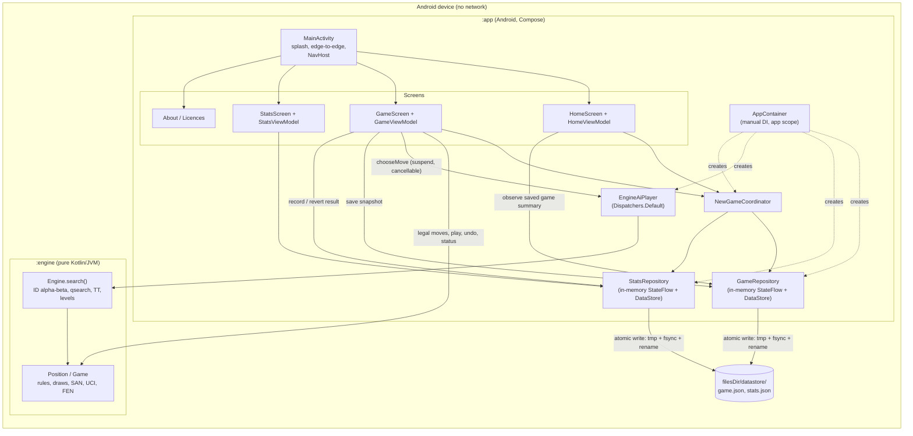

# Tech design: Chess vs Computer (Android, Kotlin), v1

- **Status:** Draft for build
- **Date:** 2026-10-14
- **Inputs:** [01-prd.md](./01-prd.md) (approved; all OQs resolved) · [02-design.md](./02-design.md) (draft; its OQ-D1 to OQ-D9 are **provisional**, and this design follows the designer's recommendations, see §13)
- **Plan:** [04-plan.md](./04-plan.md)
- **Project state:** greenfield. `C:\armen-projects\chess-android` holds only `docs/`, and it is not yet a git repository.

---

## 0. Requirements recap and assumptions

The PRD and design spec are the requirements. This document adds no product scope. These are the constraints that shape the architecture:

| Constraint | Source | Architectural consequence |
|---|---|---|
| Self-written engine, no GPL, no network, no SDKs | PRD OQ-1, OQ-2 | Pure-Kotlin `:engine` module; manifest strips `INTERNET`; a dependency licence check (§9.4) |
| Full FIDE rules, automatic threefold and 50-move draws, perft gate | US-4, US-5, OQ-3 | 0x88 move generator with make/unmake, a perft suite in the default test task, and exact position comparison for repetition |
| 4 levels; p95 think time 0.5/1/2/4 s; overshoot ≤ 200 ms; ≥ 70% ordering check | US-6 | Levels defined by **node budget + depth cap + hard time cap** (ADR-3); a deterministic JVM match harness |
| Engine never on main thread; undo/resign/back/rotation work while thinking | US-6, ANR guardrail | Coroutines on `Dispatchers.Default` with a cooperative stop flag (ADR-6) |
| Autosave ≤ 500 ms, survives kill/reboot, atomic write, corrupt-save handling | US-2 | Typed DataStore with a JSON serializer and a corruption handler (ADR-4); save = start FEN + UCI move list (ADR-5) |
| Unlimited undo that survives app kill | US-10, OQ-4 | The undo history *is* the saved move list |
| TalkBack board, polite live region, non-colour cues | US-8, design §5 | 64 semantics nodes over a single drawn board; announcements built by pure, unit-tested formatters |
| minSdk 26, targetSdk 36, Play only, ≤ 15 MB | PRD OQ-5, OQ-7, guardrails | R8 + resource shrinking; size and permission checks in CI |

**Assumptions**:
- A1. There is a single developer, and CI runs on GitHub Actions if the repo is pushed to GitHub (decision H-6).
- A2. The reference device (OQ-6) is not yet named. Node budgets for level 4 are finalised once it is (task T-11).
- A3. The app's `applicationId` is not yet chosen. It cannot be changed after the first Play upload (decision H-1).

---

## 1. Toolchain and local environment (verified 2026-10-14)

### 1.1 What is installed (checked in this session)

| Item | Found | Consequence |
|---|---|---|
| JDK | Temurin 21.0.12.1 | Runs Gradle and the unit tests. Robolectric needs JDK 21 to run SDK-36 tests ([Robolectric 4.16 release notes](https://github.com/robolectric/robolectric/releases)) |
| SDK platforms | `android-36` only (rev 2) | Enough for targetSdk 36, **but not for the current AndroidX libraries**, see 1.3 |
| Build tools | 35.0.0, 36.0.0 | AGP 9.4 needs 36.0.0 ([AGP 9.4 notes](https://developer.android.com/build/releases/gradle-plugin)) |
| System images | `android-35;google_apis;x86_64` only | No API 36 image. The only AVD (`grainlab_test`, API 35) belongs to another project. **Install an API 36 image and create a dedicated AVD (T-2).** |
| Emulator, platform-tools, cmdline-tools | emulator 37.2.12, adb, cmdline-tools 23.0 (`sdkmanager`, `avdmanager`, `apkanalyzer`) | Installs can be scripted; `apkanalyzer` is used for the permission check |
| Gradle | No global Gradle. Cached wrapper distributions: 8.14.3 and **9.3.1** in `~/.gradle/wrapper/dists` | Use the cached 9.3.1 binary once to generate the wrapper (T-1) |
| `ANDROID_HOME` | not set | `local.properties` with `sdk.dir` (git-ignored) |
| Host | Windows 11, 8 logical cores, Git Bash, `gh` | Commands in the plan are for Git Bash (`./gradlew`); `gradlew.bat` works the same from PowerShell |

### 1.2 Pinned versions (`gradle/libs.versions.toml`)

These were checked against Maven Central, Google Maven and kotlinlang.org on 2026-10-14. T-1 proves that they resolve and build together.

| Key | Version | Note |
|---|---|---|
| Gradle wrapper | 9.8.1 | Current release; AGP 9.4 needs ≥ 9.6 |
| AGP (`com.android.application`, `com.android.library`) | 9.4.1 | Built-in Kotlin: do **not** apply `org.jetbrains.kotlin.android` ([migrate to built-in Kotlin](https://developer.android.com/build/migrate-to-built-in-kotlin)) |
| Kotlin (`org.jetbrains.kotlin.jvm`, `.plugin.compose`, `.plugin.serialization`) | 2.4.21 | [kotlinlang releases](https://kotlinlang.org/docs/releases.html). Declaring the JVM plugin at this version in the root build aligns the KGP version that AGP's built-in Kotlin uses |
| Compose BOM | 2026.09.00 | ui/foundation 1.12.1, material3 1.4.0 |
| activity-compose | 1.13.0 | |
| core-ktx | 1.19.1 | |
| lifecycle (viewmodel-compose, runtime-compose) | 2.11.0 | |
| navigation-compose | 2.10.2 | Type-safe routes with `@Serializable` |
| core-splashscreen | 1.2.0 | |
| datastore-core | 1.2.1 | Typed DataStore (no protobuf) |
| kotlinx-coroutines | 1.11.0 | `:app` only. `:engine` uses only the stdlib |
| kotlinx-serialization-json | 1.11.0 | Save files and nav routes |
| junit | 4.13.2 | One framework for all modules (Robolectric and Compose rules are JUnit 4) |
| kotlin-test | = Kotlin | Assertions |
| robolectric | 4.17 | JVM Compose UI tests |
| turbine | 1.2.1 | Flow assertions in ViewModel tests |
| androidx.test ext-junit / runner / uiautomator | 1.3.0 / 1.7.0 / 2.4.0 | Instrumented tests |
| androidx.benchmark (plugin + junit4) | 1.5.0 | `:benchmark` module only |
| app.cash.licensee | 1.14.1 | Licence allow-list and the bundled licence list |

### 1.3 compileSdk: 37 (needs one SDK install)

I downloaded the AARs and read `META-INF/com/android/build/gradle/aar-metadata.properties`:

| Artifact | minCompileSdk | min AGP |
|---|---|---|
| `androidx.compose.ui:ui-android:1.12.1` (BOM 2026.09.00) and `1.12.0` | **37** | 9.1.0 |
| `androidx.compose.foundation:foundation-android:1.12.1` | **37** | 9.1.0 |
| `androidx.core:core:1.19.1` | **37** | 9.1.0 |
| `androidx.compose.ui:ui-android:1.11.4` (BOM 2026.06.01) | 35 | 8.6.0 |
| `androidx.core:core:1.18.0` | 36 | 8.9.1 |
| activity 1.13.0, material3 1.4.0, lifecycle 2.11.0, navigation 2.10.2, datastore 1.2.1, splashscreen 1.2.0 | ≤ 36 | ≤ 8.9.1 |

**Decision:** `compileSdk = 37`, `targetSdk = 36`, `minSdk = 26`. A compileSdk above targetSdk is normal: it changes which APIs we can call, not the runtime behaviour. T-1 installs the platform with `sdkmanager "platforms;android-37.0"`. Google's Android 17 setup guide uses the flat `compileSdk = 37` form ([setup SDK](https://developer.android.com/about/versions/17/setup-sdk)). If AGP rejects that form, use the `compileSdk { version = release(37) }` block ([CompileSdkSpec](https://developer.android.com/reference/tools/gradle-api/com/android/build/api/dsl/CompileSdkSpec)).
**Fallback without the install:** `compileSdk = 36` with Compose BOM 2026.06.01 and core-ktx 1.18.0. Everything in this design works on either. (Human decision H-2.)

### 1.4 Gradle configuration rules

- No `jvmToolchain(...)`. Only JDK 21 is installed, and toolchain auto-provisioning would need a download. Set bytecode targets explicitly instead: `:engine` uses `kotlin { compilerOptions { jvmTarget = JVM_17 } }` and `java { sourceCompatibility/targetCompatibility = 17 }`. `:app` uses `compileOptions { sourceCompatibility = targetCompatibility = JavaVersion.VERSION_17 }`. Unit tests then run on the Gradle JDK (21), which Robolectric's SDK-36 runtime needs.
- `gradle.properties`: `org.gradle.jvmargs=-Xmx4g -Dfile.encoding=UTF-8`, `org.gradle.parallel=true`, `org.gradle.configuration-cache=true`, `org.gradle.caching=true`, `android.useAndroidX=true`, `android.nonTransitiveRClass=true`.
- `local.properties` (git-ignored): `sdk.dir=C\:\\Users\\armen\\AppData\\Local\\Android\\Sdk`.

---

## 2. Context

### 2.1 Components and main flow



### 2.2 Main user story: a player's move, then the computer's reply

```mermaid
sequenceDiagram
  participant U as Player
  participant B as ChessBoard (UI)
  participant VM as GameViewModel (main)
  participant G as Game (engine, immutable)
  participant R as GameRepository (app scope, IO)
  participant AI as EngineAiPlayer (Default)
  U->>B: tap e2, tap e4
  B->>VM: onSquareTap(e2), onSquareTap(e4)
  VM->>G: legalMovesFrom(e2) / play(e2e4)
  G-->>VM: new Game (status Ongoing)
  VM->>R: save(snapshot)  [fire-and-forget, conflated]
  VM-->>B: UiState(last move, Thinking, board locked)
  VM->>AI: chooseMove(game, level)  [aiJob]
  AI->>AI: Engine.search(..., shouldStop = { !job.isActive })
  AI-->>VM: Move (after ≤ cap)
  VM->>VM: wait until 400 ms since start; wait while dialog/sheet open
  VM->>G: play(move) (generation check first)
  VM->>R: save(snapshot)
  VM-->>B: UiState(last move, Your move or result) + announcement
```

---

## 3. Module structure

### ADR-1: Gradle modules

- **Context.** The engine is the riskiest and most test-heavy code. It has to run perft and multi-minute strength matches quickly on the JVM, and it must not depend on Android.
- **Options.**
  1. *Single `:app` module.* This is simplest, but engine tests would be Android unit tests (slower configuration, AGP in the loop), and nothing would stop Android types leaking into rules code.
  2. **`:engine` (Kotlin/JVM) + `:app` (Android), plus `:benchmark` (Android library, tests only).** The compiler enforces the boundary, and engine tests run with plain `kotlin-jvm`.
  3. *Feature modules* (`:feature:game`, `:core:data`, `:core:ui` …). Faster incremental builds in large teams, but pure overhead for one developer and five screens.
- **Decision.** Option 2.
  - `:engine` uses only the Kotlin stdlib (no coroutines), so it can be tested and benchmarked anywhere.
  - `:benchmark` exists only because on-device timing must run in a non-debuggable process. That is what the Jetpack Microbenchmark plugin sets up ([Microbenchmark overview](https://developer.android.com/topic/performance/benchmarking/microbenchmark-overview)). It ships nothing.
- **Consequences.** There is one more build file per module. Pure-Kotlin parts of `:app` (formatters, layout maths, undo policy) still run as JVM unit tests in `:app`, so no extra module is needed for them.

### 3.1 Layout on disk

```
chess-android/
  settings.gradle.kts  build.gradle.kts  gradle.properties  local.properties(ignored)
  gradle/libs.versions.toml  gradle/wrapper/…  gradlew  gradlew.bat
  .github/workflows/ci.yml  .github/workflows/strength.yml
  engine/                      # kotlin("jvm"); package chess.engine
    src/main/kotlin/chess/engine/
      board/    Piece.kt Square.kt Move.kt Board.kt (0x88, mutable) MoveGen.kt Attacks.kt Zobrist.kt Fen.kt Perft.kt
      rules/    Position.kt Game.kt GameStatus.kt Draws.kt San.kt Uci.kt
      search/   Engine.kt Search.kt Eval.kt Pst.kt TranspositionTable.kt Ordering.kt LevelParams.kt Levels.kt
    src/test/kotlin/chess/engine/
      board/ rules/ search/ perft/PerftTest.kt
      strength/  LevelMatchTest.kt Openings.kt MatchRunner.kt   # excluded from `test`; run by `strengthTest`
  app/                         # com.android.application; namespace "chess.app"
    src/main/kotlin/chess/app/
      ChessApplication.kt MainActivity.kt AppContainer.kt
      nav/        Routes.kt ChessNavHost.kt
      data/       SaveFile.kt SaveSerializer.kt GameRepository.kt StatsFile.kt StatsSerializer.kt StatsRepository.kt
      ai/         AiPlayer.kt EngineAiPlayer.kt
      domain/     NewGameCoordinator.kt UndoPolicy.kt GameResult.kt PlayerSide.kt
      ui/theme/   Color.kt Theme.kt BoardColors.kt
      ui/home/    HomeScreen.kt HomeViewModel.kt
      ui/newgame/ NewGameSheet.kt
      ui/game/    GameScreen.kt GameViewModel.kt GameUiState.kt GameAction.kt
                  StatusRow.kt MoveList.kt ActionRow.kt ResultPanel.kt PromotionDialog.kt ConfirmDialogs.kt
      ui/game/board/  ChessBoard.kt BoardDrawing.kt BoardInput.kt BoardSemantics.kt PieceArt.kt
      ui/game/layout/ GameLayout.kt GameLayoutSpec.kt   # spec = pure function
      ui/a11y/    SquareDescriber.kt AnnouncementFormatter.kt SanSpeech.kt Strings.kt
      ui/stats/   StatsScreen.kt StatsViewModel.kt StatsTable.kt
      ui/about/   AboutScreen.kt LicencesScreen.kt
    src/main/res/ drawable/piece_{w,b}{k,q,r,b,n,p}.xml, ic_*.xml (Material Symbols), values/strings.xml, values/plurals…
    src/test/kotlin/chess/app/…        # JVM + Robolectric (Compose UI tests included)
    src/androidTest/kotlin/chess/app/… # emulator: E2E smoke, process death
  benchmark/                   # com.android.library + androidx.benchmark; androidTest only
  docs/licences/pieces-cburnett.md
```

The `applicationId` stays separate from the code namespace (`chess.app`). It is set in `app/build.gradle.kts` before the first Play upload (H-1).

---

## 4. Engine design (`:engine`)

### ADR-2: Board representation

- **Context.** Correctness (perft-exact) and simplicity matter more than raw speed. The strength target is "beatable casual opponent" up to a modest level 4, not competitive play. A solo developer has to debug it.
- **Options.**
  1. **0x88 mailbox** (128-entry array; `sq and 0x88 != 0` means off-board). It has a cheap off-board test and simple ray loops, and it is easy to print and debug. It is moderately fast (low millions of nodes per second on a desktop JVM; this needs measuring).
  2. *10×12 mailbox.* About as simple, with sentinel borders. It has no advantage over 0x88 here, and square conversion is slightly clumsier.
  3. *Bitboards with magic or PEXT sliders.* About 2–5× faster, but slider generation is subtle, needs precomputed magic tables, and is harder to debug with `ULong` in Kotlin. The speed isn't needed: level 4 is capped by a node budget we choose.
- **Decision.** **0x88**, with pseudo-legal generation followed by a legality filter (make the move, test whether the mover's king is attacked, unmake). The filter handles pins, en passant discovered checks along a rank, and castling through check uniformly. That is the class of bug US-4 calls out.
- **Consequences.** Search is slower than a bitboard engine, so levels are budgeted in nodes rather than depth (ADR-3). If level 4 is later called "too easy", we can raise its node budget or rewrite move generation behind the same `Board` API. The perft suite protects either change.

### 4.1 Core types

- `Square`: an `Int` from 0 to 63 in the public API (a1 = 0, h8 = 63). `Board` converts to 0x88 internally (`sq88 = sq + (sq and 56)`).
- `Piece`: `Int` codes; colour bit plus type (`PAWN..KING`). The public enums `Color` and `PieceType` are for the app.
- `Move`: `@JvmInline value class Move(val bits: Int)` holding from(6) · to(6) · promo(3) · flags(4: capture, double-push, en passant, castle). It has `uci()`, `from`, `to`, `promotion`, and boolean flags.
- `Board` (internal, mutable). It holds:
  - `IntArray(128)` of pieces and the king squares
  - side to move, castling rights (4 bits), en passant square, halfmove clock, fullmove number
  - the Zobrist key, maintained incrementally
  - a preallocated undo stack (captured piece, castling, ep, halfmove, key) for `make` and `unmake`
  
  Move generation writes into a reusable `IntArray` per ply, so the search does not allocate.
- `Position` (public, immutable). This is a snapshot of `Board` state (`IntArray(64)` copied defensively, plus the scalars). It has:
  - `Position.fromFen(fen)`, which throws `FenException` for malformed or illegal FEN (two kings, side not to move in check, and so on), and `toFen()`
  - `legalMoves(): List<Move>` (lazy, cached), `isCheck`, `pieceAt(sq)`, `sideToMove`, `fullmoveNumber`, `halfmoveClock`
  - `play(move): Position`, which throws if the move is illegal
  - `repetitionKey: Long` and `samePositionAs(other)` (see 4.3)
- `Game` (public, immutable). It holds `startPosition`, `moves: List<Move>` and `positions: List<Position>` (size = moves + 1). It provides:
  - `play(move)`, `undo(plies)`, `legalMovesFrom(sq)`, `status: GameStatus`
  - `san(ply)` and `sanList` (lazy)
  - `Game.replay(startFen, ucis)`, which throws `IllegalMoveException`; the save loader uses it

  Keeping every position costs about 300 bytes per ply (about 90 KB for a 300-ply game). In return, undo and repetition checks are trivial and correct.

### 4.2 Move generation and the perft gate (US-4)

- Pseudo-legal generation covers pawn pushes and double pushes, captures, promotions to Q/R/B/N, en passant, knight and king steps, slider rays, and castling. Castling requires: the right is set, the squares between are empty, the king is not in check, and the king's transit and destination squares are not attacked.
- Legality: `make` the move; reject it if `isAttacked(kingSq, by = opponent)`; then `unmake`.
- `isAttacked` scans rays and leaps outward from the target square. It is simple, and fast enough.
- `perft(depth)` and `divide(depth)` are public. `divide` is used to find the first diverging move when a count is wrong.

**Perft suite.** Positions and node counts are copied from [Chessprogramming wiki: Perft Results](https://www.chessprogramming.org/Perft_Results) (checked 2026-10-14):

| Position | FEN | Depths in `test` (gate) | Deep depth (`perftDeep`, release) |
|---|---|---|---|
| Initial | `rnbqkbnr/pppppppp/8/8/8/8/PPPPPPPP/RNBQKBNR w KQkq - 0 1` | 1–5: 20 / 400 / 8,902 / 197,281 / 4,865,609 | 6: 119,060,324 |
| Kiwipete | `r3k2r/p1ppqpb1/bn2pnp1/3PN3/1p2P3/2N2Q1p/PPPBBPPP/R3K2R w KQkq -` | 1–4: 48 / 2,039 / 97,862 / 4,085,603 | 5: 193,690,690 |
| Position 3 (en passant, rank pins) | `8/2p5/3p4/KP5r/1R3p1k/8/4P1P1/8 w - - 0 1` | 1–5: 14 / 191 / 2,812 / 43,238 / 674,624 | 6: 11,030,083 |
| Position 4 (promotion, castling) | `r3k2r/Pppp1ppp/1b3nbN/nP6/BBP1P3/q4N2/Pp1P2PP/R2Q1RK1 w kq - 0 1` | 1–4: 6 / 264 / 9,467 / 422,333 | 5: 15,833,292 |
| Position 4 mirrored | `r2q1rk1/pP1p2pp/Q4n2/bbp1p3/Np6/1B3NBn/pPPP1PPP/R3K2R b KQ - 0 1` | 1–4: same as Position 4 | 5: 15,833,292 |
| Position 5 | `rnbq1k1r/pp1Pbppp/2p5/8/2B5/8/PPP1NnPP/RNBQK2R w KQ - 1 8` | 1–4: 44 / 1,486 / 62,379 / 2,103,487 | 5: 89,941,194 |
| Position 6 | `r4rk1/1pp1qppp/p1np1n2/2b1p1B1/2B1P1b1/P1NP1N2/1PP1QPPP/R4RK1 w - - 0 10` | 1–4: 46 / 2,079 / 89,890 / 3,894,594 | 5: 164,075,551 |

- The default `:engine:test` runs the gate column, about 16 M nodes. This should take seconds on the JVM; T-5 records the actual time. It covers the PRD minimum and more (castling, en passant, promotion, under-promotion).
- `:engine:perftDeep` (a JUnit-category-filtered `Test` task) runs the last column before every release.
- Extra unit tests check that make/unmake round-trips restore `Board` exactly, including the Zobrist key.

### 4.3 Rules and game status (US-5)

`Game.status` is evaluated in the design's order, so a mate on the 100th ply wins:

1. No legal moves and in check → `Checkmate(winner)`.
2. No legal moves and not in check → `Stalemate`.
3. Material is **exactly** one of: K v K, K+B v K, K+N v K, or K+B v K+B with both bishops on the same square colour → `InsufficientMaterial`. This is the PRD list, not FIDE's wider "dead position" rule.
4. The current position occurred ≥ 3 times since the last irreversible move → `ThreefoldRepetition`.
5. `halfmoveClock >= 100` → `FiftyMoveRule`.
6. Otherwise → `Ongoing`.

**Position identity for repetition** follows the PRD: same placement, same side to move, same castling rights, and the same *en passant capture availability*. The en passant square only counts if a **legal** en passant capture exists. If we hashed the raw FEN ep square, a draw would be missed whenever a double push leaves no capturable pawn. `repetitionKey` (Zobrist, with the ep file included only if a legal ep capture exists) is a pre-filter, and `samePositionAs()` confirms an exact match. A hash collision can therefore never end a game.

Resignation is not a `GameStatus`, because it can't be derived from the moves. It lives in the app's `GameResult` (§6.4).

### 4.4 SAN and UCI (US-11, US-8)

- `San.format(position, move)` produces piece letters, file then rank disambiguation (and both when needed), `x`, `=Q`, `O-O`, `O-O-O`, and `+` or `#`, computed from the resulting position.
- `Uci.parse(position, "e7e8q")` resolves against the legal moves, so castling and en passant flags are inferred.
- There is no SAN parser; v1 doesn't need one.

### 4.5 Evaluation

- Material: P 100, N 320, B 330, R 500, Q 900.
- Piece-square tables with middlegame and endgame values, tapered by a phase computed from the non-pawn material. The tables are authored by the developer, starting from the well-known "Simplified Evaluation Function" shape ([CPW](https://www.chessprogramming.org/Simplified_Evaluation_Function)). Record the source in `docs/licences/` for provenance.
- Small terms: bishop pair, and a tempo bonus.
- **Mop-up term** when one side has only its king and the other has mating material: push the lone king to the edge and corner, and bring the attacking king closer. This lets levels 3 and 4 pass the US-6 K+Q v K test at modest depth.
- **Test:** `eval(p) == -eval(mirror(p))` over 50 positions. This symmetry test catches most PST indexing bugs.

### 4.6 Search

- Negamax alpha-beta with iterative deepening. The root keeps the best move of the last completed iteration. If a partial iteration has already searched the previous best move first and found something better, its improvement is used.
- **Quiescence search**: captures and promotions, stand-pat, MVV-LVA ordering, and a simple delta-pruning margin.
- **Check extension** (+1 ply when the side to move is in check). This matters for finding mates.
- **Move ordering**: TT move, then captures by MVV-LVA, then 2 killer moves per ply, then the history heuristic.
- **Transposition table: yes.**
  - Why: it supplies the TT move for ordering, which is the biggest gain from iterative deepening, and it gives cutoffs in endgames such as KQK. That is worth about 60 lines.
  - Layout: `2^18` entries in two `LongArray`s, key and packed data (move, score, depth, bound). That is 4 MiB per engine instance. Replacement is depth-preferred with an always-replace fallback. Mate scores are adjusted by ply when stored and loaded.
  - It is cleared on new game and on undo. Undo is cheap, and clearing avoids stale-history effects on repetition scoring.
- **Draws inside the search:**
  - A repetition of any position on the current path, or in the game history since the last irreversible move, scores 0. A twofold repetition inside the search is treated as a draw (standard practice).
  - Fifty-move rule and insufficient material also score 0.
  - So the engine neither walks into an automatic threefold when winning nor misses one when losing.
- **No null-move pruning or LMR in v1.** They add zugzwang and tuning risk for little benefit at this strength. Revisit only if level 4 is called too easy.
- **Stop conditions**, checked every 1,024 nodes: `nodes >= nodeBudget || now() >= deadline || shouldStop()`.
  - Depth 1 always completes, even after the deadline. It is cheap (at most a few hundred nodes plus quiescence), and it guarantees a legal, non-random move.
  - If `shouldStop()` fired, the result is marked `StopReason.Cancelled` and the caller discards it.

**Public API (load-bearing for `:app`)**

```kotlin
class Engine(ttEntriesLog2: Int = 18) {
    fun newGame()                                   // clears TT, killers, history
    fun search(
        game: Game,                                 // root = game.positions.last(); history used for repetition
        params: LevelParams,
        random: kotlin.random.Random,
        nanoTime: () -> Long = System::nanoTime,    // injectable clock (tests)
        shouldStop: () -> Boolean = { false },      // cooperative cancellation
    ): SearchResult
}
data class SearchResult(val move: Move, val scoreCp: Int, val depth: Int, val nodes: Long,
                        val elapsedMs: Long, val stopReason: StopReason)
enum class StopReason { DepthCap, NodeBudget, Deadline, Cancelled, OnlyMove }
```

Precondition: `game.status == Ongoing`; otherwise the method throws `IllegalArgumentException`. An `Engine` is not thread-safe, so the caller serialises calls (§6.5).

### ADR-3: How levels are shaped

- **Context.** US-6 needs four distinct strengths, p95 think time under per-level caps on a low-end phone, and an automated "level N+1 ≥ 70% against level N" check. A time-only definition makes strength depend on hardware. The JVM test would then measure a different engine from the one on the phone, and CI results would vary with machine load.
- **Options.**
  1. *Time only* (iterative deepening until the cap). Simple, but non-deterministic and hardware-dependent, so the JVM match test is meaningless for the phone.
  2. *Depth only.* Deterministic, but think time varies hugely by position, so caps would be breached in sharp middlegames.
  3. **Node budget + depth cap, with a hard wall-clock deadline as a safety net, plus per-level randomisation.** Strength is deterministic and device-independent whenever the device reaches the budget before the deadline. The deadline guarantees the PRD cap on slow devices, at the cost of a little strength only there.
- **Decision.** Option 3. Starting parameters are below; the PRD allows the numbers to be tuned as long as the acceptance criteria pass:

| Level | Depth cap | Node budget | Time cap → hard deadline | Quiescence | Randomisation (seeded `Random`) |
|---|---|---|---|---|---|
| 1 Beginner | 1 | 5,000 | 500 ms → stop at 400 ms | off (so it leaves pieces hanging) | 50%: uniform random legal move. Otherwise, the best 1-ply score after adding uniform noise of ±40 cp to each root move |
| 2 Casual | 2 (ID) | 30,000 | 1,000 → 900 ms | captures only, max 4 plies | 20%: uniform pick from the top 5 exact root scores |
| 3 Club | 6 (ID) | 250,000 | 2,000 → 1,900 ms | full | Uniform pick among root moves scoring ≥ best − 20 cp (needs a root re-search with a lowered alpha), while the game is undecided: once the best score is ≥ 400 cp from 0 (mates included), the best move (T-9) |
| 4 Strong | 64 (ID) | 1,500,000 (provisional; set in T-11 from the reference device's nodes per second) | 4,000 → 3,900 ms | full | none |

  - **Exact root scores** for levels 1 to 3 (needed for "top 5" or "within 20 cp"): at the final depth, each root move is searched with a window of `[best − margin − 1, +∞)` rather than a null window. Moves inside the margin then get exact scores. This is cheap at those depths.
    - *As built (T-9):* the final depth isn't known in advance (the budget may end an iteration), so the window is applied at every iteration, and the pick uses the root scores of the iteration whose move the search would play. The margin is 20 cp for level 3, 2 × 40 cp for level 1's noise (a move further below can't win after noise), and "5th best so far − 1" for level 2's top 5. Level 1's random-move and level 2's pick-or-not draws happen before the search, so the window is widened only when the pick needs it.
    - *Level 3 and decided games (T-9):* with the 20 cp pick in every position, level 3 failed to mate a level-1 defender in 16 of 200 K+Q v K games (50-move rule). There the progress moves are only a few centipawns apart, and random picks among them wander. Playing the best move once |best| ≥ 400 cp gives 200/200, worst case 20 moves. Variety in undecided positions is unchanged.
  - **Deadline margin.** The deadline is the cap minus 100 ms. That allows for result hand-off and the next stop check (≤ 1,024 nodes, a few milliseconds even on slow devices). So "never exceeds cap by more than 200 ms" holds with room to spare. A JVM test with a fake `nanoTime` asserts the deadline logic. The device benchmark (T-11) asserts the real p95.
  - The **400 ms minimum display time** is UI pacing (§6.5), not engine time. It overlaps the search; it is not added to it.
- **Consequences.**
  - The JVM match (below) plays the same engine the phone does at the node-budgeted level. The match disables the deadline to stay deterministic.
  - If a device is too slow to finish level 4's budget in 3.9 s, level 4 becomes a little weaker *on that device only*. Monotonic budgets and caps keep the levels ordered: level 4 always searches at least what level 3 does. T-11 measures the share of searches that hit the deadline rather than the budget on the reference device.

### 4.7 Automated level checks (US-6)

These live in `engine/src/test/kotlin/chess/engine/strength/`. They are excluded from the default `test` task and run by a dedicated `strengthTest` Gradle `Test` task:

```kotlin
// engine/build.gradle.kts (sketch)
tasks.test { exclude("**/strength/**"); useJUnit { excludeCategories("chess.engine.PerftDeep") } }
val strengthTest by tasks.registering(Test::class) {
    testClassesDirs = sourceSets.test.get().output.classesDirs
    classpath = sourceSets.test.get().runtimeClasspath
    include("**/strength/**"); maxHeapSize = "3g"; outputs.upToDateWhen { false }
    systemProperty("match.games", providers.gradleProperty("match.games").orElse("100").get())
}
```

- **Openings:** 50 fixed, balanced opening lines of 4 to 8 plies, stored as UCI strings in `Openings.kt` (common lines such as the Italian, Sicilian and QGD). Each is played twice with colours swapped, giving **100 games per pairing**. This is the PRD's "alternating colours and random openings for variety", but reproducible.
- **Determinism:** every game gets a fixed seed (`seed = pairingId * 1000 + gameIndex`). Deadlines are disabled; only node budgets and depth caps apply.
- **Adjudication:** the rules decide every game (mate, stalemate, threefold, 50-move, insufficient material). A 400-ply safety cap scores as a draw and is logged; if it appears often, that is itself a bug signal.
- **Parallelism:** games are independent, so a fixed thread pool of `availableProcessors()` runs them, with one `Engine` per side per game (4 MiB TT each).
- **Assertions:** L2 ≥ 70% vs L1; L3 ≥ 70% vs L2; L4 ≥ 70% vs L3; L4 ≥ 95% vs L1. Draws count 0.5.
- **Report:** a Markdown table in `engine/build/reports/strength/match.md` (W/D/L by colour, average plies, adjudications) for tuning.
- **Cost:** about 15 to 25 minutes on 8 cores, depending on the measured JVM nodes per second (estimate). `-Pmatch.games=20` gives a smoke run. The full check is a release gate and a nightly CI job, not a per-commit check.
- **Other US-6 tests** (in the default `test` task, so they run every commit, except K+Q v K and variety; see below):
  - *K+Q v K competence:* 10 fixed positions, levels 3 and 4 against a level-1 defender; mate is required before the 50-move rule in 10/10. Deadline disabled.
  - *Variety:* 5 fixed middlegame positions × 10 seeds × levels 1 to 3. At least one position yields ≥ 2 distinct moves per level.
  - *As built (T-9):* these two take about 30 s at the real level parameters, so they run in `:engine:levelChecks` (JUnit category `chess.engine.LevelChecks`), not in `test`. The default `test` covers the randomisation rules, rates, exact root scores, determinism, legality and the deadline with reduced budgets.
  - *Legality:* 1,000 random self-play plies per level; every move is in `legalMoves()`.
  - *Stop:* `shouldStop` flips after N nodes and the search returns within 1,024 nodes. With the deadline passed at start, the search still returns a legal depth-1 move.

---

## 5. Data model and persistence (US-2, US-12)

There is no database. Two small JSON documents live in app-private storage under `filesDir/datastore/`.

### ADR-4: Persistence mechanism

- **Context.** The app needs:
  - an autosave ≤ 500 ms after each move that survives kill, force-stop and reboot
  - atomic writes, so a kill mid-write leaves the previous valid save (US-2)
  - detection of a corrupt save, with a once-only message
  - a storage-full error that doesn't crash
  - a few counters for stats, and the last-used side and level
- **Options.**
  1. **Typed DataStore (`datastore-core`) with a kotlinx-serialization JSON `Serializer`.**
     - Writes go to `<file>.tmp`, are fsynced, then moved atomically over the real file. Failures throw `IOException` (verified in [`FileStorage.kt`](https://github.com/androidx/androidx/blob/androidx-main/datastore/datastore-core/src/jvmAndAndroidMain/kotlin/androidx/datastore/core/FileStorage.kt)).
     - Updates are serialised and transactional, and it offers a `ReplaceFileCorruptionHandler` ([DataStore guide](https://developer.android.com/topic/libraries/architecture/datastore)).
     - It runs on the plain JVM with a temp file, so repository tests need no device.
  2. *Room.* A relational schema, migrations and KSP for one game row and a dozen counters. More build surface and risk under AGP 9's built-in Kotlin, and no benefit.
  3. *Hand-rolled `AtomicFile` + JSON.* Roughly 40 lines that would re-implement DataStore's tmp/fsync/rename, write serialisation and corruption path, without the tests.
  4. *Preferences DataStore.* Fine for counters, but awkward for a move list. A typed document is clearer.
- **Decision.** Option 1, with **two files**:
  - `game.json` (the single saved game plus a restore-failed flag)
  - `stats.json` (counters plus the last-used side and level)

  The files are separate so that a corrupt game never costs the player their stats. The design copy promises this: "Your stats aren't affected".
- **Consequences.**
  - There is exactly one `DataStore` instance per file, held by `AppContainer`. The guide forbids two instances per file in one process.
  - An abandon followed by a new game updates both files with two writes, not one transaction. A kill between them could skew a counter by one. **Accepted:** the counts are informational, and counters are clamped at ≥ 0.

### ADR-5: Save format

- **Options.**
  1. **Start FEN + UCI move list** (+ side, level, resigned flag). It is compact, and loading replays it through the legal move generator, which validates the save as a side effect. Undo history is just the list.
  2. *Current FEN + SAN list.* This loses the repetition history (the threefold count after a restore would be wrong) and needs a SAN parser.
  3. *PGN.* Human-readable, but needs a parser and tag handling, and isn't needed in v1 (PGN export is a Could, and it can be *generated* from option 1 later).
- **Decision.** Option 1, as versioned JSON.

`game.json`, version 1:

```json
{
  "version": 1,
  "game": {
    "id": "6f1d0c9e-3a52-4c1b-9a51-0d5b0a3c2e11",
    "startFen": "rnbqkbnr/pppppppp/8/8/8/8/PPPPPPPP/RNBQKBNR w KQkq - 0 1",
    "moves": ["e2e4", "e7e5", "g1f3"],
    "player": "white",
    "level": 2,
    "resigned": false,
    "statsRecorded": false
  },
  "restoreFailed": false
}
```

| Field | Type | Null? | Constraint / meaning |
|---|---|---|---|
| `version` | Int | no | `1`. A higher value than the app knows is treated as unreadable |
| `game` | object | **yes** | `null` means there is no saved game |
| `game.id` | String (UUID) | no | Correlates log lines and the once-per-game storage-full message |
| `game.startFen` | String | no | Must parse with `Position.fromFen`. Always the standard start in v1; storing it costs nothing and lets tests restore arbitrary positions |
| `game.moves` | List<String> | no | UCI, ≤ 2,000 entries; each must be legal on replay |
| `game.player` | `"white"`/`"black"` | no | Already resolved; "Random" is never stored |
| `game.level` | Int | no | 1..4 |
| `game.resigned` | Boolean | no | Resignation can't be derived from the moves |
| `game.statsRecorded` | Boolean | no | True once this game's result has been counted in stats. Makes record and revert idempotent across a kill |
| `restoreFailed` | Boolean | no | Set by the corruption path; cleared when Home has shown the banner |

- **Derived on load, never stored:** the result (from `Game.status` + `resigned`), whose turn it is, the move number, and the SAN list.
- **Unfinished game** means `game != null && !resigned && status == Ongoing`. Home shows **Continue** only then. A finished game stays in the file, so Undo from the result panel still works after a relaunch, but Home hides **Continue** (US-2, US-5).

`stats.json`, version 1:

```json
{ "version": 1, "started": 12, "completed": 9, "abandoned": 2,
  "byLevel": [ {"won":3,"drawn":0,"lost":1}, {"won":2,"drawn":1,"lost":2}, {"won":0,"drawn":0,"lost":0}, {"won":0,"drawn":0,"lost":0} ],
  "lastSide": "white", "lastLevel": 2, "readFailed": false }
```

`byLevel` has exactly 4 entries. All counts are ≥ 0. `lastSide` is one of `white`, `black` or `random`.

**Decoding is a trust boundary.**
- `Json { ignoreUnknownKeys = true }`. The serializer rejects files over 256 KiB.
- Semantic validation runs inside `readFrom`: the version is known, the level is in range, the FEN is valid, and every UCI move is legal on replay. Any failure throws `CorruptionException`.
- The `ReplaceFileCorruptionHandler` then writes `SaveFile(game = null, restoreFailed = true)` (or `StatsFile(readFailed = true)` with zero counts).
- Home and Stats show the banner from that flag. The flag is cleared as soon as the banner has been shown, so it appears once.

**Migration and rollback.** There is no existing data, so there is no backfill. Each later format change bumps `version` and adds a pure `migrate(vN → vN+1)` function with a unit test that uses a stored v1 fixture. Play can't install an older versionCode over a newer one, so rolling back means shipping a new build that still reads every older version. The release checklist (T-27) requires the v1 fixtures to load in every future build.

### 5.1 Repositories

```kotlin
class GameRepository(store: DataStore<SaveFile>, appScope: CoroutineScope) {
    val state: StateFlow<LoadState<SaveFile>>          // Loading → Loaded(file); app-lifetime
    suspend fun awaitLoaded(): SaveFile
    fun save(game: SavedGame?)                         // non-suspending; conflated writer in appScope
    fun clearRestoreFailedFlag()
    val saveErrors: SharedFlow<SaveError>              // StorageFull(gameId) | Other
}
class StatsRepository(store: DataStore<StatsFile>, appScope: CoroutineScope) {
    val stats: StateFlow<StatsFile?>                   // in-memory is authoritative after first load
    fun recordStarted(); fun recordAbandoned()
    fun recordResult(level: Int, outcome: Outcome); fun revertResult(level: Int, outcome: Outcome)
    fun setLastUsed(side: SideChoice, level: Int)
    fun reset(gameInProgress: Boolean)                 // started = 1 if a game is in progress (design 4.8)
}
```

- **Writes run in an app-lifetime scope** (`SupervisorJob() + Dispatchers.IO` in `AppContainer`), not in `viewModelScope`. Otherwise, pressing Back straight after a move would clear the ViewModel and cancel the save.
- **Conflation:** the writer takes the latest snapshot from a `Channel(CONFLATED)` and calls `updateData { snapshot }`. An in-flight write is never cancelled, and a burst of moves produces at most one queued write.
- **Write failure:** an `IOException` (including ENOSPC) emits `SaveError.StorageFull(gameId)`. The ViewModel shows the snackbar once per `gameId` and play continues.
- **Stats** use the in-memory `StateFlow` as the source of truth after the first load. Each change writes the full snapshot, so a failed write is repaired by the next one (design 4.6: "a later write retries").

---

## 6. App architecture (`:app`)

### 6.1 Shape

- **Single activity** (`MainActivity`, `ComponentActivity`).
  - It calls `installSplashScreen()` with `setKeepOnScreenCondition { !homeReady && elapsed < 1.5 s }` and `enableEdgeToEdge()`.
  - It holds `ChessNavHost`. The condition is non-blocking; the save is read on IO.
- **Navigation Compose 2.10** with type-safe `@Serializable` routes: `Home`, `Game`, `Stats`, `About`, `Licences`. Predictive back is supported by Navigation Compose and by the stock `ModalBottomSheet` and `Dialog`. `onBackPressed` is never overridden (design §1).
- **Unidirectional data flow.**
  - Each screen has a ViewModel exposing `StateFlow<XUiState>`, an immutable data class.
  - The screen calls `vm.onAction(XAction)`.
  - One-shot UI effects (snackbars) arrive on a `Channel` → `receiveAsFlow()`, collected with `collectAsStateWithLifecycle` and `LaunchedEffect`.
- **Manual DI.**
  - `ChessApplication` creates `AppContainer`, which holds both DataStores, both repositories, the app scope, `NewGameCoordinator`, a `Clock`/`TimeSource` and the AI dispatcher.
  - ViewModels are built with `viewModelFactory { initializer { … } }`.

#### ADR-7: Dependency injection

- **Options.** Hilt (KSP, codegen, annotation surface); Koin (runtime DSL); **manual** container.
- **Decision.** Manual. There are about 8 objects, one Activity and five ViewModels. Avoiding annotation processing under AGP 9's built-in Kotlin also removes a build risk (kapt is unsupported there; [migration guide](https://developer.android.com/build/migrate-to-built-in-kotlin)).
- **Consequences.** About 40 lines of wiring. Tests construct ViewModels directly with fakes.

#### ADR-9: Navigation library

- **Options.** **Navigation Compose 2.10** (type-safe routes, predictive back, what the design spec names); Navigation 3 (newer, app-owned back stack); no library (a state-hoisted `when`).
- **Decision.** Navigation Compose 2.10. It is mature and documented, and it fits a five-route graph. Dialogs and sheets are ViewModel state, not routes (design §3.1).
- **Consequences.** Process death restores the back stack; each ViewModel re-loads from its repository.

### 6.2 State ownership

| State | Owner | Survives rotation | Survives process death |
|---|---|---|---|
| Saved game (moves, side, level, resigned) | `GameRepository` → `game.json` | yes | yes |
| Stats, last-used side and level | `StatsRepository` → `stats.json` | yes | yes |
| Selected square, pending promotion (from, to), open overlay (sheet, D1/D2, Moves sheet), sheet choices | `GameViewModel` (also `HomeViewModel` for the sheet), mirrored to `SavedStateHandle` as primitives | yes (ViewModel) | yes (`SavedStateHandle`) |
| Computer's search, held move | `GameViewModel` `aiJob` (memory only) | yes | no: recomputed on restore (US-2 AC) |
| Drag in progress, animation progress, focused square, keyboard input mode | Composables (`remember`) | drag cancelled (design 3.3) | no |
| Banner-shown flags | `restoreFailed` / `readFailed` in the files | yes | yes |

### 6.3 Game screen state

```kotlin
data class GameUiState(
    val phase: Phase,                         // Loading | Playing | Over | TooSmall (layout decides TooSmall)
    val level: Int, val player: PieceColor,
    val board: BoardUi,                       // 64 cells, orientation, selected, targets, lastMove, checkSq, ghost
    val status: StatusUi,                     // YourMove | Check | Thinking(check: Boolean) | Hint(text) | EngineError
    val sanMoves: List<String>,               // SAN; index = ply
    val canUndo: Boolean, val canResign: Boolean,
    val result: ResultUi?,                    // non-null → ResultPanel
    val overlay: Overlay,                     // None | NewGame(side, level) | ConfirmAbandon(side, level) | ConfirmResign | Promotion(from, to) | MovesSheet
    val announcement: Announcement?,          // structured; formatted to text in UI (§8.3); carries a sequence number
)
data class BoardUi(val cells: List<CellUi>, val whiteAtBottom: Boolean, val selected: Int?,
                   val targets: Map<Int, TargetKind>, val lastMove: Pair<Int, Int>?, val checkSquare: Int?,
                   val interactive: Boolean)
sealed interface GameAction { data class SquareTap(val sq: Int); data class Drop(val from: Int, val to: Int)
    data class Promote(val type: PieceType); object PromotionCancel; object Undo; object ResignClick; object ResignConfirm
    object NewGameClick; data class SheetChange(...); object Play; object AbandonConfirm; object DialogCancel
    object RetryEngine; object ScreenStarted; object ScreenStopped; object MovesClick }
```

- The engine's `Game` is held privately in the ViewModel. `UiState` is derived from it with a pure `GameUiMapper`. Unit tests feed it FENs and compare structures.
- Compose strong skipping is on by default with Kotlin 2.x, so plain `List` and `Map` parameters are fine. No `kotlinx.collections.immutable` is needed.

### 6.4 Game rules in the app layer (pure, JVM-tested)

- `GameResult` = `Status(GameStatus)` | `Resigned`. Each result maps to a title, an explanation and a stats outcome (design 4.3.7).
- `UndoPolicy.plies(game, player, thinking, result)` returns `Int?` (null means disabled):
  - **Computer thinking:** 1 (revert the player's last move).
  - **Player's turn, game ongoing:** 2, if a player move exists before the computer's last move; otherwise null. This covers the start position, and "player is Black and only the computer's first move has been played".
  - **Game over:** the number of plies back to *before the player's last move*: 1 if the player made the last move, 2 if the computer did. It is null if the player has never moved. Resigned games follow the same rule (PRD; design OQ-D3 is provisional, see §13).
  - If the result had been counted (`statsRecorded`), undo after a finished game calls `stats.revertResult` and clears `resigned` and `statsRecorded`.
- **Recording results:** when a result is first set, call `stats.recordResult` once and set `statsRecorded = true` in the same save snapshot. Both are idempotent across a kill (a restore never double-counts).

### 6.5 The computer's turn: off the main thread, cancellable, and held behind dialogs

#### ADR-6: Concurrency model for the search

- **Options.**
  1. **Coroutines.** `withContext(Dispatchers.Default)` around the blocking `Engine.search`, with `shouldStop = { !job.isActive }` polled every 1,024 nodes.
  2. A dedicated `Thread` or `Executor` with `interrupt()`. More plumbing and no structured lifetime.
  3. WorkManager. Built for deferrable background work, not interactive sub-4-second compute.
- **Decision.** Option 1. Cancelling the `aiJob` (Undo, Resign, Abandon, leaving the screen) stops the search within about 1,024 nodes (milliseconds). The engine stays coroutine-free.

```kotlin
class EngineAiPlayer(private val dispatcher: CoroutineDispatcher, private val random: Random,
                     private val nanoTime: () -> Long) : AiPlayer {
    private val engine = Engine()                 // one TT per ViewModel instance (4 MiB)
    private val mutex = Mutex()                   // Engine is not thread-safe
    override suspend fun chooseMove(game: Game, level: Int): Move = mutex.withLock {
        withContext(dispatcher) {
            val job = coroutineContext.job
            engine.search(game, Levels.params(level), random, nanoTime, shouldStop = { !job.isActive }).move
        }                                         // throws CancellationException if cancelled
    }
    fun newGame() = engine.newGame()
}
```

**GameViewModel's AI loop** (single `aiJob`; a `generation` counter is incremented on every change to the game):

```kotlin
private fun startAiTurnIfNeeded() {
    if (!screenStarted || game.status != Ongoing || resigned || game.sideToMove == player) return
    val gen = generation
    aiJob?.cancel()
    aiJob = viewModelScope.launch {
        val mark = timeSource.markNow()
        val move = try { ai.chooseMove(game, level) }
                   catch (e: CancellationException) { throw e }
                   catch (e: Exception) { log(e); setStatus(EngineError); return@launch }
        (MIN_AI_DISPLAY - mark.elapsedNow()).takeIf { it.isPositive() }?.let { delay(it) }   // 400 ms
        if (overlayBlocksAi.value) {                         // D1, D2 or the New game sheet is open
            overlayBlocksAi.first { !it }                    // suspends; cancelled if Resign/Abandon confirmed
            delay(MIN_AI_DISPLAY)                            // "apply 400 ms after the dialog closes with Cancel"
        }
        if (gen == generation) applyMove(move, actor = Computer)
    }
}
```

- **Held move.** While D1, D2 or the sheet is open, the status stays "Computer is thinking…" (design 4.3.8). Confirming Resign or Abandon cancels `aiJob`, which discards the held move. The promotion picker can't be open on the computer's turn, and the Moves sheet doesn't block.
- **Undo while thinking:** `aiJob.cancel()`, increment `generation`, revert 1 ply, save. The cancelled search can't apply a stale move, because of both the `generation` check and the cancellation. Starting a new search waits on the mutex until the old one has actually returned (≤ 1,024 nodes).
- **Lifecycle.** `GameScreen` reports `ScreenStarted` and `ScreenStopped` via `LifecycleStartEffect`.
  - On stop, the search is cancelled. On start, it restarts if it is the computer's turn.
  - This meets "when the app returns, the AI's move is completed within the cap" without searching while backgrounded, where the cached-app freezer could pause the process mid-search. It also saves battery.
  - Leaving to Home pops `Game` and clears the ViewModel, which cancels everything. **Continue** builds a new ViewModel, which starts the search.
- **Process death while thinking.** The restored ViewModel loads the save (computer to move) and starts the search on `ScreenStarted` (US-2 AC).
- **Engine error.** A non-cancellation exception sets `StatusUi.EngineError` with **Try again**, which re-runs `startAiTurnIfNeeded()`. Undo, Resign and New game stay enabled.

### 6.6 New game, abandon, and random side (US-1)

`NewGameCoordinator` (app scope) is used by both Home and Game. It is pure logic plus repository calls:
1. `requiresAbandonPrompt()` is true if the saved game is unfinished.
2. `start(sideChoice, level, abandonCurrent)`:
   - if `abandonCurrent`, call `stats.recordAbandoned()`
   - call `stats.recordStarted()` and `stats.setLastUsed(sideChoice, level)`
   - resolve Random with the injected `Random` (`nextBoolean()`)
   - save the new `SavedGame`
   - return the resolved colour, which drives the "You play White/Black" snackbar
3. The caller navigates to `Game` (from Home) or resets in place (from Game). The Game ViewModel re-initialises from the repository state.

### 6.7 Adaptive layout (US-9)

- `GameLayoutSpec.compute(widthDp, heightDp, chrome: ChromeHeights, density): LayoutSpec` is a **pure function** of design §4.1. It returns the mode (Stacked or SideBySide), the board size (snapped so `board / 8` is a whole number of pixels), the collapse level (0, 1 or 2), whether the move list is a column, and TooSmall.
- It is unit-tested against every row of the design's table (360×640 with 3-button and gesture navigation, 320×568, 640×360 both ways, and the tablets) and the 200%-font case.
- `GameLayout` is a `SubcomposeLayout`. It first measures the chrome (status row, move strip, action row) at the current font scale, calls `compute`, then places the board and the chrome. Window size comes from the constraints after `WindowInsets.safeDrawing` padding.

---

## 7. Frontend: board component

`ChessBoard(board: BoardUi, onAction, modifier)`:

- **Drawing.** One `Canvas`/`drawBehind` draws the layers in design §4.3.3 order: squares, check tint, coordinates, corner marks, pieces, cues with halo, focus ring, then the dragged piece.
  - Pieces are 12 `VectorPainter`s from `PieceArt` (`Map<Piece, Int>` of drawable resource IDs). This is the only place piece files are referenced, so swapping the art set is a one-file change.
  - Coordinates are drawn with `TextMeasurer` at 0.24 × square size. They scale with the board, not the font setting (design 5.9).
- **Input.** A single `pointerInput` handles the whole board.
  - It runs `awaitEachGesture`. Movement under 8 dp is a tap; 8 dp or more is a drag.
  - The square under the finger is the drop target. A second finger is ignored.
- **Animation.** The ViewModel emits an `AnimationHint(from, to, rookFrom?, rookTo?)` with each applied move. The UI animates an `Animatable` offset over 200 ms, or 0 ms when `ANIMATOR_DURATION_SCALE == 0`.
- **Gesture exclusion.** `Modifier.systemGestureExclusion { rect of the player's 4 ranks, height ≤ 200 dp }` (design 3.2).
- **Accessibility overlay.** On top of the canvas sits a `Column` of 8 `Row`s of 64 transparent `Box`es, in visual order. Each uses `Modifier.clearAndSetSemantics { contentDescription = …; onClick(label) {…}?; customActions = … }`. The container has `isTraversalGroup = true`, and `collectionInfo` is deliberately *not* set (design 5.3). These nodes have no pointer input, so touches still reach the board's single gesture handler.
- **Keyboard.** The board container is one focus target (`focusable()`), which makes it a single Tab stop.
  - `onKeyEvent` handles the arrows, Enter/Space and Escape against a remembered `focusedSquare`.
  - The focus ring is drawn only when `LocalInputModeManager.current.inputMode == Keyboard`.
  - Ctrl+Z and Ctrl+N are handled at screen level and published via `onProvideKeyboardShortcuts` in `MainActivity`.

---

## 8. Accessibility implementation (US-8)

### 8.1 Square descriptions

- `SquareDescriber.describe(cell, ctx): String` is a pure function that implements the grammar in design 5.3. The click label comes from `SquareDescriber.clickLabel(...)`, and the custom action list from `SquareDescriber.actions(...)`.
- Strings come from resources through a small `Strings` interface (`AndroidStrings(resources)` in production).
- JVM tests use Robolectric's real resources. They test the real English copy, including every example in design 5.3.
- **Coordinate pronunciation.** If QA finds that TalkBack says "uh 1" (design 5.3), switch `spokenCoordinate()` to the "A 1" form in one place.

### 8.2 Polite live region

- `StatusRow` carries `Modifier.semantics { liveRegion = LiveRegionMode.Polite; contentDescription = spoken }`.
- `spoken` is `"{event sentence} {status sentence}"`. When it equals the previous text, a U+200B is appended so the change still fires (design 5.4).
- `Assertive` is never used. `View.announceForAccessibility` is not used either; it is deprecated at API 36 (design 5.4 citing the API diff).

### 8.3 Announcement grammar

- `AnnouncementFormatter.format(a: Announcement, strings): String` covers every row of the design 5.4 table. Its input is a structured `Announcement`:
  - `MoveMade(actor, piece, from, to, captured, enPassant, castle, promotion, check, mate, drawReason)`
  - `Selected(piece, sq, targets)`, `Undo(n, reopened)`, `Resigned`, `NewGame(...)`, `Resumed(...)`, `EngineError`, …
- The ViewModel builds the structure from the engine `Move` and the `Position` before and after the move. That keeps the ViewModel free of strings, so its tests compare data, not text.
- `SanSpeech.speak(san)` expands SAN for move-list rows ("Nbd7" → "knight from b to d7").

### 8.4 Focus

- `FocusRequester`s cover the result title, the Undo button, the board and the dialogs' opener controls.
- The ViewModel emits `FocusTarget` effects (`ResultTitle`, `Square(sq)`, `Undo`, `Opener`), and the screen honours them per design 5.2.
- Dialogs and sheets use the stock `paneTitle` behaviour.

### 8.5 Testing limits

- Robolectric Compose tests assert the semantics tree: 64 nodes in the right order, descriptions, click labels, custom actions, live-region content after each action, and `heading()`/`paneTitle` placement.
- They **cannot** prove what TalkBack actually speaks or how it handles focus. The design's §5.11 checklist is run by hand on a physical device in T-28 (the `google_apis` emulator images ship without TalkBack).

---

## 9. Security and privacy

### 9.1 Permissions and components

- **Manifest:** no permissions. `<uses-permission android:name="android.permission.INTERNET" tools:node="remove"/>` guards against a library merging it in.
- **CI check:** `apkanalyzer manifest permissions app-release-unsigned.apk` must print no `INTERNET` (T-27).
- Only `MainActivity` is exported, as the launcher. There are no services, receivers or providers. The `ui-test-manifest` dependency is `debugImplementation` only.

### 9.2 Backup

- `android:allowBackup="false"`, plus `dataExtractionRules` excluding everything.
- **Why:** the About copy says "Your games and stats stay on this device", and the Data safety form says no data collected or shared. Cloud backup would contradict the first statement. This is cheap to reverse (H-5).

### 9.3 Untrusted input

- The only untrusted input is the app's own files, which may be truncated or damaged.
- Decoding validates size, schema, ranges and move legality (§5). Malformed input never crashes the app; it follows the corruption path.

### 9.4 Supply chain and licences

- `app.cash.licensee` allow-lists `Apache-2.0`, `MIT` and `BSD-3-Clause`. Any GPL or LGPL dependency fails the build, which protects the PRD's no-GPL decision.
- With `bundleAndroidAsset = true`, it bundles the list into `assets/app/cash/licensee/artifacts.json`, which feeds S7b ([licensee README](https://github.com/cashapp/licensee)).
- *Risk:* the README lists `com.android.application` support but doesn't mention AGP 9. If it fails under AGP 9.4, use a hand-maintained `assets/licences.json`. Every dependency is AndroidX or JetBrains under Apache-2.0, and the list is reviewed in the release checklist.
- **Piece art:** taken from Wikimedia Commons under BSD-3-Clause, *not* from the Lichess repository, which is GPL (design 6.3). Recorded in `docs/licences/pieces-cburnett.md`, with the notice shown in S7b.

### 9.5 PII and secrets

- There is no PII; the app collects nothing.
- Secrets are limited to the upload keystore. It lives outside the repo, and `keystore.properties` is git-ignored. Release signing uses Play App Signing with an upload key.

### 9.6 Abuse and rate limits

Not applicable: there is no server and no network.

---

## 10. Performance and scale

| Hot path | Budget | How it is met and checked |
|---|---|---|
| Computer think time, p95 on the reference device | L1 0.5 s · L2 1 s · L3 2 s · L4 4 s; overshoot ≤ 200 ms | Hard deadline at cap − 100 ms, checked every 1,024 nodes. **T-11** `:benchmark` measures p50, p95 and max per level over 20 positions, plus the share of searches stopped by the deadline rather than the budget, on the emulator and then the reference device |
| Search allocations | ~0 per node | Preallocated move buffers and undo stack; `Move` is a value class. The app allocates only per *game ply* |
| Perft gate | Seconds on the JVM (recorded in T-5) | It runs on every `test`, so slowness is noticed at once |
| Save after a move | ≤ 500 ms (US-2) | JSON under 30 KB, one fsync; typically single-digit ms. A debug log measures it |
| Cold start to Home with the save read | Splash ≤ 1.5 s, then the skeleton (design) | The DataStore read starts in `Application.onCreate` on IO. A restore replays ≤ 2,000 moves (well under 50 ms; asserted in a JVM test) |
| Start position after Play | ≤ 1 s (US-1) | Constant position; no I/O on that path (the save is fire-and-forget) |
| Board redraw | 60 fps on drag | A single canvas; drag offset kept in `remember` state (no recomposition of the 64 semantics nodes during drag) |
| Move list with 150+ moves | No visible jank | `LazyRow` / `LazyColumn` with stable keys (ply index). Checked in the profiler in T-28 |
| Memory | Small | TT 4 MiB per `Engine`; game history < 100 KB |
| APK / download size | ≤ 15 MB (PRD guardrail) | R8 full mode + `isShrinkResources`. Icons are individual Material Symbols vector XMLs, **not** `material-icons-extended`. No bundled fonts. Expect a 3 to 6 MB universal APK (estimate). CI fails if the release APK is over 15 MB (T-27) |

**JIT warm-up.** The first search after a cold start runs before ART's JIT has compiled the hot loop, so it searches fewer nodes inside the deadline. Correctness and caps are unaffected; only that first move may be slightly weaker.
- If T-11 shows level-4 first-move searches being cut by the deadline on the reference device, add a 200 ms warm-up search on `Dispatchers.Default` when the Game screen opens. Adding a Baseline Profile is the heavier alternative.
- Custom Baseline Profile generation is out of scope for v1. The Compose libraries ship their own profiles.

---

## 11. Failure modes

| Dependency or event | Behaviour | Timeout / retry / fallback |
|---|---|---|
| DataStore read slow at launch | Splash for at most 1.5 s, then the Home skeleton; **New game** disabled until the read completes (design 4.2) | No timeout on the read itself (local file). It is retried only on the next launch |
| Save file corrupt or invalid | `CorruptionException` → handler writes an empty save with `restoreFailed = true` → banner once | The previous good file is preserved by the atomic rename, so corruption implies an outside cause |
| Save write fails (storage full, I/O) | `SaveError.StorageFull(gameId)` → snackbar once per game; play continues | The next move retries automatically (the conflated writer) |
| Stats read fails | Reset to zeros, `readFailed` → banner on Stats | n/a |
| Stats write fails | In-memory counts shown; the next change rewrites the full snapshot | Implicit retry |
| Engine throws (bug) | Status row error + **Try again** | Manual retry; caught and logged; Undo, Resign and New game still work |
| Engine slower than expected | The deadline stops it; best move so far; depth 1 always completes | Built in |
| Process frozen or killed mid-search | Search cancelled on `ScreenStopped`; restarted on `ScreenStarted` or on restore | Recompute (US-2 AC) |
| Kill mid-write | The previous valid file remains (tmp + rename) | n/a |
| Cancelled search still running when the next one starts | The `Mutex` waits for it (≤ 1,024 nodes) | n/a |
| Window too small (board < 192 dp) | "Make this window larger to play"; the game and search continue | n/a |
| OOM allocating the TT (very unlikely at 4 MiB) | Construct `Engine(ttEntriesLog2 = 16)` on `OutOfMemoryError` once, at `EngineAiPlayer` creation | Single fallback |

---

## 12. Observability

There is no network, so there is no telemetry. Play Console sees only crashes and ANRs.

- **Crashes and ANRs:** Play Console Android vitals (PRD guardrails).
  - Release builds use R8, so **keep each release's `mapping.txt`**. The AAB embeds the R8 mapping, which Play uses to deobfuscate stack traces. Check this in the Play Console's app bundle explorer after the first upload, and upload `mapping.txt` by hand if it's missing.
- **Logs:** a tiny `Log` wrapper with tags `Engine`, `Save` and `Game`.
  - Debug builds log each search (level, depth, nodes, elapsed time, stop reason, score) and each save (bytes, ms).
  - Release builds strip `Log.v/d/i` with R8 `-assumenosideeffects`. They keep `Log.w/e` for corruption and save errors (on-device only).
- **StrictMode** (debug only): `detectDiskReads`, `detectDiskWrites` and `detectCustomSlowCalls` on the main thread, with `penaltyLog`. This catches accidental main-thread I/O.
- **Analytics events: none, by design (PRD).** The PRD's metrics come from Play Console (retained installers, vitals, size) and from the Stats screen. The Stats fields (started, completed, abandoned, W/D/L per level) are exactly the pre-launch proxy's inputs.
- **Engine diagnostics for tuning:** the strength match report and the T-11 benchmark JSON (`benchmark/build/outputs/connected_android_test_additional_output/…`).

---

## 13. Provisional design decisions (designer's open questions) and the cost of overriding them

| Design OQ | Provisional choice used here | Where it lives | Cost if the user overrides it |
|---|---|---|---|
| OQ-D2 Dark theme follows system | Light and dark M3 schemes from seed #6B4E37; board palette fixed | `ui/theme/Theme.kt` | **Low.** Light-only is one line |
| OQ-D2 Dynamic colour off | `dynamicColor = false` | `Theme.kt` | **Low code, medium QA.** Turning it on is one line, but every chrome and contrast check around the fixed board (design 5.6) must be redone across wallpapers, and screenshots become non-deterministic |
| Piece art: Cburnett BSD from Commons → VectorDrawables | 12 `piece_*.xml`, `PieceArt` map, S7/S7b text, `docs/licences/pieces-cburnett.md` | res + one Kotlin file + docs | **Low to medium.** Swap the 12 files and the licence text. Nothing else references them. A non-vector set would need a different painter |
| OQ-D4 Capture announcements include the from-square | `AnnouncementFormatter` | one function + tests | **Low** |
| OQ-D6 "Read all pieces" deferred | not built | (would be one custom action on the board container) | **Low** to add later |
| OQ-D3 Undo after resign per PRD (take back the player's last move) | `UndoPolicy` | one branch + tests | **Low.** The save keeps the moves on resign, so "undo only cancels the resignation" (0 plies) is a one-branch change |
| OQ-D5 Inline result panel | `ResultPanel` inside `GameLayout` | layout | **Medium.** Switching to a dialog touches layout, focus and tests |
| OQ-D7 39 dp squares in gesture-nav landscape | `GameLayoutSpec` | pure function | **Low** to change the numbers; **high** if immersive mode is wanted (insets, gestures, a QA matrix) |
| OQ-D1 App name | `app_name` string | strings.xml | **Low** for the name. The **applicationId is irreversible after the first Play upload** (H-1) |

These choices are also **expensive to reverse** (beyond the ADRs):
- the `applicationId`
- save format v1, which every future build must read
- level definition by node budget, which re-tuning would invalidate
- the 64-node semantics model, which the accessibility tests and focus logic depend on

---

## 14. Testing strategy

| Layer | Where | Runner | Needs emulator? | Examples |
|---|---|---|---|---|
| Engine unit tests | `engine/src/test` | JUnit 4, plain JVM | no | FEN round-trip and invalid FEN; make/unmake restores; Zobrist incremental = from scratch; rules per draw type; SAN; eval symmetry; search mate-in-1/2; stop and deadline with a fake clock |
| **Perft gate** | `engine/src/test/.../perft` | `:engine:test` (gate) / `:engine:perftDeep` | no | The §4.2 table. **Release gate** |
| **Strength match** | `engine/src/test/.../strength` | `:engine:strengthTest` | no | The §4.7 checks. **Release gate**, nightly |
| App pure logic | `app/src/test` | JVM | no | `UndoPolicy`, `GameUiMapper`, `GameLayoutSpec` vs the design table, `SquareDescriber`, `AnnouncementFormatter`, `SanSpeech`, the serializers (round-trip, corrupt, oversize, illegal moves, unknown version), the v1 fixture |
| Repositories | `app/src/test` | JVM with a `TemporaryFolder` DataStore | no | Atomic save and restore; corruption → flag; `IOException` → `SaveError`; conflation; stats reset rule |
| ViewModels | `app/src/test` | `runTest` + `StandardTestDispatcher` (also injected as the AI dispatcher and `Dispatchers.Main`) + Turbine; a fake `AiPlayer` with a scripted delay or exception | no | Selection rules (US-3); 400 ms minimum; held move while a dialog is open; undo while thinking cancels; resign and abandon discard the held move; stats record/revert idempotent; restore when the computer is to move restarts the search on `ScreenStarted` |
| Compose UI (screens and components) | `app/src/test` | **Robolectric 4.17** + `createComposeRule` / `createAndroidComposeRule<MainActivity>` | **no** | Home states; sheet → Play → Game; tap e2→e4; promotion dialog; result panel; 64 semantics nodes and labels; live-region text; Stats; About |
| Instrumented E2E | `app/src/androidTest` | AndroidJUnit4 + Compose test + UiAutomator | **yes** | Launch → New game → play 3 moves → `am kill` → relaunch → Continue restores (script); a release-build smoke run |
| On-device performance | `benchmark/src/androidTest` | androidx.benchmark (non-debuggable) | **yes, and the reference device** | Think-time p50/p95/max per level; nodes per second |
| Manual | checklist | physical device | device | TalkBack checklist (design 5.11), colour simulators, 200% font, Switch Access, keyboard |

#### ADR-8: Compose UI tests on the JVM with Robolectric

- **Context.** The developer is solo, works TDD-style, and is on Windows, where emulators are slow to boot.
- **Options.**
  1. **Robolectric for most Compose tests, plus a thin instrumented suite.**
  2. Everything instrumented on an emulator.
  3. No UI tests.
- **Decision.** Option 1. Robolectric 4.16+ supports SDK 36 on JDK 21, both of which are present.
- **Consequences.**
  - `testOptions.unitTests.isIncludeAndroidResources = true`.
  - Robolectric's rendering is not pixel-accurate, so there are no screenshot tests in v1.
  - If a specific Compose behaviour misbehaves under Robolectric, move that test to `androidTest` unchanged; the `ComposeTestRule` API is identical.
  - **Emulator-dependent tasks:** T-2, T-11, T-27 (release smoke) and T-28.

---

## 15. Build, CI and release

### 15.1 Build types

- **debug:** `applicationIdSuffix = ".debug"`. StrictMode and debug logs are on.
- **release:**
  - `isMinifyEnabled = true`, `isShrinkResources = true`, `proguard-android-optimize.txt` + `proguard-rules.pro`.
  - kotlinx-serialization and Navigation ship their own consumer rules. Add `-assumenosideeffects` for `Log.v/d/i`.
  - Signed from `keystore.properties` if present; otherwise unsigned. Play rejects debug-signed uploads, so there is no debug-key fallback for release.
- **benchmark:** in `:benchmark`, configured by the androidx.benchmark plugin.

### 15.2 Versioning

`versionCode` is an integer bumped per upload, and `versionName` follows SemVer `1.0.0`. Both live in `app/build.gradle.kts`.

### 15.3 CI (GitHub Actions, if the repo is hosted there; H-6)

- `ci.yml` runs on push and PR, on `ubuntu-latest` with Temurin 21 and `gradle/actions/setup-gradle`:
  - `./gradlew :engine:test :app:testDebugUnitTest :app:lintDebug :app:assembleRelease`
  - then the permission check (`apkanalyzer`) and the size check (APK ≤ 15 MB)
  - `compileSdk 37` needs `platforms;android-37.0`, installed with the runner's `sdkmanager`
- `strength.yml` runs nightly and on demand: `./gradlew :engine:strengthTest :engine:perftDeep`, uploading `match.md`.
- No emulator in CI for v1. The instrumented and benchmark suites run locally before each release (T-28 checklist).

### 15.4 Release gate (all must pass)

1. Perft gate + `perftDeep`.
2. `strengthTest`.
3. Unit, Robolectric and lint.
4. Instrumented E2E on the API 36 AVD.
5. T-11 think-time p95 on the reference device.
6. Size ≤ 15 MB and no `INTERNET` permission.
7. The licence list is present.
8. The manual accessibility checklist.

---

## 16. Rollout

- **No runtime feature flags.** There is no server, and every v1 feature ships together.
- Debug-only affordances, such as a debug log of the engine's search info, sit behind `BuildConfig.DEBUG`.
- **Tracks:** internal testing → **closed test** (≥ 12 testers × 14 consecutive days; PRD) → production with a **staged rollout** (for example 10% → 50% → 100%), watching vitals against the guardrails at each step.
- **Rollback:**
  - Halt the staged rollout in Play Console.
  - Ship a fixed build with a higher `versionCode`. Play can't downgrade.
  - Because of this, save-format readers must stay backward compatible forever (§5). Format changes add a version and never change v1's meaning.
- **Migration ordering:** none in v1. Later versions migrate at read time, inside the serializer, before validation.
- **Backwards compatibility during deploy:** not applicable (no client/server split).

---

## 17. Human decisions needed

| # | Decision | Recommendation | Needed by |
|---|---|---|---|
| H-1 | `applicationId` (permanent on Play) and app name (design OQ-D1) | A reverse-domain ID you control (for example `io.github.<your-github-user>.chess`). Pick a distinctive app name without third-party brands | Before the first Play upload (T-27); a placeholder is fine until then |
| H-2 | Install `platforms;android-37.0` to use compileSdk 37 and the latest Compose and Core | **Yes.** One `sdkmanager` command. Fallback: compileSdk 36 with Compose BOM 2026.06.01 and core-ktx 1.18.0 | T-1 |
| H-3 | Reference device model (PRD OQ-6) | The lowest-end phone you own (≤ 4 GB RAM, 2020 or earlier). Record it in `04-plan.md` | T-11 (sets level-4 node budget) |
| H-4 | Confirm the design spec's provisional choices (§13), especially OQ-D3 undo-after-resign | Accept the designer's recommendations. For OQ-D3, the designer recommends "undo only cancels the resignation"; it is a one-branch change, so it can be decided late | Before T-20 (OQ-D3); others before T-12 and T-14 |
| H-5 | Disable cloud backup (`allowBackup=false`) | **Yes**, to keep "stays on this device" true. Cost: stats don't move to a new phone | T-12 |
| H-6 | Host the repo on GitHub (private is fine) to get CI | **Yes.** Otherwise run the same Gradle commands locally before each release | T-27 |

---

## Changelog

- **2026-10-14**: First version. Toolchain verified locally; compileSdk 37 needed by current AndroidX (AAR metadata checked). ADR-1 to ADR-9. Perft suite from CPW. Level shaping by node budget + hard deadline. DataStore JSON persistence with start FEN + UCI.
