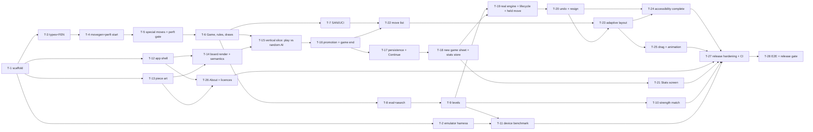

# Implementation plan: Chess vs Computer (Android, Kotlin), v1

- **Date:** 2026-10-14
- **Design:** [03-tech-design.md](./03-tech-design.md) · **PRD:** [01-prd.md](./01-prd.md) · **UX:** [02-design.md](./02-design.md)
- **Reference device (PRD OQ-6):** _not yet recorded._ Fill in before T-11: model, RAM, Android version.

## How to read this plan

- Every task ends with the app building and **all** existing tests passing.
- Commands are for **Git Bash** from the repo root (`cd /c/armen-projects/chess-android`). From PowerShell, use `.\gradlew.bat` with the same arguments.
- **GATE** means the standard green-build command, which every task runs last (after T-12 it covers both modules):

  ```bash
  ./gradlew :engine:test :app:testDebugUnitTest :app:lintDebug :app:assembleDebug
  ```

- **Emulator:** tasks marked **[emulator]** need the `chess36` AVD from T-2 (or a device). All other tasks run on the JVM only. That includes the Compose UI tests, which run on Robolectric (ADR-8).
- **Parallel:** "∥ with X" means the tasks touch disjoint files and can run at the same time once their dependencies are done.
- **Write the tests first.** Each task lists them, and they should fail before the implementation.

## Order and lanes



- **Riskiest first:**
  1. The toolchain combination: AGP 9.4.1, Kotlin 2.4.21, Gradle 9.8.1, compileSdk 37 and Robolectric 4.17 (T-1).
  2. The emulator path (T-2).
  3. Perft-correct move generation (T-4, T-5).
  4. Whether a Kotlin engine is fast and strong enough to separate four levels (T-8 to T-11).
- **First demo:** T-15, where you play a legal game against a random-move computer on the real board.
- **Lanes after T-1:**
  - **Engine** (T-3 → T-10) runs alongside **App shell** (T-2, T-12, T-13, T-14).
  - They meet at T-15 (needs T-6) and T-19 (needs T-9).

---

## Phase 0: Scaffold and environment

### T-1: Project scaffold that builds and tests on this machine
- **Stories:** enabler for all; guardrail "no INTERNET permission".
- **Depends on:** none. **Parallel:** none (everything waits on it).
- **Do:**
  1. Install compileSdk 37 (H-2): `yes | "$LOCALAPPDATA/Android/Sdk/cmdline-tools/latest/bin/sdkmanager.bat" "platforms;android-37.0"`. *Fallback, if declined:* compileSdk 36, Compose BOM 2026.06.01, core-ktx 1.18.0 (design §1.3).
  2. `git init`. Add `.gitignore` covering `.gradle/`, `build/`, `local.properties`, `keystore.properties`, `*.jks`, `.idea/` and `*.iml`.
  3. Generate the wrapper **before** adding any plugins. The cached Gradle 9.3.1 can't configure AGP 9.4, which needs Gradle 9.6 or newer. With only an empty `settings.gradle.kts` (`rootProject.name = "chess-android"`) present, run:
     `"$USERPROFILE/.gradle/wrapper/dists/gradle-9.3.1-bin/23ovyewtku6u96viwx3xl3oks/gradle-9.3.1/bin/gradle" wrapper --gradle-version 9.8.1 --distribution-type bin`
     Then check with `./gradlew --version`.
  4. Write `local.properties` with `sdk.dir=C\:\\Users\\armen\\AppData\\Local\\Android\\Sdk`.
  5. Add `gradle/libs.versions.toml` with the versions in design §1.2, the root `build.gradle.kts` (plugins `apply false`), and `gradle.properties` (design §1.4).
  6. Create the `:engine` module: `kotlin("jvm")`, JVM target 17, `testImplementation(kotlin("test-junit"))`, `junit`.
  7. Create the `:app` module:
     - AGP application with built-in Kotlin (no `kotlin-android` plugin), plus the Compose compiler plugin and the serialization plugin
     - namespace `chess.app`, placeholder `applicationId` (H-1), `compileSdk 37`, `minSdk 26`, `targetSdk 36`
     - Compose BOM and Material 3; `testOptions.unitTests.isIncludeAndroidResources = true`; Robolectric
     - `MainActivity` with `enableEdgeToEdge()` showing the text "Chess"
     - a manifest that removes `INTERNET` (`tools:node="remove"`)
     - `implementation(project(":engine"))`
- **Files:** `settings.gradle.kts`, `build.gradle.kts`, `gradle.properties`, `gradle/libs.versions.toml`, `gradle/wrapper/*`, `gradlew*`, `.gitignore`, `engine/build.gradle.kts`, `engine/src/{main,test}/kotlin/chess/engine/Smoke*.kt`, `app/build.gradle.kts`, `app/proguard-rules.pro`, `app/src/main/AndroidManifest.xml`, `app/src/main/kotlin/chess/app/MainActivity.kt`, `app/src/main/res/values/strings.xml`, `app/src/test/kotlin/chess/app/MainActivityTest.kt`.
- **Tests first:**
  - `engine`: `SmokeTest` (a trivial assertion; proves the JVM test runner).
  - `app`: `MainActivityTest` (Robolectric + `createAndroidComposeRule<MainActivity>()`; asserts the text "Chess" is displayed; proves Robolectric SDK 36 on JDK 21).
- **Done when:**
  ```bash
  ./gradlew :engine:test :app:testDebugUnitTest :app:lintDebug :app:assembleDebug
  "$LOCALAPPDATA/Android/Sdk/cmdline-tools/latest/bin/apkanalyzer.bat" manifest permissions app/build/outputs/apk/debug/app-debug.apk   # prints nothing
  ```
  Record the resolved versions in the commit message. If any pinned version fails, adjust `libs.versions.toml` and note it in design §1.2.

### T-2: Emulator harness and first instrumented test [emulator]
- **Stories:** enabler (US-2 process death, US-6 timing, release smoke).
- **Depends on:** T-1. **Parallel:** ∥ with T-3…T-10 and T-12, T-13.
- **Do:**
  1. Install the image: `yes | "$LOCALAPPDATA/Android/Sdk/cmdline-tools/latest/bin/sdkmanager.bat" "system-images;android-36;google_apis_playstore;x86_64"`. The Play Store image lets you install TalkBack later.
  2. Create the AVD: `echo no | "$LOCALAPPDATA/Android/Sdk/cmdline-tools/latest/bin/avdmanager.bat" create avd -n chess36 -k "system-images;android-36;google_apis_playstore;x86_64"`.
  3. Edit `~/.android/avd/chess36.avd/config.ini` to set `hw.lcd.width=720`, `hw.lcd.height=1280` and `hw.lcd.density=320` (a 360 × 640 dp screen, the design's tightest case) and `hw.ramSize=2048`. **Do not modify `grainlab_test`.**
  4. Boot it: `"$LOCALAPPDATA/Android/Sdk/emulator/emulator.exe" -avd chess36 -no-snapshot-save &`, then `"$LOCALAPPDATA/Android/Sdk/platform-tools/adb.exe" wait-for-device`.
  5. Add `androidTest` dependencies (ext-junit, runner, the Compose `ui-test-junit4`, uiautomator) and `LaunchSmokeTest`, which checks that the activity launches and "Chess" is shown.
  6. Add `scripts/emulator.md` with these commands.
- **Files:** `app/build.gradle.kts`, `app/src/androidTest/kotlin/chess/app/LaunchSmokeTest.kt`, `scripts/emulator.md`.
- **Done when:** `./gradlew :app:connectedDebugAndroidTest` passes on `chess36`, and GATE passes.

---

## Phase 1: Engine rules core (before any game UI)

### T-3: Core types, 0x88 board and FEN
- **Stories:** US-4, US-2 (FEN in save).
- **Depends on:** T-1. **Parallel:** ∥ with T-2, T-12, T-13.
- **Do:**
  - `Square` helpers (0..63 ↔ 0x88 ↔ "e4"), `Piece`/`PieceColor`/`PieceType`, `Move` value class (packing, `uci()`).
  - Mutable `Board` (fields only, no moves yet).
  - `Fen.parse/format` with validation that throws `FenException`. Checks: 8 ranks, 8 files each, exactly one king per side, no pawns on ranks 1 and 8, castling rights consistent with king and rook squares, an ep square on rank 3 or 6, and numeric clocks.
- **Files:** `engine/src/main/kotlin/chess/engine/board/{Square,Piece,Move,Board,Fen}.kt`, tests under `engine/src/test/kotlin/chess/engine/board/`.
- **Tests first:**
  - FEN round-trip for the start position and all 7 perft FENs in design §4.2.
  - 10 invalid FENs rejected, each with a specific message.
  - `Move` pack/unpack covers every flag combination.
  - Square name conversions are correct.
- **Done when:** `./gradlew :engine:test` passes.

### T-4: Move generation, make/unmake, legality and perft (start position)
- **Stories:** US-4.
- **Depends on:** T-3. **Parallel:** ∥ with the app lane.
- **Do:**
  - `Attacks.isAttacked(sq, by)`.
  - Pseudo-legal generation into an `IntArray` buffer for pawn pushes, double pushes and captures (no promotions or en passant yet), knights, sliders and king steps.
  - `make`/`unmake` with an undo stack.
  - Legality filter (make, check own king, unmake).
  - `Perft.perft(board, depth)` and `divide`.
- **Files:** `engine/.../board/{MoveGen,Attacks,Perft}.kt`, `Board.kt`; `engine/src/test/.../perft/PerftTest.kt`, `board/MakeUnmakeTest.kt`.
- **Tests first:**
  - Perft for the initial position, depth 1–4 = 20 / 400 / 8,902 / 197,281. These depths need no castling, en passant or promotion.
  - make/unmake restores the board (`equals` on all fields) for every legal move in the 7 FENs.
  - A pinned piece can't move off its pin line (two hand positions).
- **Done when:** `./gradlew :engine:test` passes.

### T-5: Castling, en passant, promotion; the full perft gate
- **Stories:** US-4 (QA gate).
- **Depends on:** T-4. **Parallel:** ∥ with the app lane.
- **Do:**
  - Castling generation (rights, empty path, king not in check, transit and destination squares not attacked) and the rook move in make/unmake.
  - En passant generation and capture, including the rank-pin discovered-check case.
  - Promotions to Q, R, B and N, with and without capture.
  - Castling rights updated when the king or a rook moves or a rook is captured.
  - A `perftDeep` JUnit category, plus a `perftDeep` Gradle `Test` task; default `test` excludes the category (design §4.7 sketch).
- **Files:** `MoveGen.kt`, `Board.kt`, `PerftTest.kt`, `PerftDeep.kt` (category marker), `engine/build.gradle.kts`.
- **Tests first:** the full gate column of design §4.2 (all 7 positions); the deep column in `perftDeep`; unit tests for each castling-blocked reason; an en passant that exposes the king along a rank is illegal (position 3 lines).
- **Done when:**
  ```bash
  ./gradlew :engine:test --tests "chess.engine.perft.*"   # gate; record wall time in the PR
  ./gradlew :engine:perftDeep                             # release depth
  ./gradlew :engine:test
  ```

### T-6: Zobrist keys, immutable Position/Game, game status and all draw types
- **Stories:** US-5, US-2 (replay), US-10 (undo).
- **Depends on:** T-5. **Parallel:** ∥ with the app lane (T-12 to T-14).
- **Do:**
  - Zobrist tables built from a fixed seed, updated incrementally in make/unmake.
  - `Position`: an immutable snapshot with `legalMoves`, `play`, `isCheck`, `repetitionKey` (ep file only if a *legal* ep capture exists) and `samePositionAs`.
  - `Game`: `positions`, `moves`, `play`, `undo(n)`, `legalMovesFrom(sq)`, `status`, and `Game.replay(startFen, ucis)`.
  - `GameStatus`, evaluated in the order of design §4.3.
- **Files:** `engine/.../board/Zobrist.kt`; `engine/.../rules/{Position,Game,GameStatus,Draws}.kt`; tests under `engine/src/test/.../rules/`.
- **Tests first:**
  - The incremental key equals the from-scratch key after every move of 3 random 200-ply games.
  - Checkmate: fool's mate and back-rank mate.
  - Stalemate: two positions.
  - Threefold: a knight shuffle reaches it on the third occurrence, non-consecutive; no draw when only castling rights differ; **no draw on a repeated FEN ep square when no legal ep capture exists vs. one that does**.
  - 50-move: draw at 100 plies; **mate on the 100th ply wins**.
  - Insufficient material: K v K, KB v K, KN v K, KB v KB same colour → draw; KB v KB opposite colours, KNN v K, KP v K → not a draw.
  - `undo(2)` restores the position and status.
  - `replay` rejects an illegal UCI move.
  - Replaying 2,000 plies takes < 50 ms; log the time.
- **Done when:** `./gradlew :engine:test` passes.

### T-7: SAN and UCI
- **Stories:** US-11, US-8.
- **Depends on:** T-6. **Parallel:** ∥ with T-8 (disjoint files) and the app lane.
- **Do:** `San.format(position, move)` (disambiguation by file, rank or both; `x`; `=Q`; `O-O`/`O-O-O`; `+`/`#`); `Uci.parse(position, text)`; `Game.sanList`.
- **Files:** `engine/.../rules/{San,Uci}.kt`, tests.
- **Tests first:**
  - Table-driven: 30 cases including `Nbd7`, `R1e2`, `Qh4xe1` (double disambiguation), `exd6` en passant, `e8=Q+`, `bxa1=N#`, `O-O-O+`.
  - The SAN list of a known 20-move game matches its published PGN.
  - UCI round-trip for every legal move of the 7 FENs.
- **Done when:** `./gradlew :engine:test` passes.

---

## Phase 2: Engine search and levels

### T-8: Evaluation and search (iterative deepening, alpha-beta, quiescence, transposition table, stop)
- **Stories:** US-6.
- **Depends on:** T-6. **Parallel:** ∥ with T-7 and the app lane.
- **Do:**
  - `Eval`: material, tapered PSTs, bishop pair, mop-up.
  - `Search`: negamax alpha-beta, iterative deepening, quiescence, check extension, MVV-LVA, killer moves, history heuristic.
  - `TranspositionTable` (2^18 entries, two `LongArray`s).
  - Repetition and 50-move draws inside the search.
  - Stop checks every 1,024 nodes (node budget, deadline, `shouldStop`); depth 1 always completes.
  - The `Engine` API exactly as in design §4.6.
- **Files:** `engine/.../search/{Engine,Search,Eval,Pst,TranspositionTable,Ordering,LevelParams}.kt`, tests under `engine/src/test/.../search/`.
- **Tests first:**
  - `eval(p) == -eval(mirror(p))` over 50 positions.
  - Finds mate in 1 (5 positions) and mate in 2 (3 positions) at depth ≤ 4.
  - Doesn't leave the queen en prise in 5 tactical positions at 50k nodes.
  - Avoids a threefold when +3 pawns ahead.
  - `shouldStop` honoured within 1,024 nodes.
  - With a fake `nanoTime` whose deadline is already passed, it still returns a legal depth-1 move.
  - Node budget respected within 1,024.
  - The TT stores and retrieves mate scores ply-adjusted (unit test).
  - Every returned move is legal across 500 random positions.
  - **Log nodes per second** on the JVM in a test-output line, to feed the T-10 estimate.
- **Done when:** `./gradlew :engine:test` passes.

### T-9: Levels 1–4 (randomisation, root scoring), K+Q v K and variety checks
- **Stories:** US-6.
- **Depends on:** T-8. **Parallel:** ∥ with T-7 and the app lane.
- **Do:**
  - `Levels.params(level)` per design ADR-3 table: depth cap, node budget, time cap, quiescence mode, randomisation.
  - Exact root scores at the final depth for levels 1–3 (lowered-alpha root window).
  - Level 1's 50% uniform random move plus ±40 cp noise.
  - Level 2's 20% pick from the top 5.
  - Level 3's pick within 20 cp.
- **Files:** `engine/.../search/{Levels,LevelParams,Search}.kt`, tests `search/LevelsTest.kt`, `search/KqkMateTest.kt`, `search/VarietyTest.kt`.
- **Tests first:**
  - K+Q v K, 10 fixed positions: levels 3 and 4 (deadline off) mate a level-1 defender before the 50-move rule, 10/10.
  - Variety: 5 positions × 10 seeds; levels 1–3 each produce ≥ 2 distinct moves in at least one position.
  - Level 1 random-move share is between 40% and 60% over 1,000 decisions.
  - Each level's search, with the deadline on and a fake clock advancing 1 ms per 1,000 nodes, stops ≤ cap − 100 ms + one check interval.
- **Done when:** `./gradlew :engine:test` passes.

### T-10: Strength match harness and tuning (release gate)
- **Stories:** US-6 (ordering check).
- **Depends on:** T-9. **Parallel:** ∥ with T-11 and the app lane. *Timebox two sittings. If the thresholds aren't met, tune only `LevelParams` and eval weights, not the architecture.*
- **Do:**
  - `Openings.kt` (50 balanced lines of 4–8 plies, UCI).
  - `MatchRunner`: fixed thread pool, seeded per game, deadline off, 400-ply safety cap.
  - `LevelMatchTest`, asserting the thresholds in design §4.7.
  - The `strengthTest` Gradle task with `-Pmatch.games` override.
  - A Markdown report in `engine/build/reports/strength/match.md`.
- **Files:** `engine/src/test/kotlin/chess/engine/strength/{Openings,MatchRunner,LevelMatchTest}.kt`, `engine/build.gradle.kts`.
- **Tests first:**
  - `MatchRunnerTest` (in the default `test`, fast): a 2-game match between level 1 and level 1 completes with a legal result.
  - Colours alternate.
  - The same seeds give identical PGN.
- **Done when:**
  ```bash
  ./gradlew :engine:strengthTest -Pmatch.games=20    # smoke, while tuning
  ./gradlew :engine:strengthTest                      # full: L2≥70% vs L1, L3≥70% vs L2, L4≥70% vs L3, L4≥95% vs L1
  ./gradlew :engine:test
  ```
  Commit the final `match.md` numbers into this plan's "Results" section below.

### T-11: On-device think-time benchmark [emulator, then the reference device]
- **Stories:** US-6 (caps), ANR guardrail.
- **Depends on:** T-9, T-2. **Parallel:** ∥ with T-10 and the app lane.
- **Do:**
  - Add the `:benchmark` module (`com.android.library` with the `androidx.benchmark` plugin, namespace `chess.benchmark`, depends on `:engine`).
  - `ThinkTimeBenchmark` runs each level over 20 fixed middlegame and endgame positions with the **real** deadline. It records elapsed time, nodes and stop reason per search, and writes p50/p95/max per level plus the share of searches stopped by the deadline to the instrumentation output.
  - `NpsBenchmark` uses `BenchmarkRule` for a fixed-node search (nodes per second).
  - Set level 4's node budget so that the reference device's p95 ≤ 3.9 s, and update design ADR-3 and `Levels.kt`.
  - *Fallback if the benchmark plugin fails on AGP 9.4:* make `:benchmark` a plain library module whose androidTest uses `testBuildType = "release"` with debug signing for tests only, and keep the same test code.
- **Files:** `settings.gradle.kts`, `benchmark/build.gradle.kts`, `benchmark/src/androidTest/kotlin/chess/benchmark/{ThinkTimeBenchmark,NpsBenchmark}.kt`, `engine/.../search/Levels.kt`.
- **Tests first:** the assertions inside `ThinkTimeBenchmark` are p95 ≤ cap and max ≤ cap + 200 ms for every level.
- **Done when:**
  ```bash
  ./gradlew :benchmark:connectedCheck -Pandroid.testInstrumentationRunnerArguments.androidx.benchmark.suppressErrors=EMULATOR   # on chess36
  ./gradlew :benchmark:connectedCheck   # on the reference device (adb -s <serial>); paste p95 table below
  ```
  GATE also passes.

---

## Phase 3: App shell and board (∥ with Phase 1–2)

### T-12: App shell: container, theme, navigation, splash, edge-to-edge
- **Stories:** US-1 (home entry), US-9 (baseline), design §1 platform baseline.
- **Depends on:** T-1. **Parallel:** ∥ with T-3…T-11, T-13.
- **Do:**
  - `ChessApplication` + `AppContainer` (app `CoroutineScope`, dispatcher providers, placeholders for the repositories).
  - Theme from seed #6B4E37: light and dark schemes, `dynamicColor = false`, `BoardColors` tokens (design §6.2).
  - Type-safe routes `Home`, `Game`, `Stats`, `About` and `Licences` in `ChessNavHost`, with placeholder screens.
  - `installSplashScreen()` (with the keep condition stubbed to `false`).
  - Manifest: `allowBackup="false"` and `dataExtractionRules` (H-5).
  - StrictMode in debug.
  - Material Symbols vector XMLs for `arrow_back`, `undo`, `flag`, `add`, `format_list_numbered`, `info`, `error`, `hourglass_empty` and `crop_free`. Do not add the `material-icons-extended` dependency.
  - All design §4.10 strings in `strings.xml`.
- **Files:** `app/src/main/kotlin/chess/app/{ChessApplication,AppContainer,MainActivity}.kt`, `nav/*`, `ui/theme/*`, `ui/{home,stats,about}/*Screen.kt` (placeholders), `res/values/{strings,themes}.xml`, `res/drawable/ic_*.xml`, `res/xml/data_extraction_rules.xml`, `AndroidManifest.xml`.
- **Tests first** (Robolectric):
  - Home shows **New game**, **Stats** and **About**.
  - Tapping Stats navigates to Stats; back returns to Home.
  - Placeholder Game route reachable; back returns Home.
  - `BoardColorsTest`: the design §5.6 contrast ratios are ≥ the required values (WCAG formula in a test helper).
- **Done when:** GATE passes.

### T-13: Piece artwork and licence record
- **Stories:** US-3 (pieces), PRD artwork dependency.
- **Depends on:** T-1. **Parallel:** ∥ with everything in Phases 1–3 (res + docs only).
- **Do:**
  - Download the 12 Cburnett `Chess_{k,q,r,b,n,p}{l,d}t45.svg` files **from Wikimedia Commons** (not from Lichess).
  - Convert them with Android Studio > New > Vector Asset > Local SVG into `piece_{w,b}{k,q,r,b,n,p}.xml`.
  - Check them visually at 24 dp and 96 dp.
  - Create `docs/licences/pieces-cburnett.md` with the file URLs, the download date, the chosen BSD-3-Clause licence and the exact notice from each file page (all 12 checked).
  - Make the app icon (a knight on `primaryContainer`, with a monochrome layer).
- **Files:** `app/src/main/res/drawable/piece_*.xml`, `app/src/main/res/mipmap-*/ic_launcher*`, `app/src/main/res/drawable/ic_launcher_*.xml`, `docs/licences/pieces-cburnett.md`.
- **Tests first:** `PieceArtResourcesTest` (Robolectric): all 12 drawables inflate as `VectorDrawable`.
- **Done when:** GATE passes. Also attach a screenshot of the 12 pieces at 96 dp on light and dark squares to the PR (manual).

### T-14: ChessBoard static render and 64 semantics nodes
- **Stories:** US-3 (cues, coordinates), US-8 (square descriptions), US-9 (square size).
- **Depends on:** T-12, T-13. **Parallel:** ∥ with the engine lane.
- **Do:**
  - `BoardUi`/`CellUi` models (app-level; no engine types).
  - `ChessBoard` composable that draws the design §4.3.3 layers: squares, last-move tint and corner, check tint and badge, coordinates by orientation, pieces through `PieceArt`, selected border, dots and rings with halo.
  - The 64-node semantics overlay in visual order for either orientation, with `isTraversalGroup`.
  - `SquareDescriber` (pure; uses the `Strings` interface) implementing the design §5.3 grammar, click labels and custom-action labels.
  - A `@Preview` with fixtures.
- **Files:** `app/.../ui/game/board/{ChessBoard,BoardDrawing,BoardSemantics,PieceArt}.kt`, `app/.../ui/a11y/{SquareDescriber,Strings}.kt`, `ui/game/GameUiState.kt` (BoardUi part), tests.
- **Tests first:**
  - `SquareDescriberTest`: every example string in design §5.3, plus the state-word order.
  - `ChessBoardSemanticsTest` (Robolectric): 64 nodes; first and last are a8 and h1 (White) or h1 and a8 (Black); "e1, white king, selected, in check" from a fixture; no click action on read-only squares.
- **Done when:** GATE passes.

---

## Phase 4: Playable game (vertical slices)

### T-15: Vertical slice: play a legal game against a random-move computer (first demo)
- **Stories:** US-3, US-4 (legality), US-6 (off main thread, 400 ms minimum, board locked), US-5 (status only).
- **Depends on:** T-6, T-14. **Parallel:** none (it is the merge point).
- **Do:**
  - `AiPlayer` interface plus a temporary `RandomMoveAiPlayer` (deleted in T-19).
  - `GameViewModel`:
    - in-memory new game: White, level 2, from Home's **New game** (temporary direct start)
    - selection rules in design §4.3.3 (own piece, reselect, deselect, illegal square, no-legal-moves hint for 2.5 s)
    - applying moves and `GameUiMapper` (engine `Game` → `BoardUi`)
    - the AI loop (design §6.5) with the 400 ms minimum and `generation` guard
  - `StatusRow` (Your move / Check / Thinking).
  - A basic `GameScreen` (board + status in a simple column).
- **Files:** `app/.../ai/{AiPlayer,RandomMoveAiPlayer}.kt`, `ui/game/{GameViewModel,GameUiState,GameAction,GameUiMapper,GameScreen,StatusRow}.kt`, tests.
- **Tests first:**
  - `GameViewModelSelectionTest` (`runTest`, fake AI): each US-3 AC row; a piece with no legal moves selects nothing; taps during the computer's turn are ignored.
  - `GameViewModelAiTest`: the computer's move appears exactly at 400 ms of virtual time when the fake AI answers at 50 ms, and at 700 ms when it answers at 700 ms; the AI runs on the injected dispatcher, never `Main`.
  - `GameUiMapperTest`: last-move squares, check square, dots vs rings, and an en passant destination counted as a capture ring.
  - `GameScreenTest` (Robolectric): tap e2 then e4; the e4 node then describes "white pawn, last move to".
- **Done when:** GATE passes. Demo with `./gradlew :app:installDebug` on `chess36` and play a few moves.

### T-16: Promotion picker, game-end detection and result panel
- **Stories:** US-4 (promotion and cancel), US-5 (all results, board lock).
- **Depends on:** T-15. **Parallel:** none (same ViewModel).
- **Do:**
  - `Overlay.Promotion(from, to)`, with the pawn drawn on the target while the picker is open.
  - `PromotionDialog` (`BasicAlertDialog`, 4 options plus Cancel, 2×2 grid when labels wrap, `paneTitle`).
  - Cancel, Back or scrim tap returns the pawn.
  - Mirror the selection and promotion state into `SavedStateHandle`.
  - `GameResult` mapping (design §4.3.7).
  - `ResultPanel` (title, explanation, meta, New game/Undo/Home buttons; the Undo and New game buttons stay inert until T-18 and T-20).
  - Board input stops when the game is over.
- **Files:** `ui/game/{PromotionDialog,ResultPanel,GameViewModel,GameUiState}.kt`, `domain/GameResult.kt`, tests.
- **Tests first:**
  - The ViewModel opens the picker only for promotion moves.
  - Cancel restores the selection-cleared state.
  - Choosing Knight plays `e7e8n`.
  - Picker state survives a ViewModel rebuilt from `SavedStateHandle`.
  - Each of the 7 results in design §4.3.7 maps to the right title, explanation and outcome (from FEN fixtures).
  - Robolectric: the dialog has 4 labelled options, and the result panel shows "Checkmate. You win" after a scripted mate.
- **Done when:** GATE passes.

### T-17: Persistence: autosave, restore, corrupt save, storage full, Continue
- **Stories:** US-2 (all ACs), US-5 (no Continue after the game ends).
- **Depends on:** T-16. **Parallel:** ∥ with T-26 only (the ViewModel lane stays sequential).
- **Do:**
  - `SaveFile` v1 + `SaveSerializer` (256 KiB cap, semantic validation by replay → `CorruptionException`).
  - The DataStore with `ReplaceFileCorruptionHandler` writing `restoreFailed = true`.
  - `GameRepository` (app-scope conflated writer, `SaveError`).
  - The ViewModel saves after every applied move, promotion and result.
  - The ViewModel loads on init (Loading → Playing). If it is the computer's turn, the search starts on `ScreenStarted` (with the random AI for now).
  - Splash keep-on-screen until the first load or 1.5 s.
  - `HomeViewModel` with the **Game in progress** card (level, side, move number, whose turn), the corrupt-save banner shown once, and the skeleton card after 1.5 s with **New game** disabled until loaded.
  - The storage-full snackbar once per game.
- **Files:** `app/.../data/{SaveFile,SaveSerializer,GameRepository}.kt`, `AppContainer.kt`, `MainActivity.kt`, `ui/home/{HomeScreen,HomeViewModel}.kt`, `ui/game/GameViewModel.kt`, `app/src/test/resources/saves/v1-*.json` (fixtures), tests.
- **Tests first:**
  - `SaveSerializerTest`:
    - round-trip
    - truncated JSON → corruption
    - unknown `version` → corruption
    - an illegal move → corruption
    - level 5 → corruption
    - more than 256 KiB → corruption
    - a v1 fixture loads
  - `GameRepositoryTest` (JVM, TemporaryFolder):
    - a save then a new instance reads the same data
    - a corrupt file → `restoreFailed` set and `game == null`
    - an injected `IOException` storage → `SaveError.StorageFull`
    - 10 rapid saves → the last one wins
  - `HomeViewModelTest`: no save, unfinished save, finished save, corrupt save (banner once, then the flag cleared).
  - `GameViewModelRestoreTest`: restoring with the computer to move starts the search after `ScreenStarted`.
- **Done when:** GATE passes. Manual check on `chess36`:
  - Play 3 moves, then `adb shell am kill <applicationId>.debug` (with the app in the background).
  - Relaunch → Continue restores the position and the move count.
  - Script the steps in `scripts/emulator.md`.

### T-18: New game sheet, abandon flow, random side, last-used settings, stats store
- **Stories:** US-1 (all ACs), US-12 (counts update), US-7 (abandon edge).
- **Depends on:** T-17. **Parallel:** none.
- **Do:**
  - `StatsFile` v1 + serializer + `StatsRepository` (in-memory authoritative, full-snapshot writes, `readFailed`).
  - `NewGameCoordinator` (design §6.6).
  - `NewGameSheet` (`ModalBottomSheet`, radio groups via `selectable`/`selectableGroup`, pinned Play button), opened from Home and Game.
  - D1 Abandon dialog after **Play** only when the game is unfinished; Cancel closes both.
  - The "You play White/Black" snackbar for Random.
  - Result recording: `statsRecorded` idempotence (design §6.4).
  - Remove the temporary direct start from T-15.
- **Files:** `app/.../data/{StatsFile,StatsSerializer,StatsRepository}.kt`, `domain/NewGameCoordinator.kt`, `ui/newgame/NewGameSheet.kt`, `ui/game/ConfirmDialogs.kt`, `ui/home/*`, `ui/game/GameViewModel.kt`, tests.
- **Tests first:**
  - `NewGameCoordinatorTest`:
    - started + 1 on Play
    - abandoned + 1 only on Abandon
    - Random resolves 50/50 (10,000 draws with `Random(seed)`, each side 45–55%; plus the PRD's 100-start QA band 35–65 as a smoke test)
    - last used side and level persisted; first-run defaults White and level 2
  - `StatsRepositoryTest`: record and revert are symmetric; counters are never negative; reset with a game in progress sets started = 1; a corrupt file → zeros + `readFailed`.
  - Robolectric: the sheet defaults; Play with an unfinished game → D1; Cancel returns to the game unchanged.
- **Done when:** GATE passes.

### T-19: Real engine: EngineAiPlayer, lifecycle-tied search, held move, engine error
- **Stories:** US-6 (all runtime ACs), US-2 (resume thinking).
- **Depends on:** T-9, T-18. **Parallel:** ∥ with T-21 and T-22 (different files).
- **Do:**
  - `EngineAiPlayer` (design §6.5; mutex, `Dispatchers.Default`, `shouldStop = { !job.isActive }`, `Engine.newGame()` on new game and undo).
  - `LifecycleStartEffect` → `ScreenStarted`/`ScreenStopped` (cancel and restart).
  - `overlayBlocksAi` StateFlow (D1, D2 and the New game sheet). The held move is applied 400 ms after Cancel and discarded on confirm.
  - `StatusUi.EngineError` with **Try again**.
  - Delete `RandomMoveAiPlayer`.
  - Debug log of each `SearchResult`.
- **Files:** `app/.../ai/EngineAiPlayer.kt`, `AppContainer.kt`, `ui/game/{GameViewModel,GameScreen,StatusRow}.kt`, tests.
- **Tests first:**
  - `GameViewModelHeldMoveTest`:
    - the sheet opens while thinking → the move isn't applied while open
    - Cancel → applied 400 ms later
    - D2 confirm → never applied
  - `GameViewModelLifecycleTest`: `ScreenStopped` cancels; `ScreenStarted` restarts once.
  - `EngineErrorTest`: a fake AI throws → EngineError; Try again → a move.
  - `EngineAiPlayerTest` (JVM, real engine, level 1): returns a legal move; cancelling the calling job returns within 50 ms (wall clock) at level 4.
- **Done when:** GATE passes. Manual check on `chess36`: play as Black at level 4, rotate during thinking, background and foreground the app; the move arrives.

### T-20: Undo and resign
- **Stories:** US-10 (all ACs), US-7 (resign, back to Home keeps the game).
- **Depends on:** T-19. **Parallel:** ∥ with T-21 and T-22.
- **Do:**
  - `UndoPolicy` (design §6.4) and the three undo paths (player's turn: 2 plies; thinking: cancel + 1 ply; game over: reopen + stats revert).
  - D2 Resign dialog → cancel search → `resigned = true` → loss recorded.
  - `ActionRow` (Undo/Resign/New game with icon-over-label `TextButton`s, enabled per design §4.3.6).
  - Result panel Undo and New game wired.
  - System back from Game → Home, with Continue shown.
- **Files:** `app/.../domain/UndoPolicy.kt`, `ui/game/{ActionRow,GameViewModel,ResultPanel,ConfirmDialogs}.kt`, tests.
- **Tests first:**
  - `UndoPolicyTest`, table-driven:
    - start position → disabled
    - Black with only the computer's first move → disabled
    - player's turn → 2
    - thinking → 1
    - player mated the computer → 1
    - computer mated the player → 2
    - resigned → per PRD (with a comment linking design OQ-D3)
  - The ViewModel cancels the search on undo while thinking (the fake AI's job is cancelled).
  - Undo after the game is over reverts stats exactly once, even across a ViewModel rebuild.
  - Resign during thinking → no move applied, loss recorded.
- **Done when:** GATE passes.

### T-21: Stats screen
- **Stories:** US-12 (all ACs).
- **Depends on:** T-18. **Parallel:** ∥ with T-19, T-20 and T-22.
- **Do:**
  - `StatsViewModel`, `StatsScreen`, `StatsTable` (merged row semantics: "Level 1, Beginner: 3 won, 0 drawn, 1 lost.").
  - D3 Reset dialog and the "Stats reset" snackbar.
  - The read-error banner, cleared after it is shown.
  - Locale grouping for numbers.
- **Files:** `app/.../ui/stats/*`, tests.
- **Tests first:**
  - Robolectric: a fresh install shows all zeros and "Finish a game to see results here."; the merged row descriptions are correct; Reset → zeros; reset with a game in progress → started = 1.
  - ViewModel: an update from the repository is reflected immediately.
- **Done when:** GATE passes.

### T-22: Move list (strip and column variants) and SAN speech
- **Stories:** US-11 (all ACs), US-8 (move list speech).
- **Depends on:** T-7, T-16. **Parallel:** ∥ with T-19 to T-21 (only `MoveList.kt`, `SanSpeech.kt` and a slot in `GameScreen`).
- **Do:**
  - `MoveList` strip (`LazyRow`) and column (`LazyColumn`) with stable keys, a latest-ply bold pill, auto-scroll (instant with reduced motion), "No moves yet", and no clickable rows.
  - `SanSpeech` per design §5.4.
  - Pair or row merged descriptions.
- **Files:** `app/.../ui/game/MoveList.kt`, `ui/a11y/SanSpeech.kt`, `ui/game/GameScreen.kt` (slot), tests.
- **Tests first:**
  - `SanSpeechTest`: every rule in design §5.4.
  - Robolectric: after 3 plies, the strip shows "1. e4 e5 2. Nf3"; the merged row reads "Move 2. White: knight f3."; undo removes plies; a 300-ply fixture renders and scrolls to the end.
- **Done when:** GATE passes.

---

## Phase 5: Layout, accessibility and interaction polish

### T-23: Adaptive Game layout (stacked, side-by-side, collapses, too small, Moves sheet)
- **Stories:** US-9 (all ACs), design §4.1.
- **Depends on:** T-20, T-22. **Parallel:** ∥ with T-26.
- **Do:**
  - `GameLayoutSpec.compute` (pure).
  - `GameLayout` (`SubcomposeLayout` measuring the chrome at the current font scale), `WindowInsets.safeDrawing`.
  - Collapse 1 (icon-only actions + `PlainTooltip`).
  - Collapse 2 (hide the strip, add the top-bar Moves icon → S5 `ModalBottomSheet`).
  - The column move list when spare height is over 120 dp; the result panel placement per mode.
  - The **window too small** state.
  - `traversalIndex` so the board reads after the status row in side-by-side mode.
- **Files:** `app/.../ui/game/layout/{GameLayout,GameLayoutSpec}.kt`, `ui/game/{GameScreen,ActionRow,MoveList}.kt`, tests.
- **Tests first:**
  - `GameLayoutSpecTest`: every row of the design §4.1 table (mode, board, square size, collapses), 200% font on 360 × 640 (board 312–320, collapse 2), board < 192 → TooSmall, pixel snapping.
  - Robolectric with `@Config(qualifiers = "w360dp-h640dp")`, `"w640dp-h360dp-land"` and `"w800dp-h1280dp"`: the board node is square and its bounds match the spec; the Moves icon appears only under collapse 2.
- **Done when:** GATE passes. On `chess36`, take screenshots at font scale 1.0 and 2.0, portrait and landscape (`adb shell settings put system font_scale 2.0`).

### T-24: Accessibility completion (announcements, actions, focus, keyboard)
- **Stories:** US-8 (all ACs), design §5.
- **Depends on:** T-20, T-23. **Parallel:** ∥ with T-25 only if the files are coordinated (both touch `ChessBoard.kt`); default sequential.
- **Do:**
  - The structured `Announcement` emitted by the ViewModel for every event in the design §5.4 table.
  - `AnnouncementFormatter`.
  - The `StatusRow` polite live region with the U+200B repeat trick.
  - Click labels and custom actions on squares (Move to f3 / Take knight on f6 / Castle kingside / … and promote).
  - `FocusTarget` effects (design §5.2).
  - Keyboard: a single Tab stop, arrows, Enter/Space, Escape, focus ring in keyboard mode.
  - Ctrl+Z and Ctrl+N with `onProvideKeyboardShortcuts`.
  - Headings and `paneTitle`s.
  - Snackbar timeout from `AccessibilityManager` when TalkBack is on.
- **Files:** `app/.../ui/a11y/AnnouncementFormatter.kt`, `ui/game/{GameViewModel,StatusRow,GameScreen,ResultPanel}.kt`, `ui/game/board/{BoardSemantics,BoardInput}.kt`, `MainActivity.kt`, tests.
- **Tests first:**
  - `AnnouncementFormatterTest`: every row of the design §5.4 table verbatim, including captures with the from-square (OQ-D4) and draw sentences.
  - The ViewModel emits the right `Announcement` for a quiet move, capture with check, castling, en passant, promotion, mate, undo ×2, resign, resume.
  - Robolectric:
    - the live-region node's `contentDescription` changes after a move, and the same text twice still changes
    - the custom action "Move to f3" on g1 performs the move
    - keyboard arrows + Enter make a move
    - the result title is focused when the game ends
- **Done when:** GATE passes. The manual TalkBack pass is in T-28.

### T-25: Drag and drop, move animations, reduced motion, gesture exclusion
- **Stories:** US-13 (all ACs), US-3 (200 ms slide), design §3.2 and §5.10.
- **Depends on:** T-23 (and T-24 if done sequentially). **Parallel:** see T-24.
- **Do:**
  - `BoardInput` gesture handling: an 8 dp slop decides tap vs drag; the dragged piece drawn at 1.5× with a 35% ghost; a drop-target border; snap-back over 150 ms that keeps the selection.
  - A drop on a promotion square opens S4. A second finger is ignored. A 3-button Back during a drag cancels it.
  - `AnimationHint` from the ViewModel and a 200 ms slide (king and rook for castling). No animation on undo or restore.
  - `ANIMATOR_DURATION_SCALE == 0` → instant (also the spinner becomes an icon and the list jumps).
  - `systemGestureExclusion` on the player's half (≤ 200 dp).
  - The latest pointer state lives in `remember`, so a drag doesn't recompose the semantics nodes.
- **Files:** `app/.../ui/game/board/{BoardInput,ChessBoard,BoardDrawing}.kt`, `ui/game/GameViewModel.kt` (`Drop` action, `AnimationHint`), tests.
- **Tests first:**
  - Robolectric `performTouchInput`:
    - a 5 dp move counts as a tap
    - a drag from e2 to e4 makes the move
    - a drop on an illegal square → no move, the piece stays selected
    - a drop of a pawn on e8 opens the picker
  - ViewModel: `Drop(from, to)` follows the same legality path as a tap.
  - `ReducedMotionTest`: with the animator scale set to 0, the result panel appears without delay.
- **Done when:** GATE passes. Manual check on `chess36`: drag from the a-file edge doesn't trigger Back.

### T-26: About and Licences screens
- **Stories:** PRD piece-art dependency, privacy promise, design §4.9.
- **Depends on:** T-12, T-13. **Parallel:** ∥ with T-15 to T-25.
- **Do:**
  - The `app.cash.licensee` plugin with `allow("Apache-2.0")`, `allow("MIT")`, `allow("BSD-3-Clause")` and `bundleAndroidAsset = true`.
  - `AboutScreen` (version from `BuildConfig`, privacy text, credits) and `LicencesScreen` (parses `artifacts.json`; the full Cburnett BSD notice from `res/raw/cburnett_bsd.txt`). The list item is hidden if the asset is missing.
  - *Fallback if licensee fails on AGP 9.4:* a hand-written `assets/licences.json` and a release-checklist item.
- **Files:** `app/build.gradle.kts`, `app/.../ui/about/*`, `app/src/main/res/raw/cburnett_bsd.txt`, tests.
- **Tests first:** Robolectric: About shows the version and privacy text; Licences lists at least `androidx.compose.material3`; the BSD notice text is present.
- **Done when:** `./gradlew :app:licenseeDebug` passes (it fails on a disallowed licence), and GATE passes.

---

## Phase 6: Release

### T-27: Release hardening and CI
- **Stories:** PRD guardrails (size ≤ 15 MB, no INTERNET, crash and ANR), Play requirements.
- **Depends on:** T-21, T-24, T-25, T-26 (and T-10, T-11 for the gate). **Parallel:** none. Run a release smoke on [emulator].
- **Do:**
  - Release build type:
    - minify + shrink resources
    - `proguard-rules.pro` with `-assumenosideeffects` for `Log.v/d/i`
    - signing from `keystore.properties` if present
  - Set the final `applicationId` (H-1), `versionCode`/`versionName`, and the app name.
  - `scripts/check-release.sh`:
    - `apkanalyzer manifest permissions` must not list `INTERNET`
    - the APK file size is ≤ 15,728,640 bytes
    - the licence asset is present in the APK (`apkanalyzer files list`)
  - `.github/workflows/ci.yml` and `strength.yml` (design §15.3; if H-6 is yes), including `sdkmanager "platforms;android-37.0"` on the runner.
  - A save-format v1 fixture test is marked "must never be deleted".
  - Release checklist in `docs/product/chess-vs-computer/release-checklist.md`.
- **Files:** `app/build.gradle.kts`, `app/proguard-rules.pro`, `scripts/check-release.sh`, `.github/workflows/*.yml`, `docs/product/chess-vs-computer/release-checklist.md`.
- **Tests first:** `ReleaseConfigTest` is not practical; the check script *is* the test. It must fail when run against a deliberately bad APK (add `INTERNET` temporarily, confirm it fails, then revert).
- **Done when:**
  ```bash
  ./gradlew :engine:test :app:testDebugUnitTest :app:lintRelease :app:assembleRelease :app:bundleRelease
  bash scripts/check-release.sh app/build/outputs/apk/release/app-release*.apk
  ```
  The release APK installs and runs a full game on `chess36` with no R8 crash (navigation, save/restore and the About licences list exercised).

### T-28: E2E suite, manual accessibility pass and release gate run [emulator + device]
- **Stories:** US-1 to US-13 acceptance; design §5.11.
- **Depends on:** T-27. **Parallel:** none.
- **Do:**
  - `androidTest` E2E (Compose + UiAutomator):
    - New game as White → 3 moves → background → `am kill` via UiAutomator `executeShellCommand` → relaunch → Continue → same move list
    - Resign flow → result panel → Home without Continue
  - The manual checklist from design §5.11 on a physical device with TalkBack (a full game including castling, en passant and promotion via squares and custom actions), the colour simulators, 200% font in portrait and landscape, Switch Access and a keyboard.
  - Profiler check of a 150-move list.
  - Run the full release gate (design §15.4) and record results below.
- **Files:** `app/src/androidTest/kotlin/chess/app/{ResumeE2ETest,ResignE2ETest}.kt`, this plan's Results section.
- **Done when:**
  ```bash
  ./gradlew :app:connectedDebugAndroidTest                  # chess36
  ./gradlew :engine:perftDeep :engine:strengthTest
  ./gradlew :benchmark:connectedCheck                       # reference device
  ```
  All pass, and the manual checklist is signed off in `release-checklist.md`.

---

## Summary table

| ID | Goal | Stories | Depends on | Parallel with | Emulator |
|---|---|---|---|---|---|
| T-1 | Scaffold builds and tests | all | none | none | no |
| T-2 | Emulator harness + smoke test | enabler | T-1 | T-3…T-13 | **yes** |
| T-3 | Types, 0x88 board, FEN | US-4 | T-1 | T-2, T-12, T-13 | no |
| T-4 | Move generation + perft (start) | US-4 | T-3 | app lane | no |
| T-5 | Special moves + perft gate | US-4 | T-4 | app lane | no |
| T-6 | Position/Game, all draws, Zobrist | US-5, US-2, US-10 | T-5 | app lane | no |
| T-7 | SAN + UCI | US-11, US-8 | T-6 | T-8, app lane | no |
| T-8 | Eval + search | US-6 | T-6 | T-7, app lane | no |
| T-9 | Levels, KQK, variety | US-6 | T-8 | T-7, app lane | no |
| T-10 | Strength match (gate) | US-6 | T-9 | T-11, app lane | no |
| T-11 | Device think-time benchmark | US-6 | T-9, T-2 | T-10, app lane | **yes + device** |
| T-12 | App shell | US-1, US-9 | T-1 | engine lane, T-13 | no |
| T-13 | Piece art + licence record | US-3 | T-1 | everything in Phases 1–3 | no |
| T-14 | Board render + 64 semantics nodes | US-3, US-8, US-9 | T-12, T-13 | engine lane | no |
| T-15 | **Demo:** play vs random AI | US-3, US-4, US-6 | T-6, T-14 | none | no (demo on emulator optional) |
| T-16 | Promotion + game end + result panel | US-4, US-5 | T-15 | T-26 | no |
| T-17 | Persistence + Continue | US-2, US-5 | T-16 | T-26 | no (manual kill check) |
| T-18 | New game sheet + abandon + stats store | US-1, US-12, US-7 | T-17 | T-26 | no |
| T-19 | Real engine + lifecycle + held move | US-6, US-2 | T-9, T-18 | T-21, T-22, T-26 | no (manual check) |
| T-20 | Undo + resign | US-10, US-7 | T-19 | T-21, T-22, T-26 | no |
| T-21 | Stats screen | US-12 | T-18 | T-19, T-20, T-22 | no |
| T-22 | Move list + SAN speech | US-11, US-8 | T-7, T-16 | T-19, T-20, T-21 | no |
| T-23 | Adaptive layout | US-9 | T-20, T-22 | T-26 | no (screenshots manual) |
| T-24 | Accessibility completion | US-8 | T-20, T-23 | (T-25 with care) | no |
| T-25 | Drag + animation + reduced motion | US-13, US-3 | T-23 | (T-24 with care) | no |
| T-26 | About + licences | privacy, artwork | T-12, T-13 | T-15…T-25 | no |
| T-27 | Release hardening + CI | guardrails | T-21, T-24, T-25, T-26 (+T-10, T-11) | none | **yes** (release smoke) |
| T-28 | E2E + manual a11y + release gate | all | T-27 | none | **yes + device** |

## Results (fill in as tasks complete)

| Check | Value | Date |
|---|---|---|
| Perft gate wall time (T-5) | Gate (`:engine:test --tests "chess.engine.perft.*"`, all 7 positions, about 17.0 M leaf nodes): **0.94 s** in JUnit, 8.6 s wall clock including Gradle. Release depths (`:engine:perftDeep`, about 609 M leaf nodes): **25.2 s** in JUnit, 27 s wall clock (a first run with a parallel build on the machine took 49.2 s / 72 s). Dev machine, JDK 21, bulk counting at depth 1. | 2026-10-14 |
| JVM search speed, nodes per second (T-8) | | |
| Strength match L2/L1, L3/L2, L4/L3, L4/L1 (T-10) | | |
| Reference device p95 per level, deadline-stop share (T-11) | | |
| Level-4 node budget chosen (T-11) | | |
| Release APK size (T-27) | | |

## Decisions (2026-10-14, user)

- **Gate approved.** The design (02) and this plan are approved, and so are the designer's provisional choices (§13 of the tech design): dark theme follows the system, dynamic colour is off, Undo after resign follows the PRD, capture announcements include the from-square, and "read all pieces" is deferred.
- **H-1 App name:** "Arm Chess" (repo `arm-chess`). `applicationId` is `io.github.armendeveloper.armchess`; use it from T-1 instead of a placeholder. Namespace stays `chess.app`.
- **H-2 SDK:** approved. Installed by the orchestrator before T-1: `platforms;android-37.0`, `build-tools;37.0.0`, `system-images;android-36.1;google_apis_playstore;x86_64`. Plain `android-36` Play images are not offered, so use the 36.1 image when T-2 creates the `chess36` AVD. On Windows, `sdkmanager.bat` splits on `;`, so pass package paths with `/` (e.g. `platforms/android-37.0`).
- **H-3 Reference device:** still open. Needed before T-11.
- **H-5 `allowBackup=false`:** approved.
- **H-6 Repo:** the user asked for a **public GitHub repo** (account `armendeveloper`). T-1 runs `git init`. The orchestrator creates the remote and pushes after T-1 is green.

## Scope change (2026-10-14, user): Armenian and Russian

The user asked for **Armenian (`hy`) and Russian (`ru`)** in addition to English, to be added after the main build. This replaces the PRD assumption "English only".

**Rules for every task from now on, so the translation pass is mechanical:**
- All user-visible text goes in `res/values/strings.xml`: labels, dialogs, errors, content descriptions and TalkBack announcements. No hard-coded strings in Kotlin or Compose.
- Use `<plurals>` for anything with a count. Russian has one/few/many/other forms and Armenian has one/other.
- Build TalkBack move announcements from whole-sentence format strings with positional arguments (`%1$s`), never by joining words in code. Russian and Armenian need different word order and grammatical cases (e.g. "takes knight" uses the accusative case in Russian).
- Format numbers and dates through the locale.
- Nothing may assume Latin-script text width. Armenian and Russian strings are often 20–40% longer, so buttons and the result panel must wrap or scale at 200% font size.

**T-29: Localization (hy, ru).** Runs after T-28 and before release. It translates `strings.xml` into `values-hy/` and `values-ru/`, sets per-app language support (`android:localeConfig` plus `res/xml/locales_config.xml`, so Android 13+ shows a per-app language picker in system settings), and adds an in-app language option if the design calls for one. It also localizes piece names in TalkBack announcements and checks layouts with pseudo-locales (`en-XA`, `ar-XB`) and real hy/ru at 200% font. The move-list notation (SAN) stays in the international letter form, K Q R B N. Open question for the user at T-29: show localized piece letters, such as Russian Кр Ф Л С К, in the move list?
